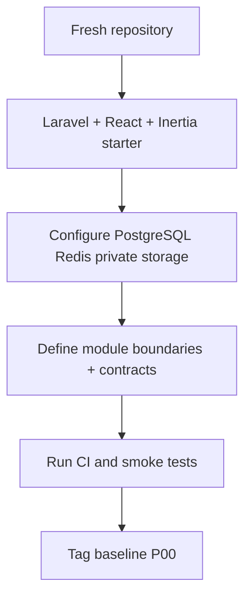

# P00 — Platform Foundation, Architecture & CI

> **Universal Laravel API Documentation Generator** · Independent phase implementation guide  
> Plan revision: 2026-11-22 · Architecture: Laravel + React + Inertia · Analysis: static-first, AI optional

| Field | Value |
|---|---|
| Phase | **P00 / 16** |
| Estimated effort | **2–3 engineer-days** |
| Prerequisites | **None** |
| Checkpoint | **Base platform** |
| Feature flag | `None (new application)` |
| Core persistence | Laravel users, sessions, jobs/failed_jobs where applicable; optionally feature_flags |

[← Implementation index](README.md) · [Shared contracts](SHARED_CONTRACTS.md)

## 1. Goal and shippable result

**Why this phase exists:** Establish a deployable Laravel + React + Inertia application with stable conventions, CI and separate execution boundaries before any repository ingestion.

**What a developer can demonstrably do afterward:** A fresh checkout boots, authenticates a placeholder area, runs migrations and tests, and exposes protected health/readiness checks without importing source code.

**Out of scope:** Project creation, repository upload, route discovery, documentation, any AI integration.

## 2. End-to-end feature workflow



### Workflow explained

1. Create the **Laravel + React/Inertia application** and verify a clean checkout can install and build. This forms the only browser-facing application; avoid a separate Next.js API/UI stack.
2. Connect the application to PostgreSQL and Redis, define private storage disks and verify health/readiness responses. Capture the precise local setup in the repository README.
3. Introduce domain/module directories, versioned contracts, correlation IDs and feature-flag defaults. No imported code should be accepted at this stage.
4. Run tests, lint, typecheck, frontend build and migration checks through CI; deploy to staging and record the first known-good commit/tag.

## 3. Implementation plan in build order

### 3.1 Backend and infrastructure

1. Create Laravel application and choose a supported PHP/Laravel/Inertia/React version combination; commit lockfiles.
2. Set up PostgreSQL connections, Redis, Horizon, and a private filesystem disk. Do not store future uploaded source under public/ or a web-accessible disk.
3. Define app/Domain and app/Contracts directories and dependency rules. Put integration contracts in dedicated versioned DTO classes.
4. Define UUID or ULID identifiers, UTC timestamps, exception responses, job correlation IDs, structured log context, and config-driven feature flags.
5. Create separate queue configuration for imports, discovery, analysis, and AI generation, even if only default queue is active today.
6. Create CI tasks for PHP tests, formatter, static-analysis checks, TypeScript typecheck, frontend build, migrations on temporary PostgreSQL, and dependency auditing.

### 3.2 React + Inertia UI

1. Set up Inertia React TypeScript app shell and accessible layout components: Sidebar, Topbar, Breadcrumbs, Flash, EmptyState, ErrorPanel, Progress.
2. Configure form patterns for validation errors, preserved draft input, loading/disabled states, and toast/flash behavior.
3. Keep future features hidden or visibly disabled; no working navigation item should lead to a dead endpoint.

### 3.3 Proposed routes and interfaces

The following are **design targets**, not routes already implemented. Keep naming and authorization consistent with your project's selected route conventions.

```text
GET /health (liveness; avoid exposing infrastructure secrets)
GET /ready (restricted/readiness, checks database and queue service)
GET /dashboard (auth-protected stub)
```

### 3.4 Database and migration strategy

Create or extend: **Laravel users, sessions, jobs/failed_jobs where applicable; optionally feature_flags**. Use foreign keys and indexes for workspace/project/snapshot identity; add columns and tables before changing readers. Do not drop older fields or mutate published/snapshot data during rollout. Confirm a matching migration and model factory exists for each new entity.

## 4. Original engineering tickets

- [ ] `P0-F01` Create Laravel application, React + TypeScript + Inertia starter and application layout.
- [ ] `P0-F02` Configure PostgreSQL, Redis, Horizon, private storage and environment templates.
- [ ] `P0-F03` Add static analysis/lint/format tooling, Laravel tests, TypeScript typecheck and React tests.
- [ ] `P0-F04` Add CI pipeline for backend tests, frontend build, migrations on temporary database, security checks.
- [ ] `P0-F05` Standardize UUID/ULID, UTC timestamps, JSON contract versions, domain errors and result objects.
- [ ] `P0-F06` Add feature flag service, health/readiness endpoints, structured logging and correlation IDs.

## 5. Design notes, contracts and examples

### Architectural conventions to lock now

- **Application boundary:** All browser navigation is through Laravel web routes + Inertia responses. Keep JSON endpoints narrow and policy-checked for asynchronous status or large indexes.
- **Analyzer boundary:** Never autoload user repositories into the main Laravel runtime. Later parsing workers are separate restricted processes that receive immutable snapshot references.
- **Database boundary:** Keep dynamic analysis payloads as versioned JSONB, while identity/permissions/joins remain normalized.
- **Feature flags:** Put enabled flags in config first; define ownership and default-off behavior. Avoid accidental access to not-yet-released routes.

### Suggested setup verification (adapt to your selected Laravel starter version)

```bash
php artisan about
php artisan migrate:status
php artisan test
npm run build
```

Record verified local commands in the project README. Do not assume these four commands prove Redis, queue or object storage availability—test those separately.


## 6. Test plan (must pass before merge)

- [ ] Clean clone: install dependencies, build assets, migrate into a fresh test database and boot app.
- [ ] Without login, /dashboard redirects to login; protected readiness endpoints do not leak sensitive config.
- [ ] DB unavailable: readiness reports unhealthy while liveness still responds correctly.
- [ ] CI fails if PHP formatting, type checks, backend tests or React build fail.

### Failure and recovery cases

- **Missing extensions or incompatible PHP/Node versions:** explicit boot/build error and pinned environment manifest.
- **Redis unavailable:** queue-dependent features remain disabled; platform gives a meaningful readiness signal.
- **Migration failed:** deployment stops before enablement, existing release continues.

## 7. Manual acceptance walkthrough

1. Start with a freshly migrated, authenticated development workspace; record a baseline test run and current feature flags.
2. Perform the workflow above using a controlled fixture that exercises **Platform foundation**.
3. Confirm the final observable result: **A fresh checkout boots, authenticates a placeholder area, runs migrations and tests, and exposes protected health/readiness checks without importing source code.**
4. Repeat one negative or unauthorized case and confirm a safe, actionable error without data leakage.
5. Disable the new feature flag (when available) and verify earlier completed features continue to work.

## 8. Compatibility and no-breakage checks

- [ ] The full earlier-phase smoke suite remains green, especially cross-workspace authorization.
- [ ] The P08 ZIP → detect → discover → analyze → static docs flow remains available once P08 exists.
- [ ] No new source execution or untrusted PHP bootstrapping has been introduced.
- [ ] All new long-running work uses authorized, retry-safe jobs and immutable snapshots where applicable.
- [ ] No new Inertia props, logs, job payloads or exports leak credentials or unauthorized source snippets.
- [ ] Feature flag defaults to **off** outside the pilot workspace until testing is complete.
- [ ] Release/migration is backwards-compatible; rollback requires no destructive data edits.

## 9. Release checkpoint and rollback

**Release sequence**

1. Merge code behind `None (new application)` (where applicable); apply only additive migrations.
2. Deploy with flag disabled; verify baseline backend tests and React build.
3. Enable for a staging workspace and complete the manual walkthrough.
4. Check structured errors, queue lag, access denials, and relevant metrics.
5. Enable for a controlled internal workspace, then record outcome and limitations.

**Rollback:** Migration failed → deployment stops before enablement, existing release continues.

**Definition of Done:** A fresh checkout boots, authenticates a placeholder area, runs migrations and tests, and exposes protected health/readiness checks without importing source code. Automated tests, authorization tests, and the regression baseline pass. The feature can be disabled without corrupting or hiding earlier data.

## 10. Handoff to the next phase

An authenticated Inertia shell, tested DB/queue/storage infrastructure, versioned DTO conventions and the baseline smoke suite.

**Do not start the next dependent phase until the above checkpoint is met.**
