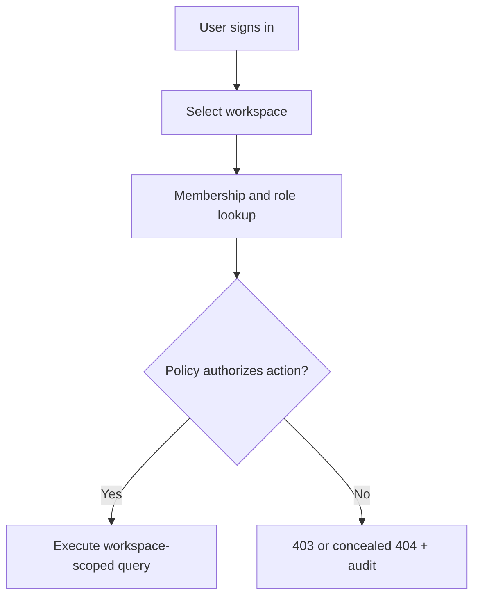

# P01 — Identity, Workspaces & Authorization

> **Universal Laravel API Documentation Generator** · Independent phase implementation guide  
> Plan revision: 2026-11-22 · Architecture: Laravel + React + Inertia · Analysis: static-first, AI optional

| Field | Value |
|---|---|
| Phase | **P01 / 16** |
| Estimated effort | **3–4 engineer-days** |
| Prerequisites | **P00** |
| Checkpoint | **Security foundation** |
| Feature flag | `workspace_management` |
| Core persistence | workspaces, workspace_members, audit_events; invitations only if team onboarding requires them |

[← Implementation index](README.md) · [Shared contracts](SHARED_CONTRACTS.md)

## 1. Goal and shippable result

**Why this phase exists:** Establish workspace ownership and reliable tenancy constraints before creating any project or source artifact.

**What a developer can demonstrably do afterward:** Users can sign in, switch workspaces, manage membership with permitted roles, and cannot see or mutate another workspace’s data.

**Out of scope:** Enterprise SSO, billing, public self-signup, sophisticated organization hierarchy.

## 2. End-to-end feature workflow



### Workflow explained

1. A user authenticates with Laravel session authentication and chooses an authorized workspace.
2. Every request derives workspace context from authenticated membership; controllers call policies and query only entities belonging to that workspace.
3. Role changes and member removals are audited. Revocation must also block polling and file downloads introduced in later phases.
4. Negative tests attempt cross-workspace access with forged IDs, not merely hidden UI. Passing tests becomes a permanent release requirement.

## 3. Implementation plan in build order

### 3.1 Backend and infrastructure

1. Implement session authentication via approved Laravel starter setup; enable CSRF-protected Inertia form posting.
2. Create workspace, workspace member and optional invitation models; define roles Owner/Maintainer/Developer/QA/Viewer and capabilities in a centralized permission matrix.
3. Write WorkspacePolicy and query scoping helpers; validate parent-child associations for any nested resource.
4. Use policy checks in controllers and re-check permission inside queued jobs at execution time when required.
5. Define auditing fields actor_id, workspace_id, event_type, target_type/id and sanitized metadata.
6. Test membership revocation and concurrent role updates. Never rely on frontend visibility as an authorization boundary.

### 3.2 React + Inertia UI

1. Workspace switcher with clear current-workspace context.
2. Members page with roles and an explicit confirmation for role changes/removal.
3. Role-aware navigation and understandable 403/empty workspace states.

### 3.3 Proposed routes and interfaces

The following are **design targets**, not routes already implemented. Keep naming and authorization consistent with your project's selected route conventions.

```text
GET /workspaces
POST /workspaces
PATCH /workspaces/{workspace}
GET /workspaces/{workspace}/members
POST /workspaces/{workspace}/members
DELETE /workspaces/{workspace}/members/{user}
```

### 3.4 Database and migration strategy

Create or extend: **workspaces, workspace_members, audit_events; invitations only if team onboarding requires them**. Use foreign keys and indexes for workspace/project/snapshot identity; add columns and tables before changing readers. Do not drop older fields or mutate published/snapshot data during rollout. Confirm a matching migration and model factory exists for each new entity.

## 4. Original engineering tickets

- [ ] `P1-F01` Auth/session login/logout, password reset as required; Sanctum where integration clients need tokens.
- [ ] `P1-F02` Workspaces and workspace-membership roles: Owner, Maintainer, Developer, QA, Viewer.
- [ ] `P1-F03` Laravel policies and scoped query helpers (`forWorkspace`, nested-resource parent checks).
- [ ] `P1-F04` Workspace switcher, membership management and invitation flows (minimal internal invitations acceptable).
- [ ] `P1-F05` Audit events for member and permission changes.

## 5. Design notes, contracts and examples

### Minimum role matrix

| Capability | Owner | Maintainer | Developer | QA | Viewer |
|---|---:|---:|---:|---:|---:|
| Create/edit projects | Yes | Yes | Yes | No | No |
| Import and analyze | Yes | Yes | Yes | No | No |
| Configure AI credentials | Yes | Yes | No | No | No |
| Submit documentation draft | Yes | Yes | Yes | No | No |
| Approve/publish | Yes | Yes | No | No | No |
| Read published documentation | Yes | Yes | Yes | Yes | Yes |
| Read raw source evidence | Yes | Yes | Yes | No | No |

This is a **starting policy**. Implement it centrally and cover it with authorization tests; never replicate it as divergent hard-coded checks in React.


## 6. Test plan (must pass before merge)

- [ ] User A cannot read another workspace’s members, projects or later job statuses.
- [ ] Viewer cannot create sources or update AI settings; Maintainer can only within assigned workspace.
- [ ] Revoked user immediately loses access, including previously generated signed URLs where technically enforceable (short TTL).
- [ ] Audit records do not contain passwords, tokens or secret-bearing request bodies.

### Failure and recovery cases

- **Stale workspace selection:** redirect to selection and invalidate unauthorized context.
- **Invitation token invalid/expired:** safe error; no accidental membership grant.
- **Policy denial:** never leak whether another tenant’s private resource exists.

## 7. Manual acceptance walkthrough

1. Start with a freshly migrated, authenticated development workspace; record a baseline test run and current feature flags.
2. Perform the workflow above using a controlled fixture that exercises **Identity and workspace RBAC**.
3. Confirm the final observable result: **Users can sign in, switch workspaces, manage membership with permitted roles, and cannot see or mutate another workspace’s data.**
4. Repeat one negative or unauthorized case and confirm a safe, actionable error without data leakage.
5. Disable the new feature flag (when available) and verify earlier completed features continue to work.

## 8. Compatibility and no-breakage checks

- [ ] The full earlier-phase smoke suite remains green, especially cross-workspace authorization.
- [ ] The P08 ZIP → detect → discover → analyze → static docs flow remains available once P08 exists.
- [ ] No new source execution or untrusted PHP bootstrapping has been introduced.
- [ ] All new long-running work uses authorized, retry-safe jobs and immutable snapshots where applicable.
- [ ] No new Inertia props, logs, job payloads or exports leak credentials or unauthorized source snippets.
- [ ] Feature flag defaults to **off** outside the pilot workspace until testing is complete.
- [ ] Release/migration is backwards-compatible; rollback requires no destructive data edits.

## 9. Release checkpoint and rollback

**Release sequence**

1. Merge code behind `workspace_management` (where applicable); apply only additive migrations.
2. Deploy with flag disabled; verify baseline backend tests and React build.
3. Enable for a staging workspace and complete the manual walkthrough.
4. Check structured errors, queue lag, access denials, and relevant metrics.
5. Enable for a controlled internal workspace, then record outcome and limitations.

**Rollback:** Policy denial → never leak whether another tenant’s private resource exists.

**Definition of Done:** Users can sign in, switch workspaces, manage membership with permitted roles, and cannot see or mutate another workspace’s data. Automated tests, authorization tests, and the regression baseline pass. The feature can be disabled without corrupting or hiding earlier data.

## 10. Handoff to the next phase

Workspace IDs, policy primitives and authorized membership roles ready to scope projects, uploads, snapshots, docs and AI settings.

**Do not start the next dependent phase until the above checkpoint is met.**
