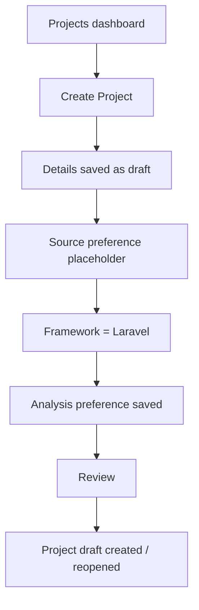

# P02 — Project Management & Create Project Wizard

> **Universal Laravel API Documentation Generator** · Independent phase implementation guide  
> Plan revision: 2026-11-22 · Architecture: Laravel + React + Inertia · Analysis: static-first, AI optional

| Field | Value |
|---|---|
| Phase | **P02 / 16** |
| Estimated effort | **3–4 engineer-days** |
| Prerequisites | **P01** |
| Checkpoint | **M0 — project-management shell** |
| Feature flag | `project_wizard` |
| Core persistence | projects and project_drafts (or project draft JSONB if intentionally chosen); indexed unique workspace_id + slug |

[← Implementation index](README.md) · [Shared contracts](SHARED_CONTRACTS.md)

## 1. Goal and shippable result

**Why this phase exists:** Allow creating a project and saving onboarding configuration independently of source import or analysis.

**What a developer can demonstrably do afterward:** A workspace member with permission can create a draft project, leave the wizard, resume later, update metadata and archive it.

**Out of scope:** Actual ZIP uploads, Git tokens, code scanning, AI invocation.

## 2. End-to-end feature workflow



### Workflow explained

1. An authorized developer opens the project wizard, enters project identity/visibility, and saves a draft immediately.
2. The user records source preference (ZIP/Git), chooses Laravel and analysis mode, and reviews configuration. These settings are metadata only; no scan starts.
3. Each step persists on the server and can be resumed after browser refresh; invalid fields return standard Inertia form errors.
4. On completion, project remains a draft or transitions according to defined status rules. Source upload is unlocked only when P04/P09 exist.

## 3. Implementation plan in build order

### 3.1 Backend and infrastructure

1. Create ProjectService with create/update/archive methods, transactional slug reservation and optimistic locking or safe last-write rules.
2. Persist five-step wizard state server-side: Details → Source → Framework → Configure → Review. Future steps may capture settings but must not start unsupported jobs.
3. Validate project name, slug uniqueness within workspace, visibility, description length and supported framework identifier.
4. Define a stable project status draft → active → archived; only activate after valid source import in later phases.
5. Avoid storing credentials in wizard draft JSON; provider auth is introduced later.

### 3.2 React + Inertia UI

1. Projects index with search, cards/table, empty state and Create Project action.
2. Five-step Inertia/React wizard using server-backed draft and Back/Continue navigation.
3. Project details screen and resume/edit/archive UI; source scan actions hidden until ready.
4. Explicitly communicate that selecting Git now is only a preference until P09 is enabled.

### 3.3 Proposed routes and interfaces

The following are **design targets**, not routes already implemented. Keep naming and authorization consistent with your project's selected route conventions.

```text
GET /projects
GET /projects/create
POST /projects
GET /projects/{project}
PATCH /projects/{project}
POST /projects/{project}/archive
```

### 3.4 Database and migration strategy

Create or extend: **projects and project_drafts (or project draft JSONB if intentionally chosen); indexed unique workspace_id + slug**. Use foreign keys and indexes for workspace/project/snapshot identity; add columns and tables before changing readers. Do not drop older fields or mutate published/snapshot data during rollout. Confirm a matching migration and model factory exists for each new entity.

## 4. Original engineering tickets

- [ ] `P2-F01` Projects table, create/list/show/update/archive services and policies.
- [ ] `P2-F02` Five-step Inertia wizard (Details → Source → Framework → Analysis → Review) with server-backed draft.
- [ ] `P2-F03` Slug uniqueness per workspace, project visibility, created_by, draft state.
- [ ] `P2-F04` Disabled future feature surfaces display truthful “not yet supported” messaging.
- [ ] `P2-F05` Project dashboard, empty states, validation errors, cancel/resume workflow.

## 5. Design notes, contracts and examples

### Wizard data contract example

```json
{
  "project_name": "Example Laravel API",
  "description": "Internal API documentation",
  "visibility": "workspace",
  "source_preference": "zip",
  "framework": "laravel",
  "root_path": ".",
  "analysis_mode": "static",
  "documentation_mode": "on_demand",
  "wizard_step": "review"
}
```

**Important:** `source_preference` is not an imported source and must not be confused with a `SourceSnapshot`. The wizard can complete without either ZIP or Git credentials.


## 6. Test plan (must pass before merge)

- [ ] Start wizard, refresh browser at step 3, resume with saved values.
- [ ] Duplicate project slug in same workspace shows validation; same slug in distinct workspaces is allowed.
- [ ] Unauthorized workspace user cannot view or edit draft.
- [ ] Draft creation never starts source import, scan or AI calls.

### Failure and recovery cases

- **Inertia validation error preserves non-secret form state.:** Inertia validation error preserves non-secret form state.
- **Concurrent draft edits use lock/version or clear last-write semantics.:** Concurrent draft edits use lock/version or clear last-write semantics.
- **Archive is reversible as a product policy or clearly documented terminal state.:** Archive is reversible as a product policy or clearly documented terminal state.

## 7. Manual acceptance walkthrough

1. Start with a freshly migrated, authenticated development workspace; record a baseline test run and current feature flags.
2. Perform the workflow above using a controlled fixture that exercises **Project CRUD and onboarding wizard**.
3. Confirm the final observable result: **A workspace member with permission can create a draft project, leave the wizard, resume later, update metadata and archive it.**
4. Repeat one negative or unauthorized case and confirm a safe, actionable error without data leakage.
5. Disable the new feature flag (when available) and verify earlier completed features continue to work.

## 8. Compatibility and no-breakage checks

- [ ] The full earlier-phase smoke suite remains green, especially cross-workspace authorization.
- [ ] The P08 ZIP → detect → discover → analyze → static docs flow remains available once P08 exists.
- [ ] No new source execution or untrusted PHP bootstrapping has been introduced.
- [ ] All new long-running work uses authorized, retry-safe jobs and immutable snapshots where applicable.
- [ ] No new Inertia props, logs, job payloads or exports leak credentials or unauthorized source snippets.
- [ ] Feature flag defaults to **off** outside the pilot workspace until testing is complete.
- [ ] Release/migration is backwards-compatible; rollback requires no destructive data edits.

## 9. Release checkpoint and rollback

**Release sequence**

1. Merge code behind `project_wizard` (where applicable); apply only additive migrations.
2. Deploy with flag disabled; verify baseline backend tests and React build.
3. Enable for a staging workspace and complete the manual walkthrough.
4. Check structured errors, queue lag, access denials, and relevant metrics.
5. Enable for a controlled internal workspace, then record outcome and limitations.

**Rollback:** Archive is reversible as a product policy or clearly documented terminal state.

**Definition of Done:** A workspace member with permission can create a draft project, leave the wizard, resume later, update metadata and archive it. Automated tests, authorization tests, and the regression baseline pass. The feature can be disabled without corrupting or hiding earlier data.

## 10. Handoff to the next phase

A persisted authorized project ID and source preference ready for snapshot infrastructure.

**Do not start the next dependent phase until the above checkpoint is met.**
