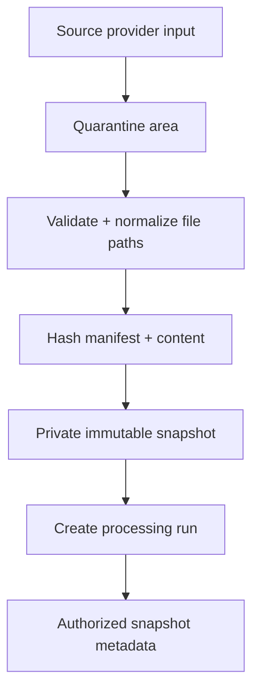

# P03 — Immutable Source Snapshots & Job Infrastructure

> **Universal Laravel API Documentation Generator** · Independent phase implementation guide  
> Plan revision: 2026-11-22 · Architecture: Laravel + React + Inertia · Analysis: static-first, AI optional

| Field | Value |
|---|---|
| Phase | **P03 / 16** |
| Estimated effort | **3–4 engineer-days** |
| Prerequisites | **P02** |
| Checkpoint | **Source contract ready** |
| Feature flag | `source_snapshots` |
| Core persistence | project_sources, source_snapshots, source_files, processing_runs/job metadata |

[← Implementation index](README.md) · [Shared contracts](SHARED_CONTRACTS.md)

## 1. Goal and shippable result

**Why this phase exists:** Build a single, security-scoped source abstraction consumed identically by ZIP and Git imports.

**What a developer can demonstrably do afterward:** A known fixture can be stored as an immutable source snapshot with a manifest, status, authorization checks and idempotent processing run.

**Out of scope:** ZIP extractor UI, Git OAuth, Laravel route discovery.

## 2. End-to-end feature workflow



### Workflow explained

1. An import provider submits a proposed set of files to a private quarantine area. This phase deliberately uses a controlled fixture before accepting real uploads.
2. The storage service normalizes relative paths, hashes file contents, and builds a manifest. A snapshot is stored behind an immutable server-generated storage key.
3. A processing run records the state and idempotency fingerprint; queue jobs are dispatched only after the relevant transaction commits.
4. Consumers receive only authorized snapshot IDs and manifest metadata, never a mutable branch, arbitrary path or storage credentials.
5. A failed write or retry cannot mutate an already-ready snapshot. This is the common data boundary for both source providers.

## 3. Implementation plan in build order

### 3.1 Backend and infrastructure

1. Define SourceProvider contract returning snapshot identity, not mutable directory paths; define SourceSnapshot immutable DTO.
2. Create private quarantine and snapshot storage with server-generated keys, encryption/retention rules and access service enforcing project ownership.
3. Generate manifest entries for normalized relative path, SHA-256, bytes, detected language and excluded status.
4. Define state transition guard pending → validating → ready/rejected/failed; never mark ready before storage verification.
5. Persist processing run ownership/status, attempt count, errors and idempotency fingerprint; dispatch jobs only after DB commit.
6. Build safe garbage collection for failed temporary uploads and expired quarantine objects without deleting referenced snapshots.

### 3.2 React + Inertia UI

1. Project Source panel shows source type, snapshot status, content hash summary and last import time.
2. Generic import status/progress component supports pending/validating/ready/rejected/failed.
3. Do not expose raw storage keys or filesystem paths in Inertia props.

### 3.3 Proposed routes and interfaces

The following are **design targets**, not routes already implemented. Keep naming and authorization consistent with your project's selected route conventions.

```text
GET /projects/{project}/sources
GET /projects/{project}/snapshots
GET /projects/{project}/snapshots/{snapshot}
GET /internal/processing-runs/{run}/status
```

### 3.4 Database and migration strategy

Create or extend: **project_sources, source_snapshots, source_files, processing_runs/job metadata**. Use foreign keys and indexes for workspace/project/snapshot identity; add columns and tables before changing readers. Do not drop older fields or mutate published/snapshot data during rollout. Confirm a matching migration and model factory exists for each new entity.

## 4. Original engineering tickets

- [ ] `P3-F01` Define `SourceProvider` interface and `SourceSnapshot` domain object.
- [ ] `P3-F02` Private quarantine and immutable snapshot storage with server-generated object keys.
- [ ] `P3-F03` Snapshot SHA-256 and manifest generation (path, size, hash, language).
- [ ] `P3-F04` Source statuses: `pending`, `validating`, `ready`, `rejected`, `failed`.
- [ ] `P3-F05` Job and event model for import/scan status, idempotent retries, cancellation markers.
- [ ] `P3-F06` Retention rules, secure delete process, authorized snapshot lookup service.

## 5. Design notes, contracts and examples

### Source identity contract

```json
{
  "snapshot_id": "uuid",
  "project_id": "uuid",
  "source_type": "zip_or_git",
  "sha256": "sha256-of-normalized-manifest",
  "status": "ready",
  "manifest_version": "1.0"
}
```

Do not compute a content hash from repository timestamps, ZIP metadata ordering, or file modification dates. Normalize paths and hash file content deterministically. `storage_key` stays server-side.

### Minimum state transition rules

`pending → validating → ready | rejected | failed`; retry creates an attempt while retaining immutable successful snapshots. Never mutate a ready snapshot to reflect a later Git commit.


## 6. Test plan (must pass before merge)

- [ ] Repeated identical source import resolves to a safe idempotent result without duplicate active runs.
- [ ] User from another workspace cannot obtain snapshot metadata or download source.
- [ ] After storage write failure, no snapshot is incorrectly marked ready.
- [ ] Retry with same idempotency fingerprint does not corrupt or mutate existing snapshot.

### Failure and recovery cases

- **Unexpected worker termination:** run becomes retryable; completed snapshot remains immutable.
- **Object storage denied:** status failed, sanitized error, cleanup scheduled.
- **Manifest conflict:** reject or create a new version; never update the file manifest in place.

## 7. Manual acceptance walkthrough

1. Start with a freshly migrated, authenticated development workspace; record a baseline test run and current feature flags.
2. Perform the workflow above using a controlled fixture that exercises **Immutable source storage**.
3. Confirm the final observable result: **A known fixture can be stored as an immutable source snapshot with a manifest, status, authorization checks and idempotent processing run.**
4. Repeat one negative or unauthorized case and confirm a safe, actionable error without data leakage.
5. Disable the new feature flag (when available) and verify earlier completed features continue to work.

## 8. Compatibility and no-breakage checks

- [ ] The full earlier-phase smoke suite remains green, especially cross-workspace authorization.
- [ ] The P08 ZIP → detect → discover → analyze → static docs flow remains available once P08 exists.
- [ ] No new source execution or untrusted PHP bootstrapping has been introduced.
- [ ] All new long-running work uses authorized, retry-safe jobs and immutable snapshots where applicable.
- [ ] No new Inertia props, logs, job payloads or exports leak credentials or unauthorized source snippets.
- [ ] Feature flag defaults to **off** outside the pilot workspace until testing is complete.
- [ ] Release/migration is backwards-compatible; rollback requires no destructive data edits.

## 9. Release checkpoint and rollback

**Release sequence**

1. Merge code behind `source_snapshots` (where applicable); apply only additive migrations.
2. Deploy with flag disabled; verify baseline backend tests and React build.
3. Enable for a staging workspace and complete the manual walkthrough.
4. Check structured errors, queue lag, access denials, and relevant metrics.
5. Enable for a controlled internal workspace, then record outcome and limitations.

**Rollback:** Manifest conflict → reject or create a new version; never update the file manifest in place.

**Definition of Done:** A known fixture can be stored as an immutable source snapshot with a manifest, status, authorization checks and idempotent processing run. Automated tests, authorization tests, and the regression baseline pass. The feature can be disabled without corrupting or hiding earlier data.

## 10. Handoff to the next phase

ZipSourceProvider and GitSourceProvider can both produce ready immutable SourceSnapshot IDs; scans use snapshots, not source-provider-specific data.

**Do not start the next dependent phase until the above checkpoint is met.**
