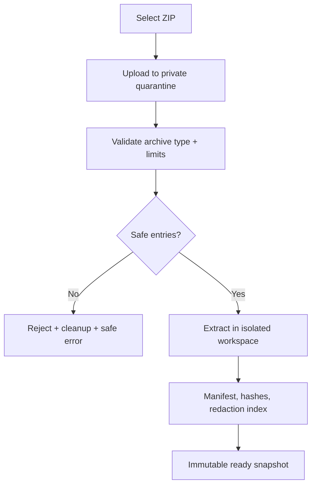

# P04 — Secure ZIP Project Import

> **Universal Laravel API Documentation Generator** · Independent phase implementation guide  
> Plan revision: 2026-11-22 · Architecture: Laravel + React + Inertia · Analysis: static-first, AI optional

| Field | Value |
|---|---|
| Phase | **P04 / 16** |
| Estimated effort | **4–6 engineer-days** |
| Prerequisites | **P03** |
| Checkpoint | **Real source ingestion** |
| Feature flag | `zip_import` |
| Core persistence | Reuses project_sources/source_snapshots/source_files; processing metadata for upload attempt |

[← Implementation index](README.md) · [Shared contracts](SHARED_CONTRACTS.md)

## 1. Goal and shippable result

**Why this phase exists:** Accept Laravel project ZIPs safely and convert them into immutable ready snapshots without executing uploaded code.

**What a developer can demonstrably do afterward:** An authorized developer uploads a valid Laravel ZIP, receives useful progress/errors, and can inspect the resulting source snapshot.

**Out of scope:** Git import, automated route scanning, direct response execution.

## 2. End-to-end feature workflow



### Workflow explained

1. Developer selects a ZIP in the Inertia upload form; server saves it in a private quarantine object with a generated name.
2. The import worker checks archive validity, path safety, symlinks/special files, count/size/ratio limits and extraction runtime before considering the source usable.
3. Only allowed regular files are extracted into an isolated workspace. Uploaded PHP, artisan and Composer scripts are **never executed**.
4. The worker builds normalized file manifest/hashes, writes a ready immutable snapshot and deletes temporary data per retention rules.
5. The UI displays a snapshot reference on success or a sanitized validation/security failure with retry options; earlier project metadata remains intact.

## 3. Implementation plan in build order

### 3.1 Backend and infrastructure

1. Validate both actual archive format and configured maximum upload bytes; refuse archives with dangerous paths, symlinks/special files or nested archive abuse.
2. Canonicalize and normalize every path; reject absolute paths, .. segments, duplicate normalized paths, NUL characters and zip-slip entries.
3. Bound total uncompressed size, file count, single file size, compression ratio, CPU/memory/runtime and extraction depth.
4. Extract only inside a restricted disposable workspace; avoid executing PHP, Composer, artisan, shell scripts or lifecycle hooks.
5. Separate source retention from LLM evidence exclusion: sensitive source can be withheld entirely or protected, never accidentally forwarded.
6. Create stable snapshot content hash; persist security findings and safe error codes; delete quarantine files after success/failure policy.

### 3.2 React + Inertia UI

1. ZIP drag-and-drop/chooser, file-size guidance and upload progress.
2. Validation progress and failed state with actionable sanitized messages.
3. Snapshot summary: file count, source root candidates, last import, fingerprint; retry starts a new controlled attempt.

### 3.3 Proposed routes and interfaces

The following are **design targets**, not routes already implemented. Keep naming and authorization consistent with your project's selected route conventions.

```text
POST /projects/{project}/uploads
GET /projects/{project}/imports/{importRun}
GET /projects/{project}/snapshots/{snapshot}
```

### 3.4 Database and migration strategy

Create or extend: **Reuses project_sources/source_snapshots/source_files; processing metadata for upload attempt**. Use foreign keys and indexes for workspace/project/snapshot identity; add columns and tables before changing readers. Do not drop older fields or mutate published/snapshot data during rollout. Confirm a matching migration and model factory exists for each new entity.

## 4. Original engineering tickets

- [ ] `P4-F01` Inertia ZIP uploader with progress bar, size warnings and server validation.
- [ ] `P4-F02` Quarantine upload and reject unsupported format, oversized/over-count archives, traversal and symlink/special-file entries.
- [ ] `P4-F03` Extract into restricted workspace using canonical path checks, file count/size/decompression limits and timeouts.
- [ ] `P4-F04` Exclude secrets and unsafe files from analysis context; preserve a private manifest and required source files for inspection.
- [ ] `P4-F05` Create content-hashed immutable snapshot; record source and import status.
- [ ] `P4-F06` User-facing upload error categories and safe retry.

## 5. Design notes, contracts and examples

### Upload boundary checklist

- Accept `multipart/form-data` over HTTPS; store to quarantine with a random server-generated name.
- Inspect central ZIP directory entries and enforce an allowlist of safe regular files/directories.
- Reject absolute and path traversal entries, symlinks and archive-in-archive support for the MVP.
- Set configurable limits for compressed/uncompressed bytes, file count, per-file bytes, runtime and extraction ratio.
- Never preserve executable permissions, and never execute package scripts or Laravel bootstrap from uploaded source.
- Validate every resolved destination remains inside the canonical extraction directory.

Test the entire path with deliberately hostile fixtures before enabling upload for additional workspaces.


## 6. Test plan (must pass before merge)

- [ ] Valid Laravel ZIP with nested project folder imports successfully.
- [ ] ZIP slip, symlink, nested archive, oversized expanded size, high compression ratio and malformed archive all fail safely.
- [ ] Parser/worker never executes source: use fixture with code that would write a sentinel file if executed.
- [ ] Unauthorized upload, repeated click and interrupted upload do not create orphaned accessible snapshots.

### Failure and recovery cases

- **Unsupported archive:** rejected with allowed-format explanation.
- **Unsafe archive content:** rejected; log only sanitized security event.
- **Partial upload:** time-bounded cleanup; no ready snapshot.
- **Quarantine scanner unavailable:** fail closed instead of accepting unvalidated archive.

## 7. Manual acceptance walkthrough

1. Start with a freshly migrated, authenticated development workspace; record a baseline test run and current feature flags.
2. Perform the workflow above using a controlled fixture that exercises **ZIP upload and validation**.
3. Confirm the final observable result: **An authorized developer uploads a valid Laravel ZIP, receives useful progress/errors, and can inspect the resulting source snapshot.**
4. Repeat one negative or unauthorized case and confirm a safe, actionable error without data leakage.
5. Disable the new feature flag (when available) and verify earlier completed features continue to work.

## 8. Compatibility and no-breakage checks

- [ ] The full earlier-phase smoke suite remains green, especially cross-workspace authorization.
- [ ] The P08 ZIP → detect → discover → analyze → static docs flow remains available once P08 exists.
- [ ] No new source execution or untrusted PHP bootstrapping has been introduced.
- [ ] All new long-running work uses authorized, retry-safe jobs and immutable snapshots where applicable.
- [ ] No new Inertia props, logs, job payloads or exports leak credentials or unauthorized source snippets.
- [ ] Feature flag defaults to **off** outside the pilot workspace until testing is complete.
- [ ] Release/migration is backwards-compatible; rollback requires no destructive data edits.

## 9. Release checkpoint and rollback

**Release sequence**

1. Merge code behind `zip_import` (where applicable); apply only additive migrations.
2. Deploy with flag disabled; verify baseline backend tests and React build.
3. Enable for a staging workspace and complete the manual walkthrough.
4. Check structured errors, queue lag, access denials, and relevant metrics.
5. Enable for a controlled internal workspace, then record outcome and limitations.

**Rollback:** Quarantine scanner unavailable → fail closed instead of accepting unvalidated archive.

**Definition of Done:** An authorized developer uploads a valid Laravel ZIP, receives useful progress/errors, and can inspect the resulting source snapshot. Automated tests, authorization tests, and the regression baseline pass. The feature can be disabled without corrupting or hiding earlier data.

## 10. Handoff to the next phase

A ZIP-backed ready SourceSnapshot with a reliable manifest that Laravel detection can inspect without running code.

**Do not start the next dependent phase until the above checkpoint is met.**
