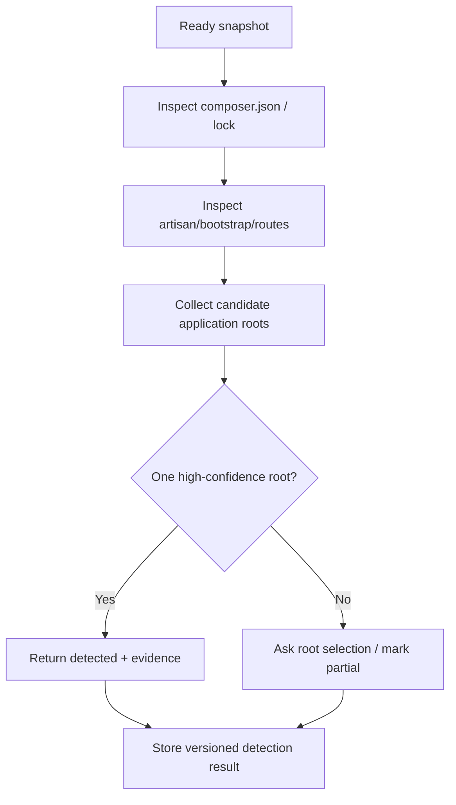

# P05 — Laravel Framework Detection & Root Selection

> **Universal Laravel API Documentation Generator** · Independent phase implementation guide  
> Plan revision: 2026-11-22 · Architecture: Laravel + React + Inertia · Analysis: static-first, AI optional

| Field | Value |
|---|---|
| Phase | **P05 / 16** |
| Estimated effort | **3–4 engineer-days** |
| Prerequisites | **P04** |
| Checkpoint | **Laravel detection working** |
| Feature flag | `framework_detection` |
| Core persistence | framework_detections or immutable detection JSONB keyed by snapshot ID and detector version |

[← Implementation index](README.md) · [Shared contracts](SHARED_CONTRACTS.md)

## 1. Goal and shippable result

**Why this phase exists:** Determine whether an immutable snapshot contains a Laravel application and identify its root and version with explicit uncertainty.

**What a developer can demonstrably do afterward:** The system identifies Laravel projects and asks the user to resolve ambiguous roots; it never boots uploaded applications to check.

**Out of scope:** Controller/route invocation, running Laravel CLI commands, AI-assisted framework guessing.

## 2. End-to-end feature workflow



### Workflow explained

1. The detector receives a **ready snapshot**, not a filesystem path supplied by the browser.
2. It parses composer metadata and checks Laravel indicator files (artisan/bootstrap/routes), recording each supporting source path.
3. If one clear app root exists, it returns a detected result; if multiple candidate roots or inconsistent metadata exist, it returns partial results and asks the user to select.
4. The selected root is verified to be inside the snapshot and stored with detector version. The route scanner in P06 consumes this verified root.
5. The detector never runs `php artisan`, Composer, provider boot code or PHP application classes.

## 3. Implementation plan in build order

### 3.1 Backend and infrastructure

1. Inspect composer.json/lock and artifact manifest via safe read-only parsers; do not run Composer or artisan.
2. Detect framework family, declared constraints vs locked version, PHP constraint, candidate root paths and route layout.
3. Support monorepos and module packages through multiple root candidates and configurable relative root selection.
4. Define statuses detected/partial/unsupported/not_found and evidence-based confidence/unknown reasons.
5. Persist detector version and snapshot hash to avoid stale reuse after reimport.

### 3.2 React + Inertia UI

1. Detection result card: framework, declared/locked version, PHP requirement, root path and evidence.
2. Multiple root candidates selection with file-path breadcrumbs and explicit Confirm action.
3. Clear partial/not-found error states and re-run option.

### 3.3 Proposed routes and interfaces

The following are **design targets**, not routes already implemented. Keep naming and authorization consistent with your project's selected route conventions.

```text
POST /projects/{project}/snapshots/{snapshot}/detect
GET /projects/{project}/snapshots/{snapshot}/detection
PATCH /projects/{project}/snapshots/{snapshot}/application-root
```

### 3.4 Database and migration strategy

Create or extend: **framework_detections or immutable detection JSONB keyed by snapshot ID and detector version**. Use foreign keys and indexes for workspace/project/snapshot identity; add columns and tables before changing readers. Do not drop older fields or mutate published/snapshot data during rollout. Confirm a matching migration and model factory exists for each new entity.

## 4. Original engineering tickets

- [ ] `P5-F01` Detect `composer.json`, `artisan`, bootstrap structure, route files and module directories.
- [ ] `P5-F02` Determine likely Laravel version from `composer.lock` when present; distinguish installed vs declared constraints.
- [ ] `P5-F03` Support manual relative application-root selection for monorepos.
- [ ] `P5-F04` Return result status: `detected`, `partial`, `unsupported`, `not_found`; include evidence/warnings.
- [ ] `P5-F05` Framework Detection page with source and version context.

## 5. Design notes, contracts and examples

### Detection output example

```json
{
  "status": "partial",
  "framework": "laravel",
  "application_roots": ["backend", "legacy-api"],
  "declared_version_constraint": "^12.0",
  "locked_framework_version": null,
  "evidence": ["backend/composer.json"],
  "warnings": ["Multiple Laravel roots were found"]
}
```

A constraint such as `^12.0` is not the runtime version. Store the distinction explicitly. Only accept a root path normalized within the imported snapshot.


## 6. Test plan (must pass before merge)

- [ ] Standard Laravel project detected with expected root.
- [ ] composer.lock missing → only constraint reported; do not claim exact installed version.
- [ ] Monorepo with two apps → explicit selection; no arbitrary default.
- [ ] Non-Laravel PHP package → unsupported/not_found without executing files.

### Failure and recovery cases

- **Malformed composer.json:** partial result with file evidence and parse error.
- **Unknown bootstrap arrangement:** partial, allow manual root selection.
- **User picks a path outside snapshot:** reject before persistence.

## 7. Manual acceptance walkthrough

1. Start with a freshly migrated, authenticated development workspace; record a baseline test run and current feature flags.
2. Perform the workflow above using a controlled fixture that exercises **Laravel framework detection**.
3. Confirm the final observable result: **The system identifies Laravel projects and asks the user to resolve ambiguous roots; it never boots uploaded applications to check.**
4. Repeat one negative or unauthorized case and confirm a safe, actionable error without data leakage.
5. Disable the new feature flag (when available) and verify earlier completed features continue to work.

## 8. Compatibility and no-breakage checks

- [ ] The full earlier-phase smoke suite remains green, especially cross-workspace authorization.
- [ ] The P08 ZIP → detect → discover → analyze → static docs flow remains available once P08 exists.
- [ ] No new source execution or untrusted PHP bootstrapping has been introduced.
- [ ] All new long-running work uses authorized, retry-safe jobs and immutable snapshots where applicable.
- [ ] No new Inertia props, logs, job payloads or exports leak credentials or unauthorized source snippets.
- [ ] Feature flag defaults to **off** outside the pilot workspace until testing is complete.
- [ ] Release/migration is backwards-compatible; rollback requires no destructive data edits.

## 9. Release checkpoint and rollback

**Release sequence**

1. Merge code behind `framework_detection` (where applicable); apply only additive migrations.
2. Deploy with flag disabled; verify baseline backend tests and React build.
3. Enable for a staging workspace and complete the manual walkthrough.
4. Check structured errors, queue lag, access denials, and relevant metrics.
5. Enable for a controlled internal workspace, then record outcome and limitations.

**Rollback:** User picks a path outside snapshot → reject before persistence.

**Definition of Done:** The system identifies Laravel projects and asks the user to resolve ambiguous roots; it never boots uploaded applications to check. Automated tests, authorization tests, and the regression baseline pass. The feature can be disabled without corrupting or hiding earlier data.

## 10. Handoff to the next phase

A validated Laravel root and versioned detection result consumed by route discovery.

**Do not start the next dependent phase until the above checkpoint is met.**
