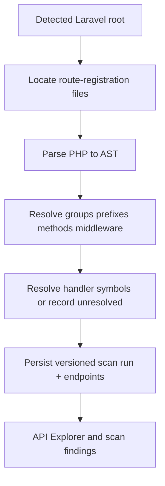

# P06 — AST Route Discovery & API Explorer

> **Universal Laravel API Documentation Generator** · Independent phase implementation guide  
> Plan revision: 2026-11-22 · Architecture: Laravel + React + Inertia · Analysis: static-first, AI optional

| Field | Value |
|---|---|
| Phase | **P06 / 16** |
| Estimated effort | **6–9 engineer-days** |
| Prerequisites | **P05** |
| Checkpoint | **M1 — endpoint inventory** |
| Feature flag | `route_discovery` |
| Core persistence | scan_runs, api_endpoints, scan_findings with snapshot-scoped endpoint identity |

[← Implementation index](README.md) · [Shared contracts](SHARED_CONTRACTS.md)

## 1. Goal and shippable result

**Why this phase exists:** Discover Laravel API routes through non-executing static analysis and expose a searchable, reliable endpoint inventory.

**What a developer can demonstrably do afterward:** A user scans a ZIP snapshot, sees endpoint list, filters by route metadata, and understands which routes could not be resolved.

**Out of scope:** Generating full documentation during scan, AI invocation, executing route:list.

## 2. End-to-end feature workflow



### Workflow explained

1. The user starts discovery against a verified Laravel root and a specific snapshot; a scan run is queued and shown in the UI.
2. The restricted parser loads candidate route-registration files as **text**, generates AST nodes and resolves static group nesting, names, prefixes, verbs and middleware.
3. Handlers become resolved endpoint records when evidence is sufficient; unsupported dynamic routes produce explicit findings with source locations.
4. The scanner commits immutable endpoint inventory for that snapshot and scan version; retries cannot duplicate endpoints.
5. API Explorer exposes searchable/filterable endpoints and scan warnings. Full document generation is intentionally absent until P07/P08.

## 3. Implementation plan in build order

### 3.1 Backend and infrastructure

1. Pin nikic/php-parser in analyzer runtime; build AST visitors to extract literal route registration expressions and file/line references.
2. Process group stacks (prefix/name/middleware/namespace), static aliases, verbs and invokable controller syntax; avoid raw regex extraction as primary logic.
3. Discover known Laravel route files plus statically referenced provider/module routes; distinguish route candidates from fully resolved endpoints.
4. Create deterministic route_identity within snapshot, normalized methods/URIs and source reference; distinguish aliases and overrides.
5. Store scan summary and unresolved findings; queue scans idempotently with snapshot+analyzer version fingerprint.
6. Build paginated endpoint listing with query filters: method, path, module, middleware/auth, resolved/unknown status.

### 3.2 React + Inertia UI

1. Project scan page with status, stages, stop/retry where supported, discovered count and warnings.
2. API Explorer endpoint table/list, tabs or filters, search and pagination, method badges.
3. Endpoint row opens a details view; Generate buttons remain disabled until P07/P08.
4. Clear banner: static discovery cannot guarantee runtime-registered routes.

### 3.3 Proposed routes and interfaces

The following are **design targets**, not routes already implemented. Keep naming and authorization consistent with your project's selected route conventions.

```text
POST /projects/{project}/snapshots/{snapshot}/scans
GET /projects/{project}/scans/{scan}
GET /projects/{project}/endpoints
GET /projects/{project}/endpoints/{endpoint}
```

### 3.4 Database and migration strategy

Create or extend: **scan_runs, api_endpoints, scan_findings with snapshot-scoped endpoint identity**. Use foreign keys and indexes for workspace/project/snapshot identity; add columns and tables before changing readers. Do not drop older fields or mutate published/snapshot data during rollout. Confirm a matching migration and model factory exists for each new entity.

## 4. Original engineering tickets

- [ ] `P6-F01` Integrate pinned `nikic/php-parser`, AST node visitors and symbol/file positions.
- [ ] `P6-F02` Discover routes from configured route files and statically resolvable provider/module patterns.
- [ ] `P6-F03` Resolve route groups, prefixes, namespace, HTTP methods, names and middleware inheritance.
- [ ] `P6-F04` Resolve controller/action or mark unresolved handlers with diagnostic reason.
- [ ] `P6-F05` Persist immutable endpoint records; generation is not triggered during discovery.
- [ ] `P6-F06` API Explorer: search/filter method/path/module/auth, pagination, scan summary, unknown cases.
- [ ] `P6-F07` Golden fixture corpus and route discovery coverage metrics.

## 5. Design notes, contracts and examples

### Route inventory schema (representative)

```json
{
  "route_identity": "sha256-fingerprint",
  "methods": ["GET"],
  "normalized_uri": "/api/v1/orders/{order}",
  "route_name": "orders.show",
  "handler": "App\Http\Controllers\OrderController@show",
  "middleware": ["auth:sanctum"],
  "source": {"path":"routes/api.php", "start_line":24},
  "resolution": "resolved"
}
```

Preserve the original route expression and known limitations. Do not claim all dynamic routes have been discovered simply because the scan finished.


## 6. Test plan (must pass before merge)

- [ ] Nested Route::prefix/group/middleware inheritance resolved as expected.
- [ ] Module route files discovered; invokable and normal controller syntax covered.
- [ ] Closures/dynamic route registration marked unresolved with evidence, not invented.
- [ ] Same snapshot rescanned twice keeps stable endpoint identities and no duplicates; ZIP import remains unaffected.

### Failure and recovery cases

- **PHP parse error in one file:** partial scan, continue other files, attach finding.
- **Dynamic route expression:** unresolved with reason and source location.
- **Worker timeout:** failed or partial with retry that does not overwrite prior completed scan.

## 7. Manual acceptance walkthrough

1. Start with a freshly migrated, authenticated development workspace; record a baseline test run and current feature flags.
2. Perform the workflow above using a controlled fixture that exercises **Route discovery and API Explorer**.
3. Confirm the final observable result: **A user scans a ZIP snapshot, sees endpoint list, filters by route metadata, and understands which routes could not be resolved.**
4. Repeat one negative or unauthorized case and confirm a safe, actionable error without data leakage.
5. Disable the new feature flag (when available) and verify earlier completed features continue to work.

## 8. Compatibility and no-breakage checks

- [ ] The full earlier-phase smoke suite remains green, especially cross-workspace authorization.
- [ ] The P08 ZIP → detect → discover → analyze → static docs flow remains available once P08 exists.
- [ ] No new source execution or untrusted PHP bootstrapping has been introduced.
- [ ] All new long-running work uses authorized, retry-safe jobs and immutable snapshots where applicable.
- [ ] No new Inertia props, logs, job payloads or exports leak credentials or unauthorized source snippets.
- [ ] Feature flag defaults to **off** outside the pilot workspace until testing is complete.
- [ ] Release/migration is backwards-compatible; rollback requires no destructive data edits.

## 9. Release checkpoint and rollback

**Release sequence**

1. Merge code behind `route_discovery` (where applicable); apply only additive migrations.
2. Deploy with flag disabled; verify baseline backend tests and React build.
3. Enable for a staging workspace and complete the manual walkthrough.
4. Check structured errors, queue lag, access denials, and relevant metrics.
5. Enable for a controlled internal workspace, then record outcome and limitations.

**Rollback:** Worker timeout → failed or partial with retry that does not overwrite prior completed scan.

**Definition of Done:** A user scans a ZIP snapshot, sees endpoint list, filters by route metadata, and understands which routes could not be resolved. Automated tests, authorization tests, and the regression baseline pass. The feature can be disabled without corrupting or hiding earlier data.

## 10. Handoff to the next phase

Normalized API endpoint records bound to immutable snapshot and source locations, suitable for per-endpoint static analysis.

**Do not start the next dependent phase until the above checkpoint is met.**
