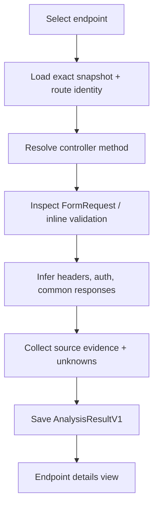

# P07 — Basic Endpoint Contract Analysis

> **Universal Laravel API Documentation Generator** · Independent phase implementation guide  
> Plan revision: 2026-11-22 · Architecture: Laravel + React + Inertia · Analysis: static-first, AI optional

| Field | Value |
|---|---|
| Phase | **P07 / 16** |
| Estimated effort | **6–9 engineer-days** |
| Prerequisites | **P06** |
| Checkpoint | **Structured analysis v1** |
| Feature flag | `endpoint_analysis` |
| Core persistence | endpoint_analyses, analysis_evidence, analysis_findings; immutable schema_version field |

[← Implementation index](README.md) · [Shared contracts](SHARED_CONTRACTS.md)

## 1. Goal and shippable result

**Why this phase exists:** Analyze one endpoint on demand and return a source-backed machine-readable request/response contract.

**What a developer can demonstrably do afterward:** Selecting Analyze yields an immutable AnalysisResultV1 containing verified request information, inferred response information and explicit unknowns.

**Out of scope:** Full dynamic business flow, execution of responses, speculative AI explanation.

## 2. End-to-end feature workflow



### Workflow explained

1. An authorized user chooses one discovered route and requests analysis; the job pins endpoint identity, snapshot hash and analyzer version.
2. The analyzer resolves the controller symbol statically, visits FormRequest/inline validation and records known path/body/query/header/auth facts.
3. It inspects obvious literal response branches and resource transformations. Anything dependent on runtime state, dynamic PHP or external configuration is classified inferred/unknown.
4. Every nontrivial fact is linked to immutable file path and line range. Persist the validated `AnalysisResultV1` object and findings as a separate immutable analysis.
5. Endpoint Details displays contract facts, evidence and unsupported cases; it must never claim that an inferred response is a captured runtime response.

## 3. Implementation plan in build order

### 3.1 Backend and infrastructure

1. Create endpoint analysis job keyed by endpoint identity, snapshot SHA, analyzer version and options; dispatch after transaction commit.
2. Resolve controller and action via static symbol table; do not autoload arbitrary uploaded classes.
3. Parse FormRequest rule arrays and inline validation; preserve conditional rules and distinguish required/nullable/sometimes.
4. Extract path/query/body locations when provable; do not infer business fields solely from variable names.
5. Infer literal response statuses and simple Resource fields, classify as verified/inferred/unknown; do not invent runtime JSON.
6. Store evidence IDs with path, content hash, symbol, line range and code excerpt access policy.
7. Validate AnalysisResultV1 schema before storage; persist findings for unresolved expressions.

### 3.2 React + Inertia UI

1. Endpoint Details tabs: Summary, Contract, Validation, Authentication, Evidence, Unknowns.
2. Analyze button, job state, re-run with analyzer version and source snapshot labels.
3. Evidence explorer highlights exact source path/line for authorized developers.

### 3.3 Proposed routes and interfaces

The following are **design targets**, not routes already implemented. Keep naming and authorization consistent with your project's selected route conventions.

```text
POST /endpoints/{endpoint}/analyses
GET /analyses/{analysis}
GET /analyses/{analysis}/evidence/{evidence}
```

### 3.4 Database and migration strategy

Create or extend: **endpoint_analyses, analysis_evidence, analysis_findings; immutable schema_version field**. Use foreign keys and indexes for workspace/project/snapshot identity; add columns and tables before changing readers. Do not drop older fields or mutate published/snapshot data during rollout. Confirm a matching migration and model factory exists for each new entity.

## 4. Original engineering tickets

- [ ] `P7-F01` Controller/method lookup tied to immutable snapshot and route identity.
- [ ] `P7-F02` Extract path/query/body fields and inline validation/FormRequest static rule arrays.
- [ ] `P7-F03` Extract known middleware/auth signals, headers and path parameters; mark conditional/dynamic rules unresolved.
- [ ] `P7-F04` Infer common literal/Resource response shapes and known status codes without fabricating examples.
- [ ] `P7-F05` Store evidence paths, file hashes, line ranges, parser warnings and normalized `AnalysisResultV1` JSON.
- [ ] `P7-F06` Add async Analyze action with accurate status and deduplication.

## 5. Design notes, contracts and examples

### Analysis envelope contract

```json
{
  "schema_version": "1.0",
  "snapshot_id": "uuid",
  "endpoint_id": "uuid",
  "request": {"headers": [], "fields": []},
  "responses": [],
  "auth": {"signals": [], "status": "inferred"},
  "evidence": [{"id":"ev-1", "path":"app/Http/Requests/StoreOrderRequest.php", "lines":[12,27]}],
  "unresolved": ["Dynamic request rule cannot be evaluated statically"]
}
```

Use **verified / inferred / unknown** to qualify claims, not a single fabricated confidence score. A valid analysis result may be partial.


## 6. Test plan (must pass before merge)

- [ ] Required, nullable, sometimes and required_if rules represented correctly for static fixture.
- [ ] Dynamic validation closure marked unknown, never converted to a false absolute rule.
- [ ] Source line references resolve to exact immutable file versions.
- [ ] Missing controller action → partial analysis with diagnostics; no fabricated response.

### Failure and recovery cases

- **Unsupported AST pattern:** unknown finding, retain valid facts.
- **Malformed PHP file:** partial output or structured failure; never bad data saved as complete.
- **Repeated button click:** one active analysis per idempotency fingerprint.

## 7. Manual acceptance walkthrough

1. Start with a freshly migrated, authenticated development workspace; record a baseline test run and current feature flags.
2. Perform the workflow above using a controlled fixture that exercises **Basic endpoint contract analysis**.
3. Confirm the final observable result: **Selecting Analyze yields an immutable AnalysisResultV1 containing verified request information, inferred response information and explicit unknowns.**
4. Repeat one negative or unauthorized case and confirm a safe, actionable error without data leakage.
5. Disable the new feature flag (when available) and verify earlier completed features continue to work.

## 8. Compatibility and no-breakage checks

- [ ] The full earlier-phase smoke suite remains green, especially cross-workspace authorization.
- [ ] The P08 ZIP → detect → discover → analyze → static docs flow remains available once P08 exists.
- [ ] No new source execution or untrusted PHP bootstrapping has been introduced.
- [ ] All new long-running work uses authorized, retry-safe jobs and immutable snapshots where applicable.
- [ ] No new Inertia props, logs, job payloads or exports leak credentials or unauthorized source snippets.
- [ ] Feature flag defaults to **off** outside the pilot workspace until testing is complete.
- [ ] Release/migration is backwards-compatible; rollback requires no destructive data edits.

## 9. Release checkpoint and rollback

**Release sequence**

1. Merge code behind `endpoint_analysis` (where applicable); apply only additive migrations.
2. Deploy with flag disabled; verify baseline backend tests and React build.
3. Enable for a staging workspace and complete the manual walkthrough.
4. Check structured errors, queue lag, access denials, and relevant metrics.
5. Enable for a controlled internal workspace, then record outcome and limitations.

**Rollback:** Repeated button click → one active analysis per idempotency fingerprint.

**Definition of Done:** Selecting Analyze yields an immutable AnalysisResultV1 containing verified request information, inferred response information and explicit unknowns. Automated tests, authorization tests, and the regression baseline pass. The feature can be disabled without corrupting or hiding earlier data.

## 10. Handoff to the next phase

Versioned AnalysisResultV1 plus evidence IDs that static documentation can render without AI.

**Do not start the next dependent phase until the above checkpoint is met.**
