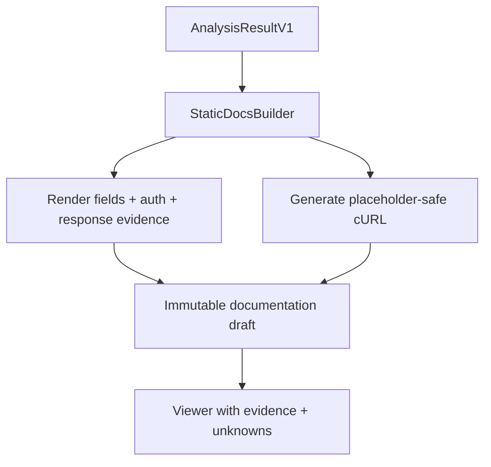

# P08 — Static API Documentation — First End-to-End Release

> **Universal Laravel API Documentation Generator** · Independent phase implementation guide  
> Plan revision: 2026-11-22 · Architecture: Laravel + React + Inertia · Analysis: static-first, AI optional

| Field | Value |
|---|---|
| Phase | **P08 / 16** |
| Estimated effort | **4–6 engineer-days** |
| Prerequisites | **P07** |
| Checkpoint | **M2 — usable without AI** |
| Feature flag | `static_docs` |
| Core persistence | documentation_versions (draft), documentation_evidence; analysis_id and snapshot_id immutable references |

[← Implementation index](README.md) · [Shared contracts](SHARED_CONTRACTS.md)

## 1. Goal and shippable result

**Why this phase exists:** Convert deterministic analysis facts into usable, shareable drafts and cURL examples with zero AI dependency.

**What a developer can demonstrably do afterward:** A user uploads ZIP → detects Laravel → scans APIs → selects endpoint → analyzes → generates and reads accurate static documentation.

**Out of scope:** AI-enhanced prose, publish approval lifecycle, automatic Git sync.

## 2. End-to-end feature workflow



### Workflow explained

1. The user selects a successful or partial analysis and clicks Generate Static Documentation. No provider settings are checked or needed.
2. A deterministic builder maps normalized facts into method/path, auth, headers, validation, inferred response schemas and explicitly unknown sections.
3. A cURL generator inserts only safe placeholders for host, token and illustrative values, with correct quoting.
4. The draft stores references to exact analysis and snapshot IDs and is rendered through the Inertia documentation view.
5. The permanent smoke path is **ZIP → detect → discover → analyze → static docs**. Every later phase must prove it still works with AI disabled.

## 3. Implementation plan in build order

### 3.1 Backend and infrastructure

1. Define StaticDocumentationBuilder accepting only validated AnalysisResultV1; no access to AI settings or external network.
2. Map method/path/auth/parameters/validation/response facts to stable documentation DTO and Markdown representation.
3. Generate cURL from contract using placeholders; escape shell text carefully; never use real bearer tokens or production customer payloads.
4. Persist draft with source snapshot, analysis ID, builder version, contract checksum and evidence mappings.
5. Keep old draft on regeneration; create a new draft/revision or safe deterministic idempotent result.
6. Expose explicit Unknown/Conditional/Inference banners instead of empty invented examples.

### 3.2 React + Inertia UI

1. Generate Static Documentation button with processing/success/failed states.
2. Documentation sections: Overview, Request, Headers, Validation, cURL, Responses, Evidence, Unknowns.
3. Copy cURL action, readable code blocks and source-link permissions.

### 3.3 Proposed routes and interfaces

The following are **design targets**, not routes already implemented. Keep naming and authorization consistent with your project's selected route conventions.

```text
POST /analyses/{analysis}/static-documentation
GET /documentation/{revision}
GET /endpoints/{endpoint}/documentation
```

### 3.4 Database and migration strategy

Create or extend: **documentation_versions (draft), documentation_evidence; analysis_id and snapshot_id immutable references**. Use foreign keys and indexes for workspace/project/snapshot identity; add columns and tables before changing readers. Do not drop older fields or mutate published/snapshot data during rollout. Confirm a matching migration and model factory exists for each new entity.

## 4. Original engineering tickets

- [ ] `P8-F01` Deterministically transform `AnalysisResultV1` into typed documentation sections.
- [ ] `P8-F02` Generate cURL from known method/path/headers/fields using placeholders rather than real credentials or production data.
- [ ] `P8-F03` Display field requirements, inferred response schemas, errors, middleware and evidence.
- [ ] `P8-F04` Persist static documentation draft plus source snapshot and analyzer version.
- [ ] `P8-F05` Add document view/edit basics; make empty/incomplete sections clearly visible.
- [ ] `P8-F06` Complete ZIP → scan → pick API → analyze → generate → read automated E2E test.

## 5. Design notes, contracts and examples

### Deterministic documentation output contract

- **Endpoint:** verb, URL template, route action and source identity.
- **Request:** path/query/body fields with required/nullable/conditional rules.
- **Authentication:** extracted guard/middleware signals and known headers.
- **Responses:** only known status/schema structure, marked inferred where appropriate.
- **cURL:** valid shell quoting with `YOUR_TOKEN`, `BASE_URL` and explicitly illustrative values.
- **Evidence:** exact file + lines in original immutable snapshot.
- **Unknowns:** dynamic rules, runtime-dependent values, unsupported routes.

Static docs are a durable product, not a temporary placeholder waiting for AI.


## 6. Test plan (must pass before merge)

- [ ] Full end-to-end flow passes with no workspace AI configuration rows.
- [ ] Generated cURL contains placeholder credential, valid escaping and no secrets.
- [ ] Source snapshot hash and analysis result displayed in doc provenance.
- [ ] Old draft remains accessible when a newer analysis generates another draft.

### Failure and recovery cases

- **Partial analysis:** partial but honest docs, with warning.
- **Static builder fails:** prior draft remains intact and user can retry.
- **Missing AI configuration:** completely irrelevant to this path.

## 7. Manual acceptance walkthrough

1. Start with a freshly migrated, authenticated development workspace; record a baseline test run and current feature flags.
2. Perform the workflow above using a controlled fixture that exercises **Static documentation generator**.
3. Confirm the final observable result: **A user uploads ZIP → detects Laravel → scans APIs → selects endpoint → analyzes → generates and reads accurate static documentation.**
4. Repeat one negative or unauthorized case and confirm a safe, actionable error without data leakage.
5. Disable the new feature flag (when available) and verify earlier completed features continue to work.

## 8. Compatibility and no-breakage checks

- [ ] The full earlier-phase smoke suite remains green, especially cross-workspace authorization.
- [ ] The P08 ZIP → detect → discover → analyze → static docs flow remains available once P08 exists.
- [ ] No new source execution or untrusted PHP bootstrapping has been introduced.
- [ ] All new long-running work uses authorized, retry-safe jobs and immutable snapshots where applicable.
- [ ] No new Inertia props, logs, job payloads or exports leak credentials or unauthorized source snippets.
- [ ] Feature flag defaults to **off** outside the pilot workspace until testing is complete.
- [ ] Release/migration is backwards-compatible; rollback requires no destructive data edits.

## 9. Release checkpoint and rollback

**Release sequence**

1. Merge code behind `static_docs` (where applicable); apply only additive migrations.
2. Deploy with flag disabled; verify baseline backend tests and React build.
3. Enable for a staging workspace and complete the manual walkthrough.
4. Check structured errors, queue lag, access denials, and relevant metrics.
5. Enable for a controlled internal workspace, then record outcome and limitations.

**Rollback:** Missing AI configuration → completely irrelevant to this path.

**Definition of Done:** A user uploads ZIP → detects Laravel → scans APIs → selects endpoint → analyzes → generates and reads accurate static documentation. Automated tests, authorization tests, and the regression baseline pass. The feature can be disabled without corrupting or hiding earlier data.

## 10. Handoff to the next phase

First durable customer value: an end-to-end non-AI pipeline against imported ZIPs. This must remain the golden regression path forever.

**Do not start the next dependent phase until the above checkpoint is met.**
