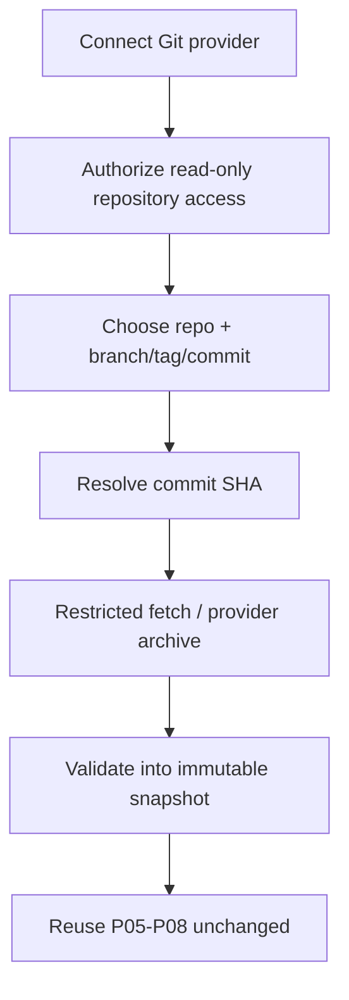

# P09 — Authenticated Git Repository Import

> **Universal Laravel API Documentation Generator** · Independent phase implementation guide  
> Plan revision: 2026-11-22 · Architecture: Laravel + React + Inertia · Analysis: static-first, AI optional

| Field | Value |
|---|---|
| Phase | **P09 / 16** |
| Estimated effort | **5–8 engineer-days** |
| Prerequisites | **P03 + proven P08 vertical slice** |
| Checkpoint | **M3 — ZIP/Git parity** |
| Feature flag | `git_import` |
| Core persistence | project_sources Git provider fields, connection metadata and source_snapshots Git SHA references |

[← Implementation index](README.md) · [Shared contracts](SHARED_CONTRACTS.md)

Detailed GitHub-only build guide: [Multi-tenant GitHub Private Repository Integration](P09_github_private_repository_implementation.md)

## 1. Goal and shippable result

**Why this phase exists:** Add Git as a second authorized source provider, reusing the same immutable snapshot and analyzer pipeline as ZIP.

**What a developer can demonstrably do afterward:** A developer chooses an authorized repository/ref, imports a commit, then sees exactly the same API Explorer and documentation flow.

**Out of scope:** Automatic repo webhooks, pull request checks, continuous sync, arbitrary self-hosted Git servers.

## 2. End-to-end feature workflow



### Workflow explained

1. The developer connects a Git provider through a scoped authorization process (for example, a GitHub App), then selects an accessible repository.
2. They choose branch, tag or commit; the backend resolves that ref to an immutable commit SHA **before** fetching content.
3. A restricted provider fetch worker obtains the source and passes it through the same validation/manifest/snapshot service used by ZIP.
4. The user continues into Laravel detection, discovery and documentation exactly as before. There must be no special Git-only analyzer path.
5. Credential revocation or provider outages block new fetches but must not make historical approved docs disappear.

## 3. Implementation plan in build order

### 3.1 Backend and infrastructure

1. Prefer GitHub App installation with minimal repository-read permissions; add GitLab provider adapter via its supported auth integration.
2. Use provider allowlist; reject arbitrary Git schemes/hosts for MVP and avoid passing URLs into shell commands.
3. Resolve branch or tag to immutable commit SHA; persist provider repository ID and ref metadata separately.
4. Perform fetching in a restricted worker; validate downloaded archive and build identical snapshot manifest to ZIP provider.
5. Prevent leaks of OAuth/Git credentials into job payloads, Inertia props, logs, snapshots and AI contexts.
6. Deduplicate same repository+commit import; a changed branch creates a new snapshot, not mutation of old snapshot.

### 3.2 React + Inertia UI

1. Source method tabs: ZIP | Git Repository; read-only connection status and Connect action.
2. Provider repository picker, branch/ref chooser, import status and linked source snapshot details.
3. If provider disabled/unavailable, ZIP path stays visible and usable.

### 3.3 Proposed routes and interfaces

The following are **design targets**, not routes already implemented. Keep naming and authorization consistent with your project's selected route conventions.

```text
GET /settings/git/connections
POST /settings/git/connect
GET /projects/{project}/git/repositories
POST /projects/{project}/git-imports
GET /projects/{project}/imports/{run}
```

### 3.4 Database and migration strategy

Create or extend: **project_sources Git provider fields, connection metadata and source_snapshots Git SHA references**. Use foreign keys and indexes for workspace/project/snapshot identity; add columns and tables before changing readers. Do not drop older fields or mutate published/snapshot data during rollout. Confirm a matching migration and model factory exists for each new entity.

## 4. Original engineering tickets

- [ ] `P9-F01` OAuth/GitHub App-style read-only integration and scoped repository selection.
- [ ] `P9-F02` GitLab adapter with equivalent minimal-scoped auth where support is available.
- [ ] `P9-F03` Select branch/tag/commit, resolve immutable commit SHA and save provider ID.
- [ ] `P9-F04` Use allowlisted provider endpoints and isolated fetch worker; no arbitrary shell Git URLs or user-provided executable hooks.
- [ ] `P9-F05` Feed downloaded source through P3 snapshot interface and reuse P5–P8 unchanged.
- [ ] `P9-F06` Re-import same commit is idempotent; detect changed commit without overwriting old docs.

## 5. Design notes, contracts and examples

### ZIP/Git parity contract

Implement `GitSourceProvider` behind the same `SourceProvider` abstraction used by ZIP. Route discovery must take a `SourceSnapshot` and never branch on `source_type`.

**Git permissions:** prefer GitHub App installation scoped to selected repositories and readonly contents/metadata permissions. For GitLab, design equivalent scoped provider behavior. Use a tightly limited repository chooser instead of asking users to paste long-lived personal access tokens into the form.

**Future (not MVP):** Webhooks, auto-rescans, pull-request decorations and repository change notifications.


## 6. Test plan (must pass before merge)

- [ ] Same Laravel source imported via ZIP and Git yields equivalent normalized discovery results.
- [ ] Private repository only accessible with authorized installation and workspace role.
- [ ] Remote branch advances during import: snapshot remains tied to resolved SHA.
- [ ] Revoking integration prevents new imports but does not destroy approved historical snapshot/docs.

### Failure and recovery cases

- **OAuth denied:** safe provider error, preserve project draft.
- **Repository not found/permission revoked:** no snapshot and clear recovery action.
- **Git provider outage/rate limit:** retry within bounds, ZIP unaffected.
- **Disallowed host/protocol:** reject SSRF-prone input.

## 7. Manual acceptance walkthrough

1. Start with a freshly migrated, authenticated development workspace; record a baseline test run and current feature flags.
2. Perform the workflow above using a controlled fixture that exercises **Git repository import**.
3. Confirm the final observable result: **A developer chooses an authorized repository/ref, imports a commit, then sees exactly the same API Explorer and documentation flow.**
4. Repeat one negative or unauthorized case and confirm a safe, actionable error without data leakage.
5. Disable the new feature flag (when available) and verify earlier completed features continue to work.

## 8. Compatibility and no-breakage checks

- [ ] The full earlier-phase smoke suite remains green, especially cross-workspace authorization.
- [ ] The P08 ZIP → detect → discover → analyze → static docs flow remains available once P08 exists.
- [ ] No new source execution or untrusted PHP bootstrapping has been introduced.
- [ ] All new long-running work uses authorized, retry-safe jobs and immutable snapshots where applicable.
- [ ] No new Inertia props, logs, job payloads or exports leak credentials or unauthorized source snippets.
- [ ] Feature flag defaults to **off** outside the pilot workspace until testing is complete.
- [ ] Release/migration is backwards-compatible; rollback requires no destructive data edits.

## 9. Release checkpoint and rollback

**Release sequence**

1. Merge code behind `git_import` (where applicable); apply only additive migrations.
2. Deploy with flag disabled; verify baseline backend tests and React build.
3. Enable for a staging workspace and complete the manual walkthrough.
4. Check structured errors, queue lag, access denials, and relevant metrics.
5. Enable for a controlled internal workspace, then record outcome and limitations.

**Rollback:** Disallowed host/protocol → reject SSRF-prone input.

**Definition of Done:** A developer chooses an authorized repository/ref, imports a commit, then sees exactly the same API Explorer and documentation flow. Automated tests, authorization tests, and the regression baseline pass. The feature can be disabled without corrupting or hiding earlier data.

## 10. Handoff to the next phase

Two interchangeable source providers yielding identical snapshot contracts; downstream analyzers remain source-agnostic.

**Do not start the next dependent phase until the above checkpoint is met.**
