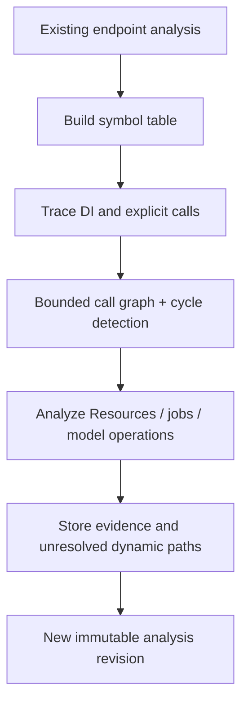

# P10 — Advanced Laravel Source & Workflow Analysis

> **Universal Laravel API Documentation Generator** · Independent phase implementation guide  
> Plan revision: 2026-11-22 · Architecture: Laravel + React + Inertia · Analysis: static-first, AI optional

| Field | Value |
|---|---|
| Phase | **P10 / 16** |
| Estimated effort | **7–11 engineer-days** |
| Prerequisites | **P07 and P08** |
| Checkpoint | **Business-logic evidence expanded** |
| Feature flag | `advanced_analysis` |
| Core persistence | api_dependencies, cached extracted symbols or analysis extension fields (additive) |

[← Implementation index](README.md) · [Shared contracts](SHARED_CONTRACTS.md)

## 1. Goal and shippable result

**Why this phase exists:** Improve deterministic evidence of complex Laravel business logic, services, conditional resources and side effects.

**What a developer can demonstrably do afterward:** Endpoint analysis includes a bounded call graph, service/model/job relationships and conditional response semantics, without breaking v1 docs.

**Out of scope:** Executing business rules against databases, full symbolic program execution, live API debugging.

## 2. End-to-end feature workflow



### Workflow explained

1. Given a versioned P07 analysis, the advanced analyzer builds symbol indexes for controller, service, resource and model code within the same snapshot.
2. It follows only statically resolvable call edges through injected services and explicit invocations, with bounds for depth/fanout/time and cycle detection.
3. It records conditional `JsonResource` fields, potential model reads/writes, queued jobs, events and exception paths as typed, source-backed relationships.
4. Unresolvable dynamic container bindings, runtime-dependent branches and asynchronous ordering remain visible limitations.
5. The result is stored as a **new** analysis revision using v1-compatible optional fields or an explicit v2 adapter; P08 documents remain renderable.

## 3. Implementation plan in build order

### 3.1 Backend and infrastructure

1. Resolve constructor-injected and direct service call edges through AST symbol indexing; retain ambiguity for container dynamic resolution.
2. Bound graph depth, fanout, total symbols and worker runtime; detect cycles and polymorphic/dynamic dispatch.
3. Analyze JsonResource::toArray fields, when/whenLoaded/mergeWhen conditions and show presence conditions instead of absolute fields.
4. Capture model reads/writes, queue dispatch, events, exception/response branches as evidence-backed side effects.
5. Add normalized dependency records with source evidence and conditional/unknown classifications.
6. Add optional v1 fields or explicit v2 adapter; never repurpose existing field semantics.

### 3.2 React + Inertia UI

1. Dependency graph/tree with node types and searchable source references.
2. Workflow summary with conditional branches and explicit unknown/async badges.
3. Compare basic vs advanced analysis and show improved coverage without inventing a confidence probability.

### 3.3 Proposed routes and interfaces

The following are **design targets**, not routes already implemented. Keep naming and authorization consistent with your project's selected route conventions.

```text
POST /endpoints/{endpoint}/analyses?profile=advanced
GET /analyses/{analysis}/dependencies
GET /analyses/{analysis}/findings
```

### 3.4 Database and migration strategy

Create or extend: **api_dependencies, cached extracted symbols or analysis extension fields (additive)**. Use foreign keys and indexes for workspace/project/snapshot identity; add columns and tables before changing readers. Do not drop older fields or mutate published/snapshot data during rollout. Confirm a matching migration and model factory exists for each new entity.

## 4. Original engineering tickets

- [ ] `P10-F01` Resolve service constructor injection, explicit method calls and invokable actions.
- [ ] `P10-F02` Trace bounded dependency graph with cycle detection, depth/call limits and unresolved dispatch diagnostics.
- [ ] `P10-F03` Analyze API Resources: `toArray`, `when`, `whenLoaded`, conditional fields.
- [ ] `P10-F04` Identify literal exception/status paths, model operations, job dispatches and integration boundaries.
- [ ] `P10-F05` Add deterministic coverage/completeness report; reanalysis produces a new immutable result.
- [ ] `P10-F06` Preserve compatibility with `AnalysisResultV1` (new nullable fields), introducing v2 only for a breaking schema change with a migration adapter.

## 5. Design notes, contracts and examples

### Dependency relationships to support

| Edge | Example | Interpretation |
|---|---|---|
| `handled_by` | Route → Controller method | Static routing |
| `validates_with` | Controller → FormRequest | Declared request validation |
| `calls` | Controller → Service method | Source-backed call edge |
| `reads_from` / `writes_to` | Service → Model | Inferred persistence interaction |
| `dispatches` | Service → Job/Event | Potential async side effect |
| `responds_with` | Controller → API Resource | Serialized output candidate |

Do not infer temporal order across queued jobs unless source evidence supports it. Store source refs and whether a relation is conditional.


## 6. Test plan (must pass before merge)

- [ ] Service chain tracing maps controller → service → model and queued job; no duplicated recursive edges.
- [ ] Resource conditional fields are not declared always-present.
- [ ] Polymorphic container binding marked unresolved when not statically provable.
- [ ] Existing P08 documentation from v1 renders unchanged after advanced extension.

### Failure and recovery cases

- **Graph explosion/recursive cycle:** stop at bounds, emit partial coverage and preserve evidence.
- **Incompatible library/parser version:** run fallback basic analyzer and report unsupported feature.
- **Unknown dynamic call:** do not hallucinate a target service.

## 7. Manual acceptance walkthrough

1. Start with a freshly migrated, authenticated development workspace; record a baseline test run and current feature flags.
2. Perform the workflow above using a controlled fixture that exercises **Advanced Laravel analysis**.
3. Confirm the final observable result: **Endpoint analysis includes a bounded call graph, service/model/job relationships and conditional response semantics, without breaking v1 docs.**
4. Repeat one negative or unauthorized case and confirm a safe, actionable error without data leakage.
5. Disable the new feature flag (when available) and verify earlier completed features continue to work.

## 8. Compatibility and no-breakage checks

- [ ] The full earlier-phase smoke suite remains green, especially cross-workspace authorization.
- [ ] The P08 ZIP → detect → discover → analyze → static docs flow remains available once P08 exists.
- [ ] No new source execution or untrusted PHP bootstrapping has been introduced.
- [ ] All new long-running work uses authorized, retry-safe jobs and immutable snapshots where applicable.
- [ ] No new Inertia props, logs, job payloads or exports leak credentials or unauthorized source snippets.
- [ ] Feature flag defaults to **off** outside the pilot workspace until testing is complete.
- [ ] Release/migration is backwards-compatible; rollback requires no destructive data edits.

## 9. Release checkpoint and rollback

**Release sequence**

1. Merge code behind `advanced_analysis` (where applicable); apply only additive migrations.
2. Deploy with flag disabled; verify baseline backend tests and React build.
3. Enable for a staging workspace and complete the manual walkthrough.
4. Check structured errors, queue lag, access denials, and relevant metrics.
5. Enable for a controlled internal workspace, then record outcome and limitations.

**Rollback:** Unknown dynamic call → do not hallucinate a target service.

**Definition of Done:** Endpoint analysis includes a bounded call graph, service/model/job relationships and conditional response semantics, without breaking v1 docs. Automated tests, authorization tests, and the regression baseline pass. The feature can be disabled without corrupting or hiding earlier data.

## 10. Handoff to the next phase

Richer immutable evidence and dependency graphs for AI summaries without compromising static contracts.

**Do not start the next dependent phase until the above checkpoint is met.**
