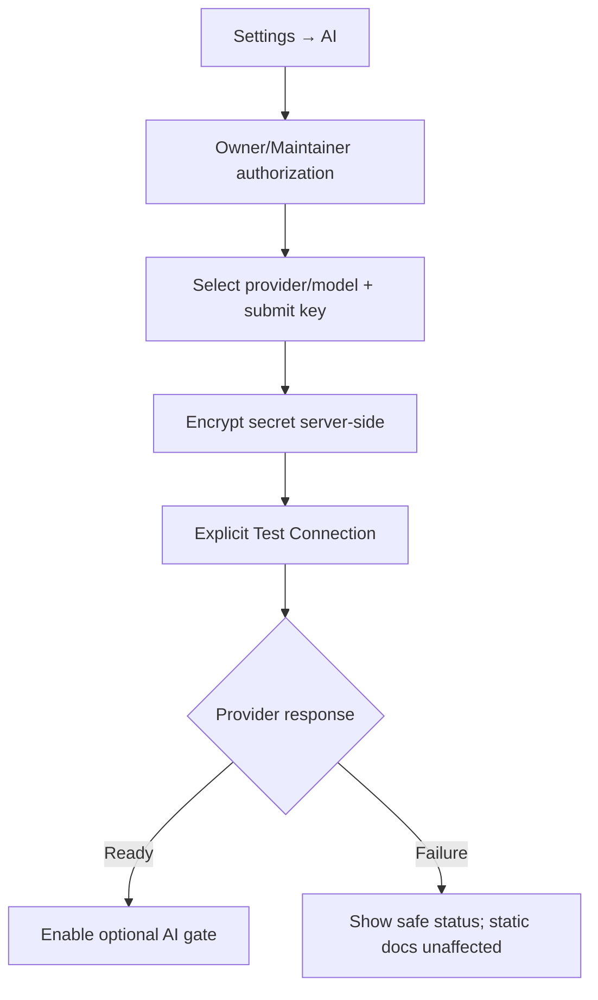

# P11 — AI Provider Settings, Credentials & Health

> **Universal Laravel API Documentation Generator** · Independent phase implementation guide  
> Plan revision: 2026-11-22 · Architecture: Laravel + React + Inertia · Analysis: static-first, AI optional

| Field | Value |
|---|---|
| Phase | **P11 / 16** |
| Estimated effort | **4–6 engineer-days** |
| Prerequisites | **P01; integrate into P08 baseline** |
| Checkpoint | **AI optional and safely configurable** |
| Feature flag | `ai_settings` |
| Core persistence | workspace_ai_configs, ai_config_checks; unique workspace_id+provider |

[← Implementation index](README.md) · [Shared contracts](SHARED_CONTRACTS.md)

## 1. Goal and shippable result

**Why this phase exists:** Make AI enhancement opt-in with workspace-level credential security, provider status and failure-safe access checks.

**What a developer can demonstrably do afterward:** Owner/Maintainer can save/replace/remove key, select allowed model, test connection and see accurate state; all static features work without a key.

**Out of scope:** AI-generated narrative, model fine-tuning, multi-provider failover, storing keys in the browser.

## 2. End-to-end feature workflow



### Workflow explained

1. An Owner/Maintainer opens Workspace Settings → AI Configuration and chooses a supported provider/model. A new key is submitted once over a protected Laravel form.
2. The backend validates configuration, encrypts the credential server-side and returns only masked/configured status. The raw key never appears in Inertia props or queue payloads.
3. Test Connection makes a bounded, throttled server-to-provider request, then maps the actual provider response to a safe health state.
4. The AI availability gate allows generation only when configured and operational; invalid credentials, quota/rate limits and outages produce distinct messages.
5. Removing/rotating the key never changes existing static analyses, static documentation or published documents.

## 3. Implementation plan in build order

### 3.1 Backend and infrastructure

1. Introduce AiProviderAdapter testConnection/generate; start with one provider and an allowlisted model set.
2. Store credentials encrypted or in a managed secret store; no raw key in Inertia props, logs, queue payloads, exception traces or snapshots.
3. Expose write-only key replacement: return configured boolean, masked suffix, health status and last check, never plaintext value.
4. Classify statuses not_configured, unchecked, ready, invalid_credentials, quota_exceeded, rate_limited, provider_unavailable, misconfigured.
5. Apply authorization and throttling to Test Connection; use a server-side adapter with fixed trusted endpoint and timeouts.
6. Resolve credentials in worker by workspace config ID; bind config version to running jobs to avoid stale-key misuse; support disable/remove.
7. Do not claim key expired based on a timeout; distinguish rejected/revoked from provider-specific expiry information.

### 3.2 React + Inertia UI

1. Workspace Settings → AI Configuration: provider/model, mask key, Replace, Remove, Test Connection, enabled toggle.
2. Informational banner about transmission of relevant sanitized source evidence to provider.
3. Status badge, last test time, diagnostic copy and links to static docs when AI not available.

### 3.3 Proposed routes and interfaces

The following are **design targets**, not routes already implemented. Keep naming and authorization consistent with your project's selected route conventions.

```text
GET /settings/ai
PUT /settings/ai
POST /settings/ai/test
DELETE /settings/ai/key
PATCH /settings/ai/enabled
```

### 3.4 Database and migration strategy

Create or extend: **workspace_ai_configs, ai_config_checks; unique workspace_id+provider**. Use foreign keys and indexes for workspace/project/snapshot identity; add columns and tables before changing readers. Do not drop older fields or mutate published/snapshot data during rollout. Confirm a matching migration and model factory exists for each new entity.

## 4. Original engineering tickets

- [ ] `P11-F01` Settings → AI Provider React/Inertia screen, accessible to Owner/Maintainer only.
- [ ] `P11-F02` Provider adapter abstraction (`testConnection`, `generate`), initially one supported provider.
- [ ] `P11-F03` Encrypt credentials at rest; mask in UI; never send them in Inertia props, logs, or browser-side provider calls.
- [ ] `P11-F04` Save/replace/remove key and model selection; explicit, throttled Test Connection.
- [ ] `P11-F05` Persist provider health and last check with state taxonomy and safe error codes.
- [ ] `P11-F06` Add `AiAvailabilityGate`: `available`, `not_configured`, `invalid`, `quota_exceeded`, `rate_limited`, `temporarily_unavailable`, `unknown`.
- [ ] `P11-F07` Preserve static docs UI for every failure state; never retroactively mark static docs failed.

## 5. Design notes, contracts and examples

### AI configuration state machine

| State | Condition | UI | AI generator |
|---|---|---|---|
| `not_configured` | No key | Configure AI | Skip; static works |
| `unchecked` | New/rotated key not tested | Test Connection | Validate according to policy |
| `ready` | Provider test succeeds | Connected | May generate |
| `invalid_credentials` | Provider rejects credential | Replace key | Stop new calls |
| `quota_exceeded` | Billing/quota failure | Fix quota | Stop/retry only after change |
| `rate_limited` | Throttle response | Try later | Bounded backoff |
| `provider_unavailable` | Network/timeout/5xx | Temporary outage | Bounded retry then fallback |
| `misconfigured` | Unsupported provider/model | Correct settings | Block AI only |

**Expired key:** only label it expired if provider provides explicit expiry metadata. Otherwise show *invalid or revoked credentials* (or unknown if ambiguous).

### Inertia props policy

```json
{
  "provider": "openai",
  "model": "configured-model-id",
  "configured": true,
  "masked_key_suffix": "...1234",
  "status": "unchecked",
  "last_checked_at": null
}
```

**Never** serialize or return the plaintext key or encrypted ciphertext to Inertia. Encrypted at rest is not enough if it leaks through logs or queue payloads.


## 6. Test plan (must pass before merge)

- [ ] Zero config rows: P08 static docs still generate and read.
- [ ] Invalid key, quota, 429, 5xx and timeout map to distinct safe states.
- [ ] API key never appears in Inertia responses, app logs, queued job payloads or audit events.
- [ ] User from other workspace cannot test/change provider settings or infer suffix.
- [ ] Key rotation while job pending has defined version-mismatch/revalidation behavior.

### Failure and recovery cases

- **Test times out:** provider_unavailable, never automatically say expired.
- **Auth failure:** invalid_credentials, disable new AI generation until updated.
- **Rate limit/quota:** do not spin infinite jobs; allow static workflow.
- **Application encryption key rotation plan must preserve ability to decrypt stored secrets or rekey securely.:** Application encryption key rotation plan must preserve ability to decrypt stored secrets or rekey securely.

## 7. Manual acceptance walkthrough

1. Start with a freshly migrated, authenticated development workspace; record a baseline test run and current feature flags.
2. Perform the workflow above using a controlled fixture that exercises **AI configuration module**.
3. Confirm the final observable result: **Owner/Maintainer can save/replace/remove key, select allowed model, test connection and see accurate state; all static features work without a key.**
4. Repeat one negative or unauthorized case and confirm a safe, actionable error without data leakage.
5. Disable the new feature flag (when available) and verify earlier completed features continue to work.

## 8. Compatibility and no-breakage checks

- [ ] The full earlier-phase smoke suite remains green, especially cross-workspace authorization.
- [ ] The P08 ZIP → detect → discover → analyze → static docs flow remains available once P08 exists.
- [ ] No new source execution or untrusted PHP bootstrapping has been introduced.
- [ ] All new long-running work uses authorized, retry-safe jobs and immutable snapshots where applicable.
- [ ] No new Inertia props, logs, job payloads or exports leak credentials or unauthorized source snippets.
- [ ] Feature flag defaults to **off** outside the pilot workspace until testing is complete.
- [ ] Release/migration is backwards-compatible; rollback requires no destructive data edits.

## 9. Release checkpoint and rollback

**Release sequence**

1. Merge code behind `ai_settings` (where applicable); apply only additive migrations.
2. Deploy with flag disabled; verify baseline backend tests and React build.
3. Enable for a staging workspace and complete the manual walkthrough.
4. Check structured errors, queue lag, access denials, and relevant metrics.
5. Enable for a controlled internal workspace, then record outcome and limitations.

**Rollback:** Application encryption key rotation plan must preserve ability to decrypt stored secrets or rekey securely.

**Definition of Done:** Owner/Maintainer can save/replace/remove key, select allowed model, test connection and see accurate state; all static features work without a key. Automated tests, authorization tests, and the regression baseline pass. The feature can be disabled without corrupting or hiding earlier data.

## 10. Handoff to the next phase

AiAvailabilityGate and provider configuration metadata available without any dependency from static-analysis modules.

**Do not start the next dependent phase until the above checkpoint is met.**
