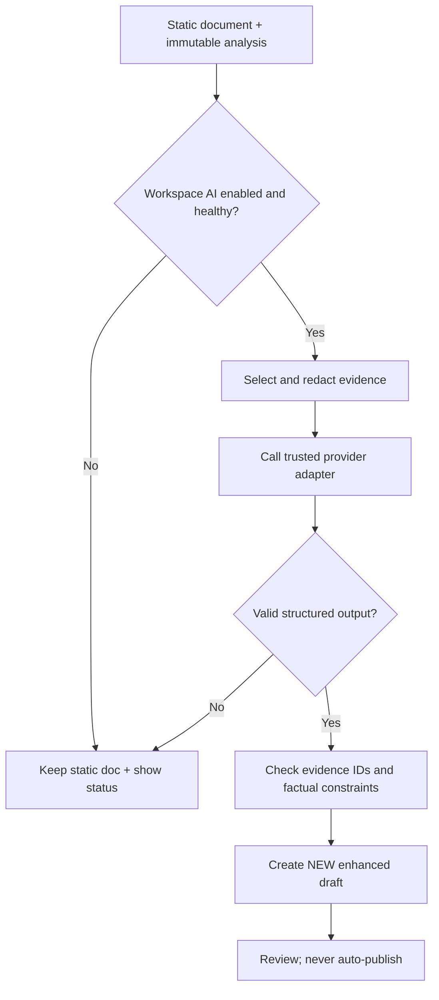

# P12 — Evidence-Grounded AI Documentation Enhancement

> **Universal Laravel API Documentation Generator** · Independent phase implementation guide  
> Plan revision: 2026-11-22 · Architecture: Laravel + React + Inertia · Analysis: static-first, AI optional

| Field | Value |
|---|---|
| Phase | **P12 / 16** |
| Estimated effort | **6–9 engineer-days** |
| Prerequisites | **P10 + P11 + P08** |
| Checkpoint | **M4 — optional AI** |
| Feature flag | `ai_enhancement` |
| Core persistence | generation_runs, nullable documentation_versions.ai_generation_id, provider usage metadata |

[← Implementation index](README.md) · [Shared contracts](SHARED_CONTRACTS.md)

## 1. Goal and shippable result

**Why this phase exists:** Generate business-logic narrative using a sanitized subset of deterministic evidence while preserving the static contract and fail-safe fallback.

**What a developer can demonstrably do afterward:** AI adds source-cited summary and workflow to a new draft; missing/invalid key or provider error leaves existing static docs untouched.

**Out of scope:** Repository-wide general chatbot, unlimited provider agents, AI-generated unverified required schemas.

## 2. End-to-end feature workflow



### Workflow explained

1. The user already has a deterministic static document from P08 and richer analysis evidence from P10. AI enhancement is a **separate optional action**.
2. The AI gate checks workspace enablement, credential health and permissions. Missing/invalid keys immediately return static docs with a safe explanation.
3. A context builder selects only relevant evidence, applies secret redaction and creates a structured provider request with immutable analysis references.
4. The provider response must satisfy a strict narrative JSON schema; the verifier rejects unknown evidence IDs, schema mutations and unsupported factual claims.
5. Only validated narrative becomes a **new draft** for review. Provider failures preserve original static draft and any published revision.

## 3. Implementation plan in build order

### 3.1 Backend and infrastructure

1. Create evidence-context selector with per-workspace permissions, snippet allowlist, size budget and secret redaction.
2. Pin prompt version and expected JSON schema; include snapshot hash, immutable analysis ID, source evidence IDs, provider/model and deterministic contract hash.
3. Generate only narrative fields (summary/workflow/business rules/unknowns) and citations; prevent LLM from editing method, URI, required request fields or verified response schemas.
4. Validate JSON schema, known evidence refs, length and claims consistent with structured analysis; reject/flag unsupported claims for review.
5. Persist generation run metadata (status, token usage, safe failure codes) and create separate enhanced draft revision.
6. Use bounded retries for transient 429/5xx and no retries for bad credentials or schema-invalid claims beyond a controlled policy.
7. Check current AI config/permissions within worker; never embed plaintext key in job serialization.

### 3.2 React + Inertia UI

1. Enhance with AI action only when allowed; always retain View Static Documentation.
2. Show provider availability/why disabled, processing state, evidence references and explicit unverified inferences.
3. On error display safe fallback copy, retry only when appropriate, and optionally Configure AI for authorized roles.

### 3.3 Proposed routes and interfaces

The following are **design targets**, not routes already implemented. Keep naming and authorization consistent with your project's selected route conventions.

```text
POST /analyses/{analysis}/ai-enhancements
GET /generations/{generation}
GET /documentation/{revision}
```

### 3.4 Database and migration strategy

Create or extend: **generation_runs, nullable documentation_versions.ai_generation_id, provider usage metadata**. Use foreign keys and indexes for workspace/project/snapshot identity; add columns and tables before changing readers. Do not drop older fields or mutate published/snapshot data during rollout. Confirm a matching migration and model factory exists for each new entity.

## 4. Original engineering tickets

- [ ] `P12-F01` Build allowlisted evidence-context selector; redact known secret types before provider egress.
- [ ] `P12-F02` Structured generation request includes analysis ID, snapshot hash, evidence IDs and prompt version.
- [ ] `P12-F03` LLM returns strictly validated JSON with `summary`, `workflow`, `business_rules`, `unknowns`, citations.
- [ ] `P12-F04` Validator rejects unrecognized evidence IDs and claims that contradict the deterministic contract.
- [ ] `P12-F05` Generate AI-enhanced **new draft**, preserving static draft and published revisions.
- [ ] `P12-F06` On missing/invalid key, quote/quota error, rate limit or timeout: show reason and retain/render deterministic docs.
- [ ] `P12-F07` Add workspace-level AI off switch and audit generated requests without logging prompt secrets.

## 5. Design notes, contracts and examples

### AI fallback decision table

| Condition | Required outcome |
|---|---|
| AI not configured/disabled | Keep and show static documentation |
| Invalid/revoked key | Stop AI attempts, direct authorized user to settings |
| Quota exceeded | Keep static docs and report quota limitation |
| Rate limited | Bounded retry; keep static visible |
| Provider timeout/outage | Bounded retry; preserve static draft |
| Invalid JSON / unknown evidence IDs | Reject AI narrative; keep static content |
| Successful, validated generation | Create separate AI-enhanced draft awaiting review |

Do **not** let model output modify immutable request/response facts. AI can explain and cite facts, but it must not fabricate required parameters, error codes, or executable cURL payloads.


## 6. Test plan (must pass before merge)

- [ ] No key: static docs remain usable and no provider call occurs.
- [ ] Provider 401/quota/429/timeout/invalid JSON → static doc preserved, safe status shown.
- [ ] Source comment containing prompt injection does not change required fields or instruct AI to reveal secrets.
- [ ] Unknown evidence ID / fabricated request field causes validation failure, not publication.
- [ ] Regenerate enhanced doc creates new draft, not overwrite published/static revision.

### Failure and recovery cases

- **AI unavailable:** status and fallback, no empty page.
- **AI output invalid:** reject narrative; preserve analysis and static docs.
- **Secret scanner flags snippet:** omit from prompt, mark limited context; fail closed when needed.

## 7. Manual acceptance walkthrough

1. Start with a freshly migrated, authenticated development workspace; record a baseline test run and current feature flags.
2. Perform the workflow above using a controlled fixture that exercises **AI documentation enhancement**.
3. Confirm the final observable result: **AI adds source-cited summary and workflow to a new draft; missing/invalid key or provider error leaves existing static docs untouched.**
4. Repeat one negative or unauthorized case and confirm a safe, actionable error without data leakage.
5. Disable the new feature flag (when available) and verify earlier completed features continue to work.

## 8. Compatibility and no-breakage checks

- [ ] The full earlier-phase smoke suite remains green, especially cross-workspace authorization.
- [ ] The P08 ZIP → detect → discover → analyze → static docs flow remains available once P08 exists.
- [ ] No new source execution or untrusted PHP bootstrapping has been introduced.
- [ ] All new long-running work uses authorized, retry-safe jobs and immutable snapshots where applicable.
- [ ] No new Inertia props, logs, job payloads or exports leak credentials or unauthorized source snippets.
- [ ] Feature flag defaults to **off** outside the pilot workspace until testing is complete.
- [ ] Release/migration is backwards-compatible; rollback requires no destructive data edits.

## 9. Release checkpoint and rollback

**Release sequence**

1. Merge code behind `ai_enhancement` (where applicable); apply only additive migrations.
2. Deploy with flag disabled; verify baseline backend tests and React build.
3. Enable for a staging workspace and complete the manual walkthrough.
4. Check structured errors, queue lag, access denials, and relevant metrics.
5. Enable for a controlled internal workspace, then record outcome and limitations.

**Rollback:** Secret scanner flags snippet → omit from prompt, mark limited context; fail closed when needed.

**Definition of Done:** AI adds source-cited summary and workflow to a new draft; missing/invalid key or provider error leaves existing static docs untouched. Automated tests, authorization tests, and the regression baseline pass. The feature can be disabled without corrupting or hiding earlier data.

## 10. Handoff to the next phase

Optional, untrusted AI narrative stored as a separate draft, ready for human review and publication workflow.

**Do not start the next dependent phase until the above checkpoint is met.**
