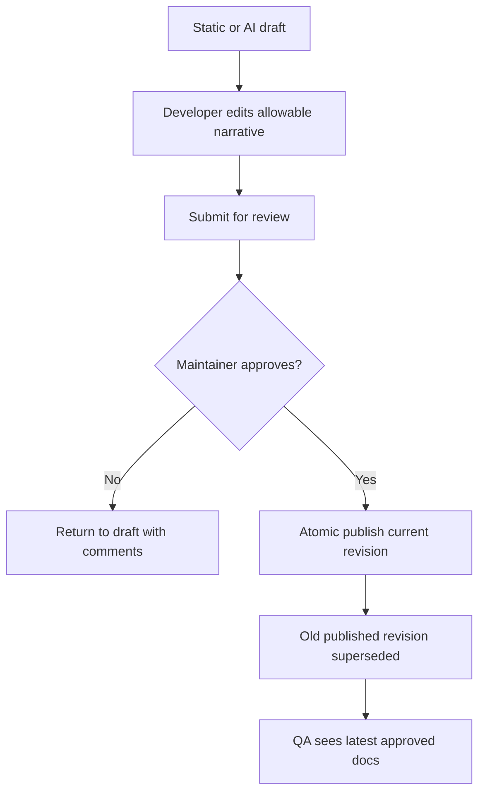

# P13 — Documentation Review, Revision History & Publishing

> **Universal Laravel API Documentation Generator** · Independent phase implementation guide  
> Plan revision: 2026-11-22 · Architecture: Laravel + React + Inertia · Analysis: static-first, AI optional

| Field | Value |
|---|---|
| Phase | **P13 / 16** |
| Estimated effort | **5–7 engineer-days** |
| Prerequisites | **P08 + P12 (static publishing still independent of AI)** |
| Checkpoint | **Approval-controlled published docs** |
| Feature flag | `documentation_publish` |
| Core persistence | documentation review events, publication pointer/current revision, reviewer metadata |

[← Implementation index](README.md) · [Shared contracts](SHARED_CONTRACTS.md)

## 1. Goal and shippable result

**Why this phase exists:** Ensure frontline teams use only approved, immutable documentation and can identify the exact source version.

**What a developer can demonstrably do afterward:** A reviewer can approve and publish a static or enhanced draft, retain history, and compare revisions without mutating past published content.

**Out of scope:** Public unauthenticated publishing, automatic publication of AI outputs, collaborative simultaneous editing.

## 2. End-to-end feature workflow



### Workflow explained

1. A Developer edits permissible documentation narrative and submits a snapshot-bound draft for review.
2. A Maintainer/Owner sees evidence, differences from the prior revision, unresolved findings and the pinned source version, then approves or rejects.
3. Publication is a transaction: update exactly one current-revision pointer for the chosen logical endpoint scope and supersede the previous published revision.
4. Published content is immutable. New analysis or AI enhancement creates a new draft that cannot silently replace what QA already uses.
5. Reader roles see approved documentation only, and source-line navigation remains separately permission-checked.

## 3. Implementation plan in build order

### 3.1 Backend and infrastructure

1. Define allowed transitions draft → in_review → published → superseded with permission guards and audit events.
2. Protect deterministic contract fields from silent manual edits; if override allowed, require justification and reviewer attribution.
3. Store immutable revisions with analysis and snapshot IDs; never modify published content.
4. Use transaction/locking or compare-and-swap so only one current published version per defined project+endpoint scope.
5. Require authorization to view code evidence even if documentation itself is viewable to QA.
6. Support static-only review/publish independent of AI provider status.

### 3.2 React + Inertia UI

1. Document editor with protected contract fields and editable explanations; clear evidence panel.
2. Submit Review, Reviewer inbox, Approve/Reject and Publish actions.
3. Revision History and Compare Changes with source commit/snapshot badges.
4. Published/Outdated banner when source is newer than published revision.

### 3.3 Proposed routes and interfaces

The following are **design targets**, not routes already implemented. Keep naming and authorization consistent with your project's selected route conventions.

```text
PATCH /documentation/{revision}
POST /documentation/{revision}/submit-review
POST /documentation/{revision}/approve
POST /documentation/{revision}/reject
POST /documentation/{revision}/publish
GET /endpoints/{endpoint}/documentation/history
```

### 3.4 Database and migration strategy

Create or extend: **documentation review events, publication pointer/current revision, reviewer metadata**. Use foreign keys and indexes for workspace/project/snapshot identity; add columns and tables before changing readers. Do not drop older fields or mutate published/snapshot data during rollout. Confirm a matching migration and model factory exists for each new entity.

## 4. Original engineering tickets

- [ ] `P13-F01` Draft → In Review → Published → Superseded lifecycle with authorization policies.
- [ ] `P13-F02` Editable documentation with deterministic contract sections protected or explicitly overridden with reviewer attribution.
- [ ] `P13-F03` Revision comparison: source snapshot, analysis version, text changes, published-by/at.
- [ ] `P13-F04` Publish as atomic transaction with exactly one current published revision per endpoint/snapshot or defined publication scope.
- [ ] `P13-F05` Render source references in code viewer only when current user is authorized to view source.
- [ ] `P13-F06` Static publish path works without any AI configuration.

## 5. Design notes, contracts and examples

### Publication invariants

1. A published version never changes in place.
2. A regenerated document is a new draft revision.
3. Publication is atomic and restricted to authorized approvers.
4. Reviewers see source snapshot/hash and analyzer version, including warnings.
5. QA readers cannot access raw source by following published evidence links unless explicitly authorized.
6. Static-only documents can be published even when AI configuration is broken or absent.

Define the scope of the “current published” pointer explicitly—for example `(project_id, logical_endpoint_key)` where a logical key groups method/URI across snapshots. The pointer must remain consistent under concurrent updates.


## 6. Test plan (must pass before merge)

- [ ] Two concurrent publish attempts yield exactly one current published revision.
- [ ] Unauthorized QA/Viewer cannot approve, publish or see restricted source evidence.
- [ ] AI outage does not prevent publishing reviewed static docs.
- [ ] New draft generation preserves previous published content and evidence.

### Failure and recovery cases

- **Reviewer rejects:** retains draft and review feedback, no publication pointer changed.
- **Source snapshot changed:** show stale banner, not silent relinking.
- **DB transaction failure:** no partially published state.

## 7. Manual acceptance walkthrough

1. Start with a freshly migrated, authenticated development workspace; record a baseline test run and current feature flags.
2. Perform the workflow above using a controlled fixture that exercises **Review, versions and publishing**.
3. Confirm the final observable result: **A reviewer can approve and publish a static or enhanced draft, retain history, and compare revisions without mutating past published content.**
4. Repeat one negative or unauthorized case and confirm a safe, actionable error without data leakage.
5. Disable the new feature flag (when available) and verify earlier completed features continue to work.

## 8. Compatibility and no-breakage checks

- [ ] The full earlier-phase smoke suite remains green, especially cross-workspace authorization.
- [ ] The P08 ZIP → detect → discover → analyze → static docs flow remains available once P08 exists.
- [ ] No new source execution or untrusted PHP bootstrapping has been introduced.
- [ ] All new long-running work uses authorized, retry-safe jobs and immutable snapshots where applicable.
- [ ] No new Inertia props, logs, job payloads or exports leak credentials or unauthorized source snippets.
- [ ] Feature flag defaults to **off** outside the pilot workspace until testing is complete.
- [ ] Release/migration is backwards-compatible; rollback requires no destructive data edits.

## 9. Release checkpoint and rollback

**Release sequence**

1. Merge code behind `documentation_publish` (where applicable); apply only additive migrations.
2. Deploy with flag disabled; verify baseline backend tests and React build.
3. Enable for a staging workspace and complete the manual walkthrough.
4. Check structured errors, queue lag, access denials, and relevant metrics.
5. Enable for a controlled internal workspace, then record outcome and limitations.

**Rollback:** DB transaction failure → no partially published state.

**Definition of Done:** A reviewer can approve and publish a static or enhanced draft, retain history, and compare revisions without mutating past published content. Automated tests, authorization tests, and the regression baseline pass. The feature can be disabled without corrupting or hiding earlier data.

## 10. Handoff to the next phase

Versioned, approved, stable docs suitable for team readers and exporters.

**Do not start the next dependent phase until the above checkpoint is met.**
