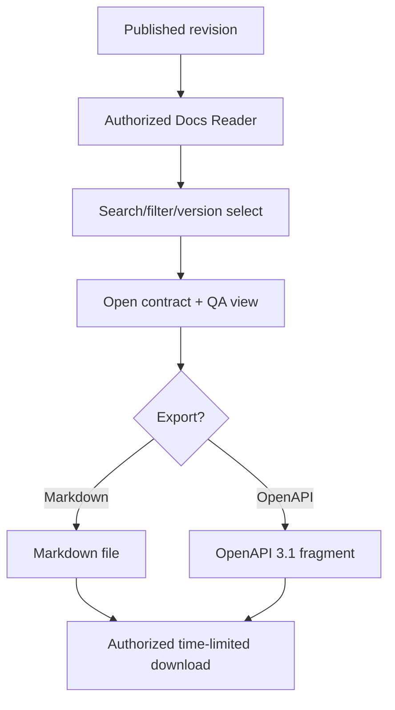

# P14 — OpenAPI/Markdown Export & Team Documentation Reader

> **Universal Laravel API Documentation Generator** · Independent phase implementation guide  
> Plan revision: 2026-11-22 · Architecture: Laravel + React + Inertia · Analysis: static-first, AI optional

| Field | Value |
|---|---|
| Phase | **P14 / 16** |
| Estimated effort | **3–5 engineer-days** |
| Prerequisites | **P13** |
| Checkpoint | **Frontend and QA self-service** |
| Feature flag | `documentation_export` |
| Core persistence | export_jobs or export_artifacts optional; access audit and storage key metadata |

[← Implementation index](README.md) · [Shared contracts](SHARED_CONTRACTS.md)

## 1. Goal and shippable result

**Why this phase exists:** Give frontend/mobile/web/QA a searchable read-only documentation experience and standards-based export of approved content.

**What a developer can demonstrably do afterward:** An authorized reader can find an approved API, understand its contract, copy safe cURL, and export valid Markdown/OpenAPI.

**Out of scope:** Public anonymous docs, Postman synchronization, interactive live API execution.

## 2. End-to-end feature workflow



### Workflow explained

1. An authorized QA/developer opens the team documentation reader and selects a project, API and published version.
2. The viewer uses approved source facts and explanations in role-appropriate presentations, without showing restricted raw source to QA.
3. Exporters render the **selected published revision**, not a transient latest draft, into sanitized Markdown or validated OpenAPI 3.1 where supported.
4. Generated export artifacts are private with short-lived authorized download links and audit records.
5. If a schema construct is unsupported, the exporter warns or omits it rather than inventing request fields or creating invalid OpenAPI.

## 3. Implementation plan in build order

### 3.1 Backend and infrastructure

1. Render only published revisions in team reader by default, with project/snapshot/version selectors.
2. Generate OpenAPI 3.1 operations only from supported verified/inferred contract fields, with extensions/warnings for uncertainty; validate generated spec.
3. Produce escaped Markdown with method, URI, headers, validation, cURL, response shapes, provenance and unknowns.
4. Require project-scoped authorization for all exports, downloads and link sharing; use short-lived private links.
5. Record export provenance: revision ID, format version, snapshot hash and content hash.
6. Offer QA-friendly overview from approved rules without revealing hidden source snippets.

### 3.2 React + Inertia UI

1. Published Docs index with search, group/filter by method/module/path and API version.
2. Two views: Developer contract and QA behavior/edge cases, both from same published revision.
3. Copy endpoint/cURL, Export Markdown, Export OpenAPI; clear unavailable/partial banners.

### 3.3 Proposed routes and interfaces

The following are **design targets**, not routes already implemented. Keep naming and authorization consistent with your project's selected route conventions.

```text
GET /projects/{project}/docs
GET /projects/{project}/docs/{revision}
POST /documentation/{revision}/exports
GET /exports/{export}/download
```

### 3.4 Database and migration strategy

Create or extend: **export_jobs or export_artifacts optional; access audit and storage key metadata**. Use foreign keys and indexes for workspace/project/snapshot identity; add columns and tables before changing readers. Do not drop older fields or mutate published/snapshot data during rollout. Confirm a matching migration and model factory exists for each new entity.

## 4. Original engineering tickets

- [ ] `P14-F01` Export validated supported fields/statuses as OpenAPI 3.1; warn about omissions/inferences.
- [ ] `P14-F02` Markdown export with endpoint identity, payloads, cURL, response schemas, source evidence and warnings.
- [ ] `P14-F03` Searchable published docs view with endpoint filters, auth, version and project selectors.
- [ ] `P14-F04` Authorized short-lived export/download URLs; sensitive references omitted for read-only users.
- [ ] `P14-F05` QA-oriented overview tab or readable business-rule summaries from approved source data.

## 5. Design notes, contracts and examples

### OpenAPI compatibility rules

Generate valid OpenAPI 3.1 for supported operations. Never emit invented required properties just to make output look complete. Where extraction is partial, include explanatory warnings in documentation or vendor extensions, or omit unsupported fragments. Validate output against an OpenAPI parser in CI.

Published docs are workspace/private by default. Share links require an authenticated authorized account, not a public URL carrying a long-lived token.


## 6. Test plan (must pass before merge)

- [ ] Markdown is valid, escaped and contains no credential; OpenAPI 3.1 validates for supported fixture.
- [ ] Reader cannot retrieve drafts or private source when role disallows.
- [ ] Expired signed links are rejected; cross-workspace exports denied.
- [ ] Selected published version matches exported revision (no silent “latest” switch).

### Failure and recovery cases

- **Unsupported inferred response representation:** warn/omit, never produce invalid spec.
- **Exporter fails:** published reader still works.
- **Object storage unavailable:** safe error and retry for exports, not publication failure.

## 7. Manual acceptance walkthrough

1. Start with a freshly migrated, authenticated development workspace; record a baseline test run and current feature flags.
2. Perform the workflow above using a controlled fixture that exercises **Export and team sharing**.
3. Confirm the final observable result: **An authorized reader can find an approved API, understand its contract, copy safe cURL, and export valid Markdown/OpenAPI.**
4. Repeat one negative or unauthorized case and confirm a safe, actionable error without data leakage.
5. Disable the new feature flag (when available) and verify earlier completed features continue to work.

## 8. Compatibility and no-breakage checks

- [ ] The full earlier-phase smoke suite remains green, especially cross-workspace authorization.
- [ ] The P08 ZIP → detect → discover → analyze → static docs flow remains available once P08 exists.
- [ ] No new source execution or untrusted PHP bootstrapping has been introduced.
- [ ] All new long-running work uses authorized, retry-safe jobs and immutable snapshots where applicable.
- [ ] No new Inertia props, logs, job payloads or exports leak credentials or unauthorized source snippets.
- [ ] Feature flag defaults to **off** outside the pilot workspace until testing is complete.
- [ ] Release/migration is backwards-compatible; rollback requires no destructive data edits.

## 9. Release checkpoint and rollback

**Release sequence**

1. Merge code behind `documentation_export` (where applicable); apply only additive migrations.
2. Deploy with flag disabled; verify baseline backend tests and React build.
3. Enable for a staging workspace and complete the manual walkthrough.
4. Check structured errors, queue lag, access denials, and relevant metrics.
5. Enable for a controlled internal workspace, then record outcome and limitations.

**Rollback:** Object storage unavailable → safe error and retry for exports, not publication failure.

**Definition of Done:** An authorized reader can find an approved API, understand its contract, copy safe cURL, and export valid Markdown/OpenAPI. Automated tests, authorization tests, and the regression baseline pass. The feature can be disabled without corrupting or hiding earlier data.

## 10. Handoff to the next phase

A usable internal docs portal reducing backend clarification requests, backed by approved and versioned evidence.

**Do not start the next dependent phase until the above checkpoint is met.**
