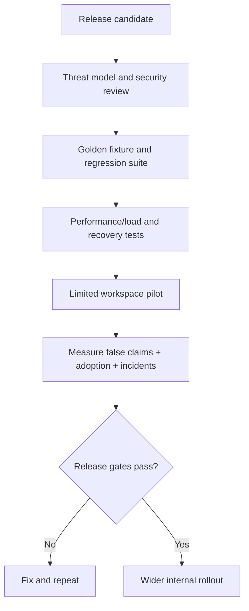

# P15 — Security Hardening, Performance & Internal Pilot

> **Universal Laravel API Documentation Generator** · Independent phase implementation guide  
> Plan revision: 2026-11-22 · Architecture: Laravel + React + Inertia · Analysis: static-first, AI optional

| Field | Value |
|---|---|
| Phase | **P15 / 16** |
| Estimated effort | **7–10 engineer-days** |
| Prerequisites | **P00–P14** |
| Checkpoint | **M5 — internal production pilot** |
| Feature flag | `pilot_rollout` |
| Core persistence | Add observed indexes/retention metadata only after query analysis; avoid destructive migrations |

[← Implementation index](README.md) · [Shared contracts](SHARED_CONTRACTS.md)

## 1. Goal and shippable result

**Why this phase exists:** Validate the end-to-end platform on real large Laravel applications and establish operational readiness and measurable team benefit.

**What a developer can demonstrably do afterward:** Internal teams can reliably create/import/scan/analyze/generate/review/publish/export while security and accuracy risks are monitored and controlled.

**Out of scope:** Full public SaaS readiness, multi-framework analyzers, live production 500 diagnosis.

## 2. End-to-end feature workflow



### Workflow explained

1. Freeze MVP scope and assemble a real release candidate including the permanent no-AI static documentation path.
2. Run threat-model reviews, malicious import fixtures, tenant-isolation tests, secret leak checks, prompt-injection tests and worker sandbox verification.
3. Load test large Laravel repositories and queue concurrency, then inspect measured parser coverage, unresolved cases and p95 processing time.
4. Onboard a small internal pilot with backend, frontend, mobile and QA; collect actual documentation corrections and repeated clarification counts.
5. Publish runbooks, retention/backup/restore policy, operational dashboards and explicit kill switches for imports, scans, AI and exports.
6. Only expand rollout if objective safety, reliability and quality gates pass; otherwise keep last published docs readable while fixing blockers.

## 3. Implementation plan in build order

### 3.1 Backend and infrastructure

1. Threat model ZIP/Git ingress, tenant isolation, storage access, LLM egress, credential rotation, uploads, parsing and queue execution.
2. Validate worker isolation, resource quotas, deny-by-default network access for parser, retention/deletion, backups and restore drills.
3. Run golden fixtures across supported Laravel versions, modules, route registration patterns and unsupported/dynamic behavior.
4. Load test scans for 100/500/1000+ routes, concurrency, queue backpressure, storage/network failure and idempotent retries.
5. Instrument queue latency, endpoint coverage, documentation evidence completeness, provider failure classifications and approval rates.
6. Pilot with real engineering/QA tasks and measure repeated clarification requests against a baseline; collect corrections and publish release notes.

### 3.2 React + Inertia UI

1. Provide a Feedback on Documentation action and clear unsupported-analysis warnings.
2. Provide admins with status dashboards for jobs, import failures and provider health without displaying source secrets.
3. Document accessible help, support escalation and recovery playbooks.

### 3.3 Proposed routes and interfaces

The following are **design targets**, not routes already implemented. Keep naming and authorization consistent with your project's selected route conventions.

```text
GET /admin/operations (authorized internal only)
POST /documentation/{revision}/feedback
GET /projects/{project}/activity
```

### 3.4 Database and migration strategy

Create or extend: **Add observed indexes/retention metadata only after query analysis; avoid destructive migrations**. Use foreign keys and indexes for workspace/project/snapshot identity; add columns and tables before changing readers. Do not drop older fields or mutate published/snapshot data during rollout. Confirm a matching migration and model factory exists for each new entity.

## 4. Original engineering tickets

- [ ] `P15-F01` Threat model ZIP/Git import, parser isolation, tenant data, provider keys, LLM prompt injection, downloads.
- [ ] `P15-F02` Harden sandbox permissions, time/memory/cpu quotas, network deny, temporary file cleanup and object storage IAM.
- [ ] `P15-F03` Expand golden fixtures to multiple Laravel generations and modular routing structures.
- [ ] `P15-F04` Performance tests for 100/500/1,000+ endpoints and concurrent analysis; optimize with file hashes and AST cache.
- [ ] `P15-F05` Operational dashboard: queue lag, scan duration, unresolved count, docs coverage, AI status/errors, approval rate.
- [ ] `P15-F06` Pilot with real repositories and actual frontend/web/QA tasks; collect false-positive/false-negative reports.
- [ ] `P15-F07` Document backups, disaster recovery, key rotation, source retention, incident response, worker retry and deployment procedure.

## 5. Design notes, contracts and examples

### Pilot release gates (proposed; measure, do not assume)

- At least **98%** coverage of routes that are *statically resolvable* in the selected golden fixtures.
- **100%** of published evidence links refer to existing lines in the referenced immutable source snapshot.
- No unsupported required request fields in release-blocking fixture documents.
- No known critical isolation, ZIP extraction or secret-handling issues.
- Static ZIP→docs flow remains operational with AI disabled and no key configured.
- Controlled failure tests prove that live exports, AI tasks and new scans can be independently disabled without hiding published documentation.

Track reduction in repeated backend clarifications via real team baseline and follow-up; do not market arbitrary percentages as already achieved.


## 6. Test plan (must pass before merge)

- [ ] Restore drill recovers published docs and snapshot pointers; private keys and credentials remain protected.
- [ ] Cross-tenant route access, import sandbox escape and prompt injection security tests pass.
- [ ] Existing P08 static path works when AI provider is completely disabled.
- [ ] Pilot QA can find a documented API without backend assistance; quality and failure metrics recorded.

### Failure and recovery cases

- **Security gate fails:** freeze new imports/scans; serve last approved docs read-only.
- **Parser incident:** disable parser worker and queue new scans without losing completed source snapshots.
- **AI incident:** disable AI enhancement only; retain static and published docs.
- **Export issue:** disable exports; preserve reader.

## 7. Manual acceptance walkthrough

1. Start with a freshly migrated, authenticated development workspace; record a baseline test run and current feature flags.
2. Perform the workflow above using a controlled fixture that exercises **Hardening and pilot release**.
3. Confirm the final observable result: **Internal teams can reliably create/import/scan/analyze/generate/review/publish/export while security and accuracy risks are monitored and controlled.**
4. Repeat one negative or unauthorized case and confirm a safe, actionable error without data leakage.
5. Disable the new feature flag (when available) and verify earlier completed features continue to work.

## 8. Compatibility and no-breakage checks

- [ ] The full earlier-phase smoke suite remains green, especially cross-workspace authorization.
- [ ] The P08 ZIP → detect → discover → analyze → static docs flow remains available once P08 exists.
- [ ] No new source execution or untrusted PHP bootstrapping has been introduced.
- [ ] All new long-running work uses authorized, retry-safe jobs and immutable snapshots where applicable.
- [ ] No new Inertia props, logs, job payloads or exports leak credentials or unauthorized source snippets.
- [ ] Feature flag defaults to **off** outside the pilot workspace until testing is complete.
- [ ] Release/migration is backwards-compatible; rollback requires no destructive data edits.

## 9. Release checkpoint and rollback

**Release sequence**

1. Merge code behind `pilot_rollout` (where applicable); apply only additive migrations.
2. Deploy with flag disabled; verify baseline backend tests and React build.
3. Enable for a staging workspace and complete the manual walkthrough.
4. Check structured errors, queue lag, access denials, and relevant metrics.
5. Enable for a controlled internal workspace, then record outcome and limitations.

**Rollback:** Export issue → disable exports; preserve reader.

**Definition of Done:** Internal teams can reliably create/import/scan/analyze/generate/review/publish/export while security and accuracy risks are monitored and controlled. Automated tests, authorization tests, and the regression baseline pass. The feature can be disabled without corrupting or hiding earlier data.

## 10. Handoff to the next phase

Production-oriented internal release with documented runbooks, rollback controls and measured team impact.

**Do not start the next dependent phase until the above checkpoint is met.**
