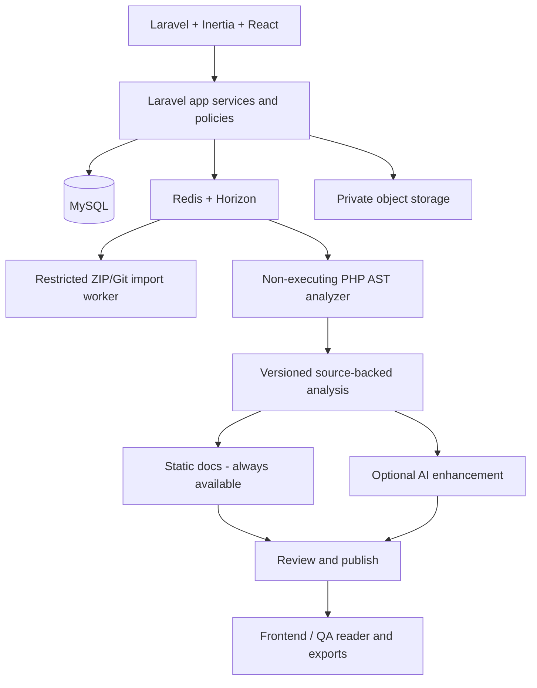

# Universal Laravel API Documentation Generator — Progressive Phase Guides

> **Purpose:** Build a reliable API documentation platform feature by feature without breaking prior work.  
> **Stack:** Laravel + React + TypeScript + Inertia.js, MySQL, Redis/Horizon and private object storage.  
> **Imports:** Secure ZIP initially; authenticated Git later.  
> **Analysis:** Static AST first, optional AI second.  
> **Plan revision:** 2026-11-22.

## How to follow these files

1. Read [Shared Engineering Contracts](SHARED_CONTRACTS.md) once and treat its boundaries as mandatory.
2. Start at P00. Open **one phase Markdown file**, implement its tasks in order, and complete its test and manual acceptance sections.
3. Do not begin a dependent phase before the previous phase's release checkpoint passes.
4. Keep changes behind a feature flag where possible; use additive migrations and idempotent background jobs.
5. Tag or commit each verified phase as a baseline, and re-run prior workflows after every subsequent phase.
6. P08 is the **first product-complete milestone**: source ZIP → scan → endpoint → static docs, without any AI key.

## Phase index

| Order | Guide | Depends on | Effort | Milestone |
|---|---|---|---|---|
| P00 | [Platform Foundation, Architecture & CI](P00_platform_foundation.md) | None | 2–3 engineer-days | Base platform |
| P01 | [Identity, Workspaces & Authorization](P01_identity_and_workspace_rbac.md) | P00 | 3–4 engineer-days | Security foundation |
| P02 | [Project Management & Create Project Wizard](P02_project_crud_and_onboarding_wizard.md) | P01 | 3–4 engineer-days | M0 — project-management shell |
| P03 | [Immutable Source Snapshots & Job Infrastructure](P03_immutable_source_storage.md) | P02 | 3–4 engineer-days | Source contract ready |
| P04 | [Secure ZIP Project Import](P04_zip_upload_and_validation.md) | P03 | 4–6 engineer-days | Real source ingestion |
| P05 | [Laravel Framework Detection & Root Selection](P05_laravel_framework_detection.md) | P04 | 3–4 engineer-days | Laravel detection working |
| P06 | [AST Route Discovery & API Explorer](P06_route_discovery_and_api_explorer.md) | P05 | 6–9 engineer-days | M1 — endpoint inventory |
| P07 | [Basic Endpoint Contract Analysis](P07_basic_endpoint_contract_analysis.md) | P06 | 6–9 engineer-days | Structured analysis v1 |
| P08 | [Static API Documentation — First End-to-End Release](P08_static_documentation_generator.md) | P07 | 4–6 engineer-days | M2 — usable without AI |
| P09 | [Authenticated Git Repository Import](P09_git_repository_import.md) | P03 + proven P08 vertical slice | 5–8 engineer-days | M3 — ZIP/Git parity |
| P10 | [Advanced Laravel Source & Workflow Analysis](P10_advanced_laravel_analysis.md) | P07 and P08 | 7–11 engineer-days | Business-logic evidence expanded |
| P11 | [AI Provider Settings, Credentials & Health](P11_ai_configuration_module.md) | P01; integrate into P08 baseline | 4–6 engineer-days | AI optional and safely configurable |
| P12 | [Evidence-Grounded AI Documentation Enhancement](P12_ai_documentation_enhancement.md) | P10 + P11 + P08 | 6–9 engineer-days | M4 — optional AI |
| P13 | [Documentation Review, Revision History & Publishing](P13_review_versions_and_publishing.md) | P08 + P12 (static publishing still independent of AI) | 5–7 engineer-days | Approval-controlled published docs |
| P14 | [OpenAPI/Markdown Export & Team Documentation Reader](P14_export_and_team_sharing.md) | P13 | 3–5 engineer-days | Frontend and QA self-service |
| P15 | [Security Hardening, Performance & Internal Pilot](P15_hardening_and_pilot_release.md) | P00–P14 | 7–10 engineer-days | M5 — internal production pilot |

## Milestones and demonstrations

- **M0 / P02:** Authenticated user creates and resumes a project draft.
- **M1 / P06:** ZIP upload → Laravel detection → discover and browse APIs.
- **M2 / P08:** Select any supported API → analyze → generate static documentation, with **zero AI credentials**.
- **M3 / P09:** Git import and ZIP import yield the same immutable snapshot interface and downstream workflow.
- **M4 / P12:** AI adds evidence-cited explanation to a new draft; disabled/invalid API key never blocks static docs.
- **M5 / P15:** Approved, searchable and exportable documentation available to authorized frontend and QA users.

## Architecture and trust boundary

Imported source files are untrusted; **do not run their Composer scripts, artisan commands, or PHP code** in the baseline analyzer. AI credentials are configured at workspace scope and never flow to the browser.

## Release gate to repeat each phase

- [ ] Migrations safe and additive; CI passes on clean checkout.
- [ ] Workspace permissions and storage access enforced on every new resource.
- [ ] Failure/retry/idempotency paths tested.
- [ ] React/Inertia page handles loading, empty, error and success states.
- [ ] No credentials or sensitive source data leaked in logs, job payloads, AI prompts or exports.
- [ ] Feature defaults off until staging validation; previous phases still work.
- [ ] Short release note and rollback mechanism recorded.

## Estimated scope

The earlier master plan estimates **71–105 engineer-days plus contingency** across P00–P15. For a single experienced engineer this is a multi-month effort; compatibility with legacy Laravel versions, unfamiliar module patterns and security hardening are the main schedule risks. These are planning estimates, not delivery commitments.

## Reference documents

- [Technical architecture blueprint v1.1](references/laravel_api_documentation_platform_blueprint.md)
- [Original consolidated phase plan](references/laravel_api_documentation_featurewise_implementation_plan.md)

These guides break the existing documents into executable features. In a conflict, prefer the latest explicitly approved product decision and update [Shared Engineering Contracts](SHARED_CONTRACTS.md) before implementing a breaking change.
