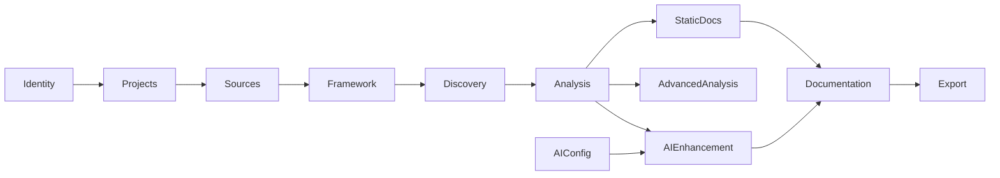

# Shared Engineering Contracts & Progressive Release Rules

> This file is normative for all P00–P15 phase guides. Review before implementing or refactoring a cross-module contract.

[← Implementation index](README.md)

## 1. Immutable identities and ownership

| Entity | Meaning | Important invariant |
|---|---|---|
| Workspace | Authorization / tenant boundary | Every project/source/doc query is membership scoped |
| Project | Long-lived documentation workspace | May exist as draft with no source |
| ProjectSource | Configured ZIP or Git connection | Mutable connection, **not** analyzed source |
| SourceSnapshot | Exact immutable imported source tree | Hash and manifest never mutate after ready |
| ScanRun | Route discovery attempt | Snapshot + discovery version pinned |
| ApiEndpoint | Discovered method/path/handler | Scoped to one snapshot and stable route identity |
| EndpointAnalysis | Immutable extracted facts | Schema version + analyzer version + evidence |
| DocumentationVersion | Generated/reviewed API documentation | Never alter a published revision in place |
| GenerationRun | Optional AI enhancement attempt | Separate from deterministic analysis |

## 2. Dependency direction



No earlier module should import a later module as a required dependency. StaticDocs must not import AIConfig or provider SDKs. Git and ZIP must implement the same SourceProvider interface.

## 3. Base software and data stack

- **Single product application:** Laravel controllers/services/policies + React/TypeScript through Inertia.
- **Source processing runtime:** restricted PHP parsing worker separated from the user-facing Laravel process.
- **Storage:** MySQL 8.4+ (metadata and contract `json` columns), Redis/Horizon (queues), private object storage (source snapshots and exports).
  - *Decision 2026-11-22:* MySQL everywhere (local, CI, production) replaces PostgreSQL. Wherever a phase guide says PostgreSQL or JSONB, read MySQL and a `json` column. Don't use Postgres-only features (partial indexes, JSONB operators, `ILIKE`, arrays). Query JSON through Laravel's `->` syntax and add generated columns when a JSON field needs an index.
- **Source analysis:** AST/static by default using `nikic/php-parser`; **never** bootstrap or execute uploaded Laravel code in the default scan.
- **AI:** optional server-to-provider integration; configured at workspace level; never required for ingestion, analysis, static documentation or viewing published docs.

## 4. SourceProvider boundary

```php
interface SourceProvider
{
    public function import(Project $project, array $configuration): SourceImportResult;
}
```

`SourceImportResult` must ultimately produce a ready immutable `snapshot_id` or a typed failure. Source consumers do not receive Git branch references or quarantine filesystem paths.

## 5. FrameworkAnalyzer boundary

```php
interface FrameworkAnalyzer
{
    public function detect(SourceSnapshot $snapshot): FrameworkDetectionResult;
    public function discover(SourceSnapshot $snapshot): DiscoveryResult;
    public function analyze(SourceSnapshot $snapshot, ApiEndpoint $endpoint): EndpointAnalysisResult;
}
```

Each result carries `schema_version`, analyzer version, snapshot ID, warnings and evidence as appropriate.

## 6. AnalysisResultV1 envelope

```json
{
  "schema_version": "1.0",
  "snapshot_id": "uuid",
  "endpoint_id": "uuid",
  "analyzer_version": "laravel-ast-v1",
  "request": {"headers": [], "fields": []},
  "responses": [],
  "dependencies": [],
  "evidence": [],
  "unresolved": []
}
```

- **Verified:** Directly traceable to static source/test fixture, with valid evidence range.
- **Inferred:** Suggestive but not independently verified; render label in docs.
- **Unknown:** Cannot determine without runtime or unsupported dynamic constructs; never invent.

Only backward-compatible additions are allowed in v1. For a breaking change, add v2 readers/adapters and run a migration period.

## 7. State machines

```text
project: draft → active → archived
snapshot: pending → validating → ready | rejected | failed
scan / analysis: queued → running → completed | partial | failed | cancelled
documentation: draft → in_review → published → superseded
AI key health: not_configured | unchecked | ready | invalid_credentials |
               quota_exceeded | rate_limited | provider_unavailable | misconfigured
```

Transitions must be guarded by services; queued workers may only transition the matching active attempt. Always dispatch jobs after DB commit.

## 8. Authorization and data exposure

- Authorized workspace/project IDs must be checked at **reads, writes, polling, job execution, evidence viewing, artifact export and download**.
- Raw imported source is sensitive and never exposed to QA/Viewer roles by default.
- Store OAuth and AI secrets encrypted/server-side; never serialize them into Inertia props, logs, queue payloads or LLM prompts.
- `SourceSnapshot` storage uses server-generated private paths and authorization-gated access; no public disk for project archives.
- AI receives only a sanitized allowlisted subset of evidence for a specific selected endpoint. Source comments/README are untrusted prompt data.

## 9. AI optional fallback

1. Build deterministic static documentation before considering AI.
2. Missing/disabled/invalid credentials → static docs remain readable and generatable.
3. Quota/rate/outage → safe status + bounded retry only where reasonable; static docs untouched.
4. Valid AI narrative → schema-validate citation IDs and facts; create a **new draft** for review.
5. AI does not change verified request or response contracts and never publishes automatically.
6. Do not label credentials **expired** unless provider explicitly gives expiry information.

## 10. Migrations and deploy safety

1. Add new columns/tables/indexes first, keeping existing readers compatible.
2. Deploy code with the new feature **disabled**.
3. Run migration and smoke tests in staging.
4. Enable only for test workspace; verify and monitor.
5. Rollback **feature flags + code** if necessary; avoid destructive migration rollback for user data.
6. Preserve the most recent verified snapshot/analysis/published docs.

## 11. Permanent regression flows

- `RG-01`: Workspace A cannot access Workspace B project or artifacts.
- `RG-02`: ZIP import cannot write outside quarantine or execute uploaded PHP.
- `RG-03`: ZIP → Laravel detection → route discovery → selected endpoint analysis → static doc works without AI.
- `RG-04`: Incomplete/dynamic source is reported as unresolved, not invented.
- `RG-05`: Published documents do not change when analysis or AI is regenerated.
- `RG-06`: Revoked Git/AI credentials stop corresponding new operations without deleting existing docs.
- `RG-07`: Queue retries create no duplicate published artifacts; every job has scoped ownership.

Run applicable tests after every phase; once P08 exists, `RG-03` is mandatory on every later release.

## 12. Completion policy

A phase is complete when: feature contract and tests pass, failure states are meaningful, migration is safe, no data leak occurs, UI has loading/empty/error/success states, prior smoke tests pass, staging release is validated and the rollback mechanism is recorded.
