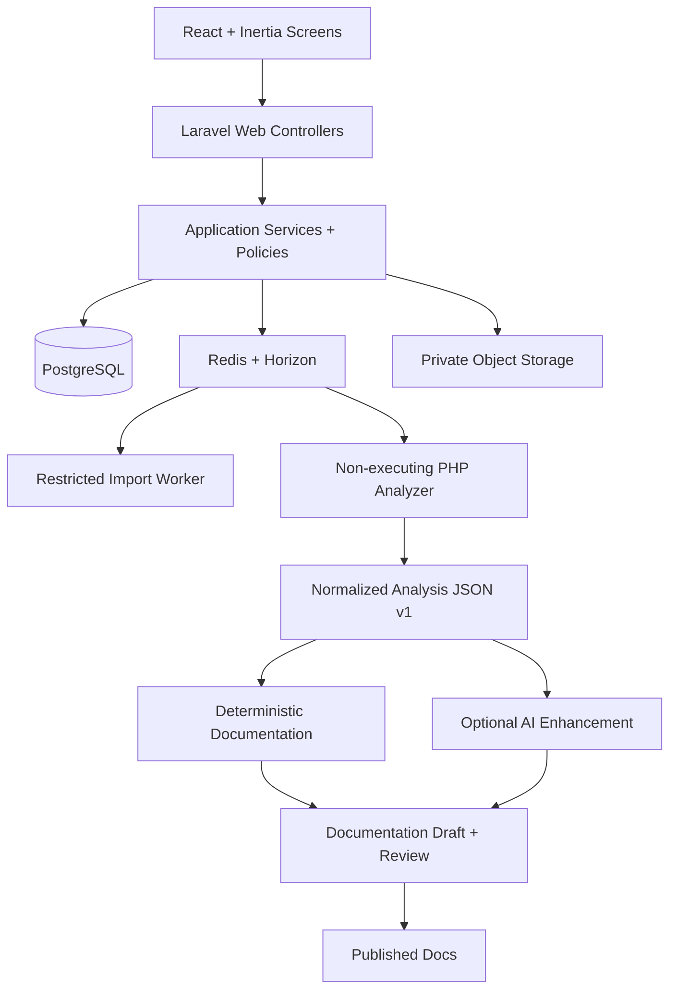

# Universal Laravel API Documentation Generator
## Feature-by-Feature Engineering Delivery Plan

**Document version:** 1.0  
**Architecture baseline:** Technical Blueprint v1.1  
**Frontend:** React + TypeScript + Inertia.js inside a Laravel application  
**Backend:** Laravel modular monolith; isolated PHP source-analysis workers  
**Data:** PostgreSQL, Redis/Horizon, private object storage  
**Import:** ZIP and authenticated Git  
**Analysis:** Deterministic AST/static analysis first; optional AI explanation second  
**Optimization:** Accuracy, isolation, source evidence, reversible releases

---

## 1. Goal and non-negotiable rules

Deliver one deployable, working increment at a time. At the end of each phase the application must build, its existing user flows must still work, and the newly introduced behavior must be exercised by automated tests. No later module may be a mandatory dependency of an earlier core flow.

### Seven invariants

1. **Static analysis works without AI.** Project import, route discovery, endpoint analysis, static documentation, and existing published docs require no LLM credentials.
2. **Source snapshots are immutable.** Every scan, analysis, and documentation revision points to a specific snapshot and analyzer/prompt version.
3. **Imported code is untrusted input.** Never bootstrap an uploaded app, execute `artisan`, run Composer scripts, or `include`/`require` source files in the default pipeline.
4. **Internal modules communicate through versioned contracts.** UI and AI generation consume normalized analysis results, not parser internals.
5. **No unapproved publication.** Regeneration always creates a new draft/revision; approved content is never overwritten.
6. **Every resource is workspace-scoped and authorized.** Auth checks apply to reads, polling, storage downloads, background jobs, and mutations.
7. **Every phase has a release and rollback path.** Prefer additive migrations, flags, idempotent jobs, and last-known-good versions.

### Definition of Done (applies to every feature)

- [ ] Contract and acceptance criteria documented.
- [ ] Server-side validation and authorization implemented.
- [ ] Migration includes indexes/FKs and can coexist with the previous deployed code during rollout.
- [ ] Happy-path, failure-path, and tenancy/security tests pass.
- [ ] Inertia/React UI has loading, empty, error, and success states where relevant.
- [ ] Observability includes structured events, actionable errors, and no secrets in logs.
- [ ] Feature flag defaults to off until validated in staging.
- [ ] Existing smoke tests and golden fixtures still pass.
- [ ] Release note, feature flag ownership, and rollback action recorded.

---

## 2. System architecture and dependency rules



### Module ownership

| Module | Owns | Must NOT depend on |
|---|---|---|
| Identity | Users, workspace membership, policies | Import, scan, AI |
| Projects | Project metadata, drafts, project states | Route parser, AI |
| Sources | Connections, upload tokens, immutable snapshots | Docs, AI |
| Framework | Laravel detection | AI, publishing |
| Discovery | Route inventory | Documentation generator |
| Analysis | Endpoint facts, evidence, dependencies | AI credentials, Inertia |
| StaticDocs | Deterministic contract rendering, cURL | AI provider |
| GitImport | Optional source adapter | ZIP implementation details |
| AIConfig | Provider settings, credential status | Source repository contents |
| AIEnhancement | Evidence-grounded natural-language explanation | Mutable project branch |
| Documentation | Drafts, revisions, review, publishing | AI availability |
| Export | Read-only formats of authorized docs | AI generation |

**Architecture choice:** use application services and Laravel controllers in a single repository. A separate worker *runtime* isolates source ingestion and parser execution. This does **not** require a second product API or a microservice deployment on day one.

### Directory layout (illustrative)

```text
app/
  Domain/
    Identity/
    Projects/
    Sources/
    Framework/
    Discovery/
    Analysis/
    StaticDocs/
    AIConfig/
    AIEnhancement/
    Documentation/
    Export/
  Contracts/
    SourceProvider.php
    FrameworkAnalyzer.php
    AnalysisResultV1.php
    AiProviderAdapter.php
  Jobs/
    ImportSourceJob.php
    DetectLaravelJob.php
    DiscoverRoutesJob.php
    AnalyzeEndpointJob.php
    GenerateAiEnhancementJob.php
  Policies/
  Http/Controllers/
resources/js/
  Pages/Projects/
  Pages/Scans/
  Pages/Endpoints/
  Pages/Documentation/
  Pages/Settings/AI/
  Components/
tests/
  Feature/
  Unit/
  Fixtures/laravel-repositories/
```

Use Inertia form submissions and server-side redirects for ordinary pages. Use narrowly scoped JSON endpoints for large paginated indexes, job status polling, and downloads. Inertia supports form validation and upload progress; choose and lock a compatible Inertia version before implementing pages.

---

## 3. Master release sequence

| Phase | Feature | Prerequisite | Working result | Estimate (engineer-days) |
|---|---|---|---|---:|
| **P0** | Platform foundation + CI | None | App deploys with health checks/tests | 2–3 |
| **P1** | Authentication, workspaces, roles | P0 | Authorized users and team isolation | 3–4 |
| **P2** | Projects + onboarding wizard | P1 | Create/manage draft projects | 3–4 |
| **P3** | Source snapshot foundation | P2 | Private immutable source storage | 3–4 |
| **P4** | Secure ZIP import | P3 | Upload and snapshot Laravel source | 4–6 |
| **P5** | Laravel detection | P4 | Identify supported Laravel roots | 3–4 |
| **P6** | Route discovery + API Explorer | P5 | Search discovered endpoints | 6–9 |
| **P7** | Basic endpoint contract analysis | P6 | Request/validation/response evidence | 6–9 |
| **P8** | Deterministic static documentation | P7 | **First complete vertical slice without AI** | 4–6 |
| **P9** | Git import | P3 + proven P8 flow | Same workflow from Git snapshots | 5–8 |
| **P10** | Advanced source analysis | P7/P8 | Resources, dependencies, conditional behavior | 7–11 |
| **P11** | AI provider settings | P1 | Configure/test/rotate credentials safely | 4–6 |
| **P12** | Optional AI enhancement | P10 + P11 | Explain verified facts; fallback survives | 6–9 |
| **P13** | Review, revisions, publish | P8 + P12 | Approved, snapshot-bound docs | 5–7 |
| **P14** | Export and team sharing | P13 | OpenAPI/Markdown, reader-friendly docs | 3–5 |
| **P15** | Hardening, pilot, release | All MVP modules | Internal production-oriented MVP | 7–10 |

**Planning arithmetic:** 71–105 engineer-days in sum, plus contingency for legacy Laravel syntax and route patterns. This is not elapsed calendar time; some infrastructure/UI work can be parallelized after interfaces stabilize. For one engineer, plan roughly 14–22 working weeks, depending on interruptions and quality requirements. Treat dates as estimates rather than commitments.

### Milestones

- **M0 / P2:** Authenticated project-management shell.
- **M1 / P6:** ZIP → detect Laravel → discover/search APIs.
- **M2 / P8:** ZIP → one API → verified static documentation. **First genuinely useful release.**
- **M3 / P9:** Git is an alternative input, not a different analysis path.
- **M4 / P12:** AI-enhanced drafts with fail-safe static behavior.
- **M5 / P15:** Reviewed, published, searchable and exportable internal docs.

---

## 4. Phase-by-phase implementation tickets

### P0 — Application foundation, conventions and CI

**Goal:** Establish a buildable, testable Laravel + React + Inertia product before feature code.

**Implementation tickets**

- [ ] `P0-F01` Create Laravel application, React + TypeScript + Inertia starter and application layout.
- [ ] `P0-F02` Configure PostgreSQL, Redis, Horizon, private storage and environment templates.
- [ ] `P0-F03` Add static analysis/lint/format tooling, Laravel tests, TypeScript typecheck and React tests.
- [ ] `P0-F04` Add CI pipeline for backend tests, frontend build, migrations on temporary database, security checks.
- [ ] `P0-F05` Standardize UUID/ULID, UTC timestamps, JSON contract versions, domain errors and result objects.
- [ ] `P0-F06` Add feature flag service, health/readiness endpoints, structured logging and correlation IDs.

**Database:** initial users/session infrastructure, queue tables as appropriate, `feature_flags` if DB-backed (environment-configured flags are also acceptable initially).

**UI:** sign-in shell, base layout, sidebar/navigation placeholders, no nonfunctional enabled actions.

**Tests:** clean install, migrations up/down in development, frontend build, smoke route, queue connection, forbidden access to protected pages.

**Gate:** CI green from a fresh checkout; one command set for local setup is documented; staging deployment passes `/health` and auth smoke tests.

**Rollback:** revert app deployment; do not yet manipulate external repositories or user uploads.

---

### P1 — Identity, workspaces and authorization

**Goal:** Every project and artifact has a trustworthy tenant boundary.

**Tickets**

- [ ] `P1-F01` Auth/session login/logout, password reset as required; Sanctum where integration clients need tokens.
- [ ] `P1-F02` Workspaces and workspace-membership roles: Owner, Maintainer, Developer, QA, Viewer.
- [ ] `P1-F03` Laravel policies and scoped query helpers (`forWorkspace`, nested-resource parent checks).
- [ ] `P1-F04` Workspace switcher, membership management and invitation flows (minimal internal invitations acceptable).
- [ ] `P1-F05` Audit events for member and permission changes.

**Database:** `workspaces`, `workspace_members`, `invitations` (optional for MVP), `audit_events`.

**UI:** Workspace Create/Select, Team Members, Access Denied.

**Tests:** Owner/Maintainer/Developer/QA/Viewer permissions, cross-workspace 403 or non-disclosure response, member revocation takes effect immediately, unauthorized job polling denied.

**Gate:** No unscoped project/scan/doc access from controllers, storage endpoints or queues.

**Rollback:** disable invitation UI; do not remove workspace authorization once introduced.

---

### P2 — Project CRUD + resumable Create Project wizard

**Goal:** Users can set up a project without importing code yet.

**Tickets**

- [ ] `P2-F01` Projects table, create/list/show/update/archive services and policies.
- [ ] `P2-F02` Five-step Inertia wizard (Details → Source → Framework → Analysis → Review) with server-backed draft.
- [ ] `P2-F03` Slug uniqueness per workspace, project visibility, created_by, draft state.
- [ ] `P2-F04` Disabled future feature surfaces display truthful “not yet supported” messaging.
- [ ] `P2-F05` Project dashboard, empty states, validation errors, cancel/resume workflow.

**Database:** `projects`, `project_drafts` (or nullable draft attributes in projects; choose one and document it).

**Routes:** `GET /projects`, `GET /projects/create`, `POST /projects`, `GET /projects/{project}`, `PATCH /projects/{project}`.

**Tests:** duplicate names/slugs, invalid drafts, workspace isolation, form validation, losing browser state does not lose saved draft.

**Gate:** Can create and reopen a project with no source; no accidental source scan or AI call.

**Rollback:** turn off project editing if needed; existing metadata remains readable.

---

### P3 — Immutable source snapshot and job infrastructure

**Goal:** ZIP and Git will use exactly the same downstream source interface.

**Tickets**

- [ ] `P3-F01` Define `SourceProvider` interface and `SourceSnapshot` domain object.
- [ ] `P3-F02` Private quarantine and immutable snapshot storage with server-generated object keys.
- [ ] `P3-F03` Snapshot SHA-256 and manifest generation (path, size, hash, language).
- [ ] `P3-F04` Source statuses: `pending`, `validating`, `ready`, `rejected`, `failed`.
- [ ] `P3-F05` Job and event model for import/scan status, idempotent retries, cancellation markers.
- [ ] `P3-F06` Retention rules, secure delete process, authorized snapshot lookup service.

**Database:** `project_sources`, `source_snapshots`, `source_files`, `processing_jobs` (or `scan_runs` plus Laravel queue metadata).

**Interfaces:** `SourceProvider::createSnapshot(...)` always returns immutable snapshot ID, not mutable branch or filesystem path.

**Tests:** simultaneous imports, duplicate snapshot hashes, failed storage writes, revoked user access, cross-workspace paths, job retry deduplication.

**Gate:** A fabricated fixture snapshot can be stored, indexed and accessed only through authorized services.

**Rollback:** disable new snapshot ingestion; old snapshots stay readable.

---

### P4 — Secure ZIP upload

**Goal:** Create real snapshots from uploaded ZIP archives; never execute repository code.

**Tickets**

- [ ] `P4-F01` Inertia ZIP uploader with progress bar, size warnings and server validation.
- [ ] `P4-F02` Quarantine upload and reject unsupported format, oversized/over-count archives, traversal and symlink/special-file entries.
- [ ] `P4-F03` Extract into restricted workspace using canonical path checks, file count/size/decompression limits and timeouts.
- [ ] `P4-F04` Exclude secrets and unsafe files from analysis context; preserve a private manifest and required source files for inspection.
- [ ] `P4-F05` Create content-hashed immutable snapshot; record source and import status.
- [ ] `P4-F06` User-facing upload error categories and safe retry.

**Database:** no new business schema required beyond P3; source type `zip`, import attempt metadata.

**UI:** ZIP dropzone, upload progress, validating state, import failed/retry, imported snapshot details.

**Tests:** ZIP slip, zip bombs/ratio limits, symlinks, nested archives, duplicate names, malformed ZIP, empty Laravel ZIP, interruption/retry, no code execution.

**Gate:** User can import an ordinary Laravel archive; security fixtures cannot escape quarantine or trigger execution.

**Rollback:** disable ZIP import; retain validated snapshots; do not delete their documentation.

---

### P5 — Laravel framework detection

**Goal:** Identify Laravel application roots safely from source metadata.

**Tickets**

- [ ] `P5-F01` Detect `composer.json`, `artisan`, bootstrap structure, route files and module directories.
- [ ] `P5-F02` Determine likely Laravel version from `composer.lock` when present; distinguish installed vs declared constraints.
- [ ] `P5-F03` Support manual relative application-root selection for monorepos.
- [ ] `P5-F04` Return result status: `detected`, `partial`, `unsupported`, `not_found`; include evidence/warnings.
- [ ] `P5-F05` Framework Detection page with source and version context.

**Database:** `framework_detections` or snapshot `framework_detection` JSONB + analyzer_version (choose one consistent strategy).

**Tests:** Laravel standard/multi-module/monorepo fixtures, missing composer.lock, unrelated PHP package, multiple candidate Laravel roots.

**Gate:** Clear root/version selection without any Laravel bootstrap execution; ambiguous roots are not guessed as certain.

**Rollback:** hide detector/require manual root selection only where safe.

---

### P6 — AST route discovery + API Explorer

**Goal:** A complete discoverable endpoint inventory, *not* a claim of full coverage for dynamic registration.

**Tickets**

- [ ] `P6-F01` Integrate pinned `nikic/php-parser`, AST node visitors and symbol/file positions.
- [ ] `P6-F02` Discover routes from configured route files and statically resolvable provider/module patterns.
- [ ] `P6-F03` Resolve route groups, prefixes, namespace, HTTP methods, names and middleware inheritance.
- [ ] `P6-F04` Resolve controller/action or mark unresolved handlers with diagnostic reason.
- [ ] `P6-F05` Persist immutable endpoint records; generation is not triggered during discovery.
- [ ] `P6-F06` API Explorer: search/filter method/path/module/auth, pagination, scan summary, unknown cases.
- [ ] `P6-F07` Golden fixture corpus and route discovery coverage metrics.

**Database:** `scan_runs`, `api_endpoints`, `scan_findings` with `(snapshot_id, route_identity)` unique identity.

**UI:** Project Scan status → API Explorer, endpoint table, method badges, unresolved route warnings, retry scan.

**Tests:** nested groups, multiple methods, route aliases, invokable controllers, closure routes, modules, duplicate declarations, dynamic registration, snapshot refresh.

**Gate:** Endpoint listing matches known fixtures to agreed coverage; scan is retry-safe; no AI credentials required.

**Rollback:** disable new scans/restore prior scan view; existing endpoint inventory remains readable.

---

### P7 — Basic endpoint contract analysis

**Goal:** Analyze a selected endpoint, output a **versioned JSON contract** with exact source references.

**Tickets**

- [ ] `P7-F01` Controller/method lookup tied to immutable snapshot and route identity.
- [ ] `P7-F02` Extract path/query/body fields and inline validation/FormRequest static rule arrays.
- [ ] `P7-F03` Extract known middleware/auth signals, headers and path parameters; mark conditional/dynamic rules unresolved.
- [ ] `P7-F04` Infer common literal/Resource response shapes and known status codes without fabricating examples.
- [ ] `P7-F05` Store evidence paths, file hashes, line ranges, parser warnings and normalized `AnalysisResultV1` JSON.
- [ ] `P7-F06` Add async Analyze action with accurate status and deduplication.

**Database:** `endpoint_analyses`, `analysis_evidence` (file FK + start/end line + hash), `analysis_findings`.

**UI:** Endpoint Details → Contract, Validation, Authentication, Evidence, Unknowns. Analysis should show stages, not fictitious percent-complete values.

**Tests:** required/nullable/sometimes, conditional FormRequest rules, route model binding, API resource presence, source locations, syntax errors, unsupported expressions.

**Gate:** Basic contract is machine-readable; every asserted fact has evidence; unsupported behavior is `unknown`/`inferred`, not silently invented.

**Rollback:** fall back to route metadata and previously successful analysis; never overwrite prior analysis.

---

### P8 — Static documentation generator (first end-to-end release)

**Goal:** Make the platform useful **without any AI provider**.

**Tickets**

- [ ] `P8-F01` Deterministically transform `AnalysisResultV1` into typed documentation sections.
- [ ] `P8-F02` Generate cURL from known method/path/headers/fields using placeholders rather than real credentials or production data.
- [ ] `P8-F03` Display field requirements, inferred response schemas, errors, middleware and evidence.
- [ ] `P8-F04` Persist static documentation draft plus source snapshot and analyzer version.
- [ ] `P8-F05` Add document view/edit basics; make empty/incomplete sections clearly visible.
- [ ] `P8-F06` Complete ZIP → scan → pick API → analyze → generate → read automated E2E test.

**Database:** `documentation_versions` (draft status), `documentation_evidence`.

**UI:** Generate Static Docs, documentation tabs, Copy cURL, provenance panel, unknown warnings.

**Tests:** no AI key, cURL quoting, no leaked tokens, JSON valid, generated doc remains linked to original snapshot, retry does not overwrite draft.

**Gate — M2:** A frontend/QA teammate can understand a supported endpoint from static docs, and the full flow works when there are **zero AI settings rows**.

**Rollback:** disable new generation only; keep docs readable. This phase is the most important stable baseline.

---

### P9 — Git repository import (second source provider)

**Goal:** Replace ZIP with Git as an input option, without changing downstream scanner logic.

**Tickets**

- [ ] `P9-F01` OAuth/GitHub App-style read-only integration and scoped repository selection.
- [ ] `P9-F02` GitLab adapter with equivalent minimal-scoped auth where support is available.
- [ ] `P9-F03` Select branch/tag/commit, resolve immutable commit SHA and save provider ID.
- [ ] `P9-F04` Use allowlisted provider endpoints and isolated fetch worker; no arbitrary shell Git URLs or user-provided executable hooks.
- [ ] `P9-F05` Feed downloaded source through P3 snapshot interface and reuse P5–P8 unchanged.
- [ ] `P9-F06` Re-import same commit is idempotent; detect changed commit without overwriting old docs.

**Database:** `git_connections` or provider-specific fields in `project_sources`, credential reference (never raw tokens in normal database rows), import attempts.

**UI:** Git provider connect, repository selector, branch/ref selector, import and reimport history.

**Tests:** private repository access, revoked scope, provider timeout, invalid refs, cross-tenant connection leak, ZIP/Git snapshot parity.

**Gate — M3:** The same endpoint analysis contract and static documentation UI work whether the snapshot originated from ZIP or Git.

**Rollback:** disable Git new imports; existing immutable snapshots and docs remain functional.

---

### P10 — Advanced Laravel analysis (quality improvements)

**Goal:** Improve coverage of real Laravel service-based business logic before AI explanations.

**Tickets**

- [ ] `P10-F01` Resolve service constructor injection, explicit method calls and invokable actions.
- [ ] `P10-F02` Trace bounded dependency graph with cycle detection, depth/call limits and unresolved dispatch diagnostics.
- [ ] `P10-F03` Analyze API Resources: `toArray`, `when`, `whenLoaded`, conditional fields.
- [ ] `P10-F04` Identify literal exception/status paths, model operations, job dispatches and integration boundaries.
- [ ] `P10-F05` Add deterministic coverage/completeness report; reanalysis produces a new immutable result.
- [ ] `P10-F06` Preserve compatibility with `AnalysisResultV1` (new nullable fields), introducing v2 only for a breaking schema change with a migration adapter.

**Database:** `api_dependencies`; optional indexed extracted symbols; analysis JSONB additions are additive.

**UI:** Workflow graph, dependency tree, conditional response badges, explanation of missing analysis.

**Tests:** helper/service chains, polymorphic calls, unresolved dynamic dispatch, job graphs, cycles, mixed static/dynamic validation.

**Gate:** Golden business-logic fixtures get better coverage, and *old* P8 docs still render unchanged.

**Rollback:** disable advanced extractor and use P7 analysis engine; persisted old analyses/docs remain valid.

---

### P11 — AI provider settings and secret management

**Goal:** AI is configurable at workspace scope but never mandatory.

**Tickets**

- [ ] `P11-F01` Settings → AI Provider React/Inertia screen, accessible to Owner/Maintainer only.
- [ ] `P11-F02` Provider adapter abstraction (`testConnection`, `generate`), initially one supported provider.
- [ ] `P11-F03` Encrypt credentials at rest; mask in UI; never send them in Inertia props, logs, or browser-side provider calls.
- [ ] `P11-F04` Save/replace/remove key and model selection; explicit, throttled Test Connection.
- [ ] `P11-F05` Persist provider health and last check with state taxonomy and safe error codes.
- [ ] `P11-F06` Add `AiAvailabilityGate`: `available`, `not_configured`, `invalid`, `quota_exceeded`, `rate_limited`, `temporarily_unavailable`, `unknown`.
- [ ] `P11-F07` Preserve static docs UI for every failure state; never retroactively mark static docs failed.

**Database:** `workspace_ai_configs`, `ai_config_checks`; encrypted secret or reference to secret manager. Restrict AI configs to unique `(workspace_id, provider)`.

**UI:** Provider/model selection, credential replacement, connection status, last checked, safe troubleshooting, disable AI switch.

**Failure handling:** Do not infer “expired” from a generic timeout. Use `expired` only if a provider explicitly supports that diagnosis; otherwise treat as invalid/revoked or unknown. When invalid, disable new AI job enqueueing but leave all static functionality enabled. For rate limits/outages, bounded retry with exponential backoff; for an invalid credential, await configuration change rather than endlessly retrying.

**Tests:** no config, wrong key, revoked key, quota errors, rate limit, network failure, rotation, concurrent updates, no key serialization, cross-tenant isolation.

**Gate:** The Test Connection control and status messages are accurate; removing the key has no effect on P1–P10 functionality.

**Rollback:** turn off AI integration entirely; secure configuration remains encrypted and can be rotated/deleted.

---

### P12 — AI documentation enhancement with hard fallback

**Goal:** Generate human-readable workflow and behavior explanations without allowing AI to overwrite extracted facts.

**Tickets**

- [ ] `P12-F01` Build allowlisted evidence-context selector; redact known secret types before provider egress.
- [ ] `P12-F02` Structured generation request includes analysis ID, snapshot hash, evidence IDs and prompt version.
- [ ] `P12-F03` LLM returns strictly validated JSON with `summary`, `workflow`, `business_rules`, `unknowns`, citations.
- [ ] `P12-F04` Validator rejects unrecognized evidence IDs and claims that contradict the deterministic contract.
- [ ] `P12-F05` Generate AI-enhanced **new draft**, preserving static draft and published revisions.
- [ ] `P12-F06` On missing/invalid key, quote/quota error, rate limit or timeout: show reason and retain/render deterministic docs.
- [ ] `P12-F07` Add workspace-level AI off switch and audit generated requests without logging prompt secrets.

**Database:** `generation_runs` (provider, model, prompt_version, status, token usage, error code, analysis hash), `documentation_versions.ai_generation_id` nullable.

**UI:** Enhance with AI button, availability indicator, partial/unknown evidence panel, estimated usage notice, retry without data loss.

**Tests:** prompt injection in source comments, invalid output JSON, fabricated field, evidence ID mismatch, provider timeout, late retry after key rotation, no-key end-to-end path.

**Gate — M4:** Static docs are always accessible; AI can add explanation but cannot mutate request fields, status codes or verified response schemas.

**Rollback:** disable AI button and workers; no migration rollback needed, old docs still render.

---

### P13 — Documentation review, revision history and publishing

**Goal:** Make docs dependable for frontend and QA, with approval and auditable changes.

**Tickets**

- [ ] `P13-F01` Draft → In Review → Published → Superseded lifecycle with authorization policies.
- [ ] `P13-F02` Editable documentation with deterministic contract sections protected or explicitly overridden with reviewer attribution.
- [ ] `P13-F03` Revision comparison: source snapshot, analysis version, text changes, published-by/at.
- [ ] `P13-F04` Publish as atomic transaction with exactly one current published revision per endpoint/snapshot or defined publication scope.
- [ ] `P13-F05` Render source references in code viewer only when current user is authorized to view source.
- [ ] `P13-F06` Static publish path works without any AI configuration.

**Database:** review metadata, publication pointer or current-version association, unique revision sequence, review events.

**UI:** Draft editor, Compare Changes, Submit Review, Approve/Reject, Publish, Revision History, warning banner when source snapshot differs from latest.

**Tests:** concurrent publish requests, incorrect role, reviewer rejects, regenerate-after-publish, evidence link access, cross-snapshot reference integrity.

**Gate:** No write operation modifies published immutable content; viewer/QA only sees approved docs; an AI outage does not block publication of reviewed static docs.

**Rollback:** pause publication actions and serve last approved revision.

---

### P14 — OpenAPI/Markdown export and team-facing reader

**Goal:** Frontend/mobile/web/QA can use documentation without developer explanation.

**Tickets**

- [ ] `P14-F01` Export validated supported fields/statuses as OpenAPI 3.1; warn about omissions/inferences.
- [ ] `P14-F02` Markdown export with endpoint identity, payloads, cURL, response schemas, source evidence and warnings.
- [ ] `P14-F03` Searchable published docs view with endpoint filters, auth, version and project selectors.
- [ ] `P14-F04` Authorized short-lived export/download URLs; sensitive references omitted for read-only users.
- [ ] `P14-F05` QA-oriented overview tab or readable business-rule summaries from approved source data.

**Database:** `export_jobs` optional, export artifact key/format/hash and audit record.

**UI:** Publish Page, Copy Link, Export controls, QA/Developer view switches.

**Tests:** valid OpenAPI parse, Markdown escaping, authorization, no credential export, source snapshot correct, exported docs correspond to approved revision.

**Gate:** An authorized QA user finds a documented endpoint and retrieves a usable request contract in < 30 seconds in pilot evaluation.

**Rollback:** disable exports; published doc viewer stays available.

---

### P15 — Security hardening, performance and internal pilot

**Goal:** Validate the product against actual complex Laravel repositories before broad rollout.

**Tickets**

- [ ] `P15-F01` Threat model ZIP/Git import, parser isolation, tenant data, provider keys, LLM prompt injection, downloads.
- [ ] `P15-F02` Harden sandbox permissions, time/memory/cpu quotas, network deny, temporary file cleanup and object storage IAM.
- [ ] `P15-F03` Expand golden fixtures to multiple Laravel generations and modular routing structures.
- [ ] `P15-F04` Performance tests for 100/500/1,000+ endpoints and concurrent analysis; optimize with file hashes and AST cache.
- [ ] `P15-F05` Operational dashboard: queue lag, scan duration, unresolved count, docs coverage, AI status/errors, approval rate.
- [ ] `P15-F06` Pilot with real repositories and actual frontend/web/QA tasks; collect false-positive/false-negative reports.
- [ ] `P15-F07` Document backups, disaster recovery, key rotation, source retention, incident response, worker retry and deployment procedure.

**Database:** indexes based on observed query plans, retention/expiry metadata if needed; no destructive schema changes in the pilot.

**UI:** clear unsupported warnings, scan/generation troubleshooting, documentation feedback.

**Tests:** entire suite plus penetration/security tests, disaster recovery restore drill, regression comparison on fixture repository corpus.

**Gate — M5:** No known critical security issues, all release-blocking tests pass, correct project/snapshot scoping, measured improvement in self-service access and documentation accuracy.

**Rollback:** disable new imports/scans/generation; preserve read-only published documents while investigating.

---

## 5. Database migration sequence and ownership

Use **expand → migrate data → switch reads/writes → contract** for any destructive schema change. Keep DB migrations compatible with old and new deployments during a rolling release. Never drop fields in the same deployment in which code stops using them.

| Migration phase | Tables/changes | Data boundaries |
|---|---|---|
| P0 | sessions, jobs/failed jobs, optionally feature_flags | Infrastructure only |
| P1 | workspaces, workspace_members, audit_events | Every tenant resource references workspace |
| P2 | projects, project_drafts | Unique `(workspace_id, slug)` |
| P3 | project_sources, source_snapshots, source_files, processing_jobs | Snapshot immutable; unique source file path within snapshot |
| P4 | source import attempts/statuses | No new coupled entities |
| P5 | framework detection JSONB/version | Snapshot-bound |
| P6 | scan_runs, api_endpoints, scan_findings | Endpoint identity unique within snapshot |
| P7 | endpoint_analyses, analysis_evidence, analysis_findings | Version/hash-bound |
| P8 | documentation_versions, documentation_evidence | Revision immutable after publish |
| P9 | git_connections/provider metadata | Credentials held securely, no raw tokens in normal fields |
| P10 | api_dependencies, optional source-symbol index | Linked to analysis result |
| P11 | workspace_ai_configs, ai_config_checks | Unique workspace/provider; encrypted credentials |
| P12 | generation_runs, nullable documentation ai_generation_id | Optional foreign key |
| P13 | review events, publication pointer/version state | Atomic publication |
| P14 | export_jobs / export_artifacts (optional) | Authorized, expiring artifacts |
| P15 | performance indexes, retention data | Backward-compatible changes |

### Important immutable identities

- `Project` = long-lived user-owned container.
- `ProjectSource` = ZIP or provider connection, potentially mutable configuration.
- `SourceSnapshot` = immutable content hash / Git commit SHA.
- `ScanRun` = one discovery attempt against one snapshot and discovery engine version.
- `ApiEndpoint` = method/path/route identity within one snapshot.
- `EndpointAnalysis` = immutable facts for an endpoint, analyzer version, source dependency hash.
- `DocumentationVersion` = human-approved or draft content bound to analysis + source snapshot.

### Suggested state machines

```text
project: draft → active → archived
source_snapshot: pending → validating → ready | rejected | failed
scan: queued → running → completed | partial | failed | cancelled
analysis: queued → running → completed | partial | failed | cancelled
doc: draft → in_review → published → superseded
ai_config: not_configured | available | invalid | quota_exceeded |
           rate_limited | temporarily_unavailable | unknown
```

Use explicit allowed transitions; do not update statuses from unrelated jobs without checking expected current state.

---

## 6. Inertia routes and asynchronous boundaries

### Page routes (Laravel web middleware)

```text
GET    /projects
GET    /projects/create
POST   /projects
GET    /projects/{project}
GET    /projects/{project}/sources
GET    /projects/{project}/scans/{scan}
GET    /projects/{project}/endpoints
GET    /projects/{project}/endpoints/{endpoint}
GET    /projects/{project}/documentation/{revision}
GET    /settings/ai
PUT    /settings/ai
POST   /settings/ai/test
DELETE /settings/ai/key
```

### Data/action routes (narrow, authenticated, authorization-scoped)

```text
POST /projects/{project}/uploads               # ZIP import
POST /projects/{project}/git-connections       # authorized Git setup
POST /projects/{project}/scans                 # enqueue scan
POST /endpoints/{endpoint}/analyses            # enqueue analysis
POST /analyses/{analysis}/static-documentation # generate deterministic draft
POST /analyses/{analysis}/ai-enhancements      # optional AI job
POST /documentation/{revision}/submit-review
POST /documentation/{revision}/publish
GET  /internal/jobs/{job}/status               # JSON polling; authorize project
```

For normal Inertia forms, prefer redirect responses plus Laravel error bags. For long-running jobs, return a job identity and poll an authorized endpoint or use broadcasting later. Do not expose raw queue payloads to the browser.

**Correct queue sequence:** Persist job intent/ownership in a transaction, dispatch after database commit, and use an idempotency fingerprint to avoid duplicate active attempts. Laravel supports after-commit dispatch and unique/overlap-prevention patterns; do not rely solely on a UI loading spinner.

---

## 7. Stable contracts between modules

### Source-provider contract

```php
interface SourceProvider
{
    public function import(Project $project, array $sourceConfig): SourceImportResult;
}
```

Both `ZipSourceProvider` and `GitSourceProvider` return an immutable `snapshot_id`. Detection and discovery should never branch on import type.

### Framework-analyzer contract

```php
interface FrameworkAnalyzer
{
    public function detect(SourceSnapshot $snapshot): FrameworkDetectionResult;
    public function discover(SourceSnapshot $snapshot): DiscoveryResult;
    public function analyze(
        SourceSnapshot $snapshot,
        ApiEndpoint $endpoint
    ): EndpointAnalysisResult;
}
```

### Normalized analysis envelope

```json
{
  "schema_version": "1.0",
  "snapshot_id": "snapshot-uuid",
  "endpoint_id": "endpoint-uuid",
  "analyzer_version": "laravel-ast-v1",
  "request": {"fields": [], "headers": []},
  "responses": [],
  "dependencies": [],
  "evidence": [],
  "unresolved": []
}
```

All consumer modules must read this envelope, not reparse arbitrary controller source. Add backward-compatible keys as optional fields. For breaking changes, support parallel v1/v2 readers and migrate asynchronously.

### AI gate behavior (pseudocode)

```text
analysis = findImmutableAnalysis(endpoint)
staticDoc = staticBuilder.build(analysis)
saveDraft(staticDoc)

if (!workspace.aiEnabled):
    return staticDoc + "AI disabled" banner

availability = aiGate.check(workspace)
if availability != available:
    return staticDoc + safe status explanation

queue AiEnhancementJob(analysis_id, static_draft_id, config_version)
return staticDoc + pending enhancement status
```

On upstream outage, token failure, quota failure, or invalid structured response, **do not delete, fail, overwrite or hide** the static draft. Existing published docs must be unaffected.

---

## 8. Zero-breakage deployment protocol

Use this checklist **for every phase**, including changes that seem frontend-only.

### Pre-merge

1. Create a short-lived feature branch from the current stable baseline.
2. Add/update tests first for the module contract and failure cases.
3. Add only additive migrations and backward-compatible event/job payload changes.
4. Put incomplete UI and background features behind a disabled feature flag.
5. Run previous milestone E2E flows, especially ZIP → scan → static docs.
6. Review security handling of uploaded files, sources, job payloads and credentials.
7. Open PR with scope, dependencies, migration behavior, screenshots, test evidence, rollback action.

### Deployment order

1. Back up or verify database recovery plan.
2. Deploy additive migration while old code still works.
3. Deploy new code and start matching queue worker versions.
4. Warm/check caches and restart Horizon workers safely where necessary.
5. Run smoke tests with feature flag **off**.
6. Enable for internal maintainers only.
7. Validate behavior and observability.
8. Expand enablement gradually when safe.

### Rollback procedure

- Disable new feature via flag; stop new jobs of that feature.
- Keep previous doc revisions and old analysis readers available.
- Roll back application code if required **without dropping additive columns**.
- Quarantine partially failed imported snapshots/jobs for later cleanup.
- Do not replay destructive jobs without idempotency checks.
- Investigate errors using structured logs, correlation ID and job attempt metadata.

**Avoid:** destructive schema migrations bundled with application changes, mutable source directory references, default-on AI generation, controllers that parse source files directly, raw provider keys in Inertia props, and scanning every endpoint deeply during initial import.

---

## 9. Testing matrix and regression gates

| After phase | Mandatory regression gate |
|---|---|
| P0–P2 | Fresh checkout boots; auth/roles/project CRUD |
| P3–P4 | Upload threats rejected; snapshots tenant-safe; existing projects work |
| P5–P6 | Supported route golden fixtures pass; ZIP import remains stable |
| P7–P8 | Extracted fields cite source; static docs and cURL work without AI |
| P9 | ZIP and Git sources follow same analysis pipeline |
| P10 | Previously generated docs unchanged; advanced analysis additive |
| P11 | Bad/missing AI settings never affect static docs or scans |
| P12 | AI output schema/evidence validated; provider failures safe |
| P13 | Published docs immutable; review/auth/concurrent publish tested |
| P14 | Exports parse and are authorized; no keys/data leakage |
| P15 | Full E2E, security, recovery, performance and pilot approval |

### Golden fixture coverage

- Laravel conventional routes and modular routes.
- Nested prefixes, middleware, versioned routes and aliases.
- Controller classes, invokable actions, closures.
- FormRequest rule arrays, inline validation, conditional rules.
- API Resources, `when`, `whenLoaded`, conditional fields.
- Services, bounded call graphs, dispatches, exceptions.
- Dynamic/unresolvable routes explicitly reported as unknown.
- Malicious ZIP archives and source comments with attempted prompt instructions.

### Pilot quality gates (proposed)

- ≥98% discovery coverage on **supported, statically resolvable fixture routes**.
- 100% published code references resolve in their snapshot.
- Zero unsupported required fields in release-blocking golden contract tests.
- No known critical security findings.
- AI unavailable mode passes the complete static documentation flow.
- Queued retry does not duplicate source snapshots, analyses or published docs.

---

## 10. Feature flags and operational controls

| Flag | Default | First eligible phase | Fail-safe behavior |
|---|---|---|---|
| `project_create` | Off until P2 test | P2 | Keep project read-only |
| `zip_import` | Off until P4 test | P4 | Existing snapshots available |
| `laravel_scan` | Off until P6 test | P6 | Show last good scan |
| `endpoint_analysis` | Off until P7 test | P7 | Show route metadata |
| `static_docs` | Off until P8 test | P8 | Published docs still accessible |
| `git_import` | Off until P9 test | P9 | ZIP import works |
| `advanced_analysis` | Off until P10 test | P10 | Basic analysis works |
| `ai_settings` | Off until P11 test | P11 | Static docs work |
| `ai_enhancement` | Off until P12 test | P12 | Static docs work |
| `doc_publishing` | Off until P13 test | P13 | Existing published docs readable |
| `doc_export` | Off until P14 test | P14 | In-app docs readable |

**Flag enforcement:** implement on the server in service authorization and job enqueue boundaries, not only as a hidden React button.

---

## 11. One-phase-at-a-time implementation playbook

When starting any phase, use a single ticket or implementation prompt containing:

```text
FEATURE:
PREREQUISITE PHASE:
USER STORY:
OUT OF SCOPE:
DATABASE CHANGES:
SERVICE CONTRACTS:
INERTIA/REACT SCREENS:
AUTHORIZATION RULES:
ASYNC JOB BEHAVIOR:
ERROR / EMPTY / LOADING STATES:
ACCEPTANCE TESTS:
REGRESSION TESTS:
FEATURE FLAG:
ROLLBACK PLAN:
```

**Development loop:** specify → write contract/tests → migrate additively → implement backend → implement UI → verify failures/permissions → run regression → deploy disabled → smoke test → enable → tag stable milestone.

### Suggested milestone tags

```text
m0-project-shell
m1-laravel-api-explorer
m2-static-docs
m3-git-import
m4-ai-enhancements
m5-internal-mvp
```

Tags are optional Git release markers, not a substitute for CI and database backups.

---

## 12. Scope discipline: What is intentionally deferred

Do **not** include these in the initial MVP unless a blocking business requirement appears:

- Framework adapters beyond Laravel.
- Executing arbitrary uploaded Laravel code to discover routes.
- Live production requests/database access to manufacture response examples.
- Runtime 500-error investigation, traces, or Sentry correlation.
- Full-repository chat and arbitrary code modification.
- Automatic Git webhook-based rescan/PR analysis.
- Automated QA execution or production API mocking.
- Public multi-tenant billing and plugin marketplace.
- Automatic unreviewed publication of AI text.

A restricted, source-backed static documentation product is an independently valuable MVP. Additional AI or runtime diagnosis capabilities can be layered onto it without changing its core source and documentation identities.

---

## 13. Operational metrics after each release

Track: imports by method and failures, quarantine rejections, scan duration p50/p95, route discovery findings and unknowns, endpoint-analysis error rate, static documentation generated/published count, AI key health, AI fallback usage, rejected AI claims, time-to-documentation, published-doc version changes, QA/frontend usage, workspace access denials, queue backlog, orphaned temporary files, and source artifact retention.

**Outcome metric:** compare the number of repeated backend API clarification questions per week before and after rollout. Documentation volume by itself is not evidence of reduced communication cost.

---

## 14. Recommended starting order

**Start P0, then P1, then P2.** Do not jump directly to AI prompts or a full AST engine.

The first implementation target is a Laravel + Inertia app with authenticated workspaces, persisted project drafts, tests and CI. The first user-value target is **P8**: upload a ZIP, discover a supported endpoint, analyze it and read static documentation—even with AI fully disabled.

After P8, Git import and AI become optional enhancements on the same reliable pipeline.

---

## References

- [Laravel queues and after-commit dispatch](https://laravel.com/docs/queues)
- [Laravel authorization / policies](https://laravel.com/docs/authorization)
- [Laravel encryption](https://laravel.com/docs/encryption)
- [Inertia React forms and validation](https://inertiajs.com/forms)
- [nikic/PHP-Parser](https://github.com/nikic/PHP-Parser)
- [OpenAPI specification](https://spec.openapis.org/oas/latest.html)
- [OWASP File Upload Cheat Sheet](https://cheatsheetseries.owasp.org/cheatsheets/File_Upload_Cheat_Sheet.html)

**Companion architecture document:** `laravel_api_documentation_platform_blueprint.md` (v1.1). This phase plan does not replace the architecture blueprint; it defines build order, phase contracts, and release gates against it.
