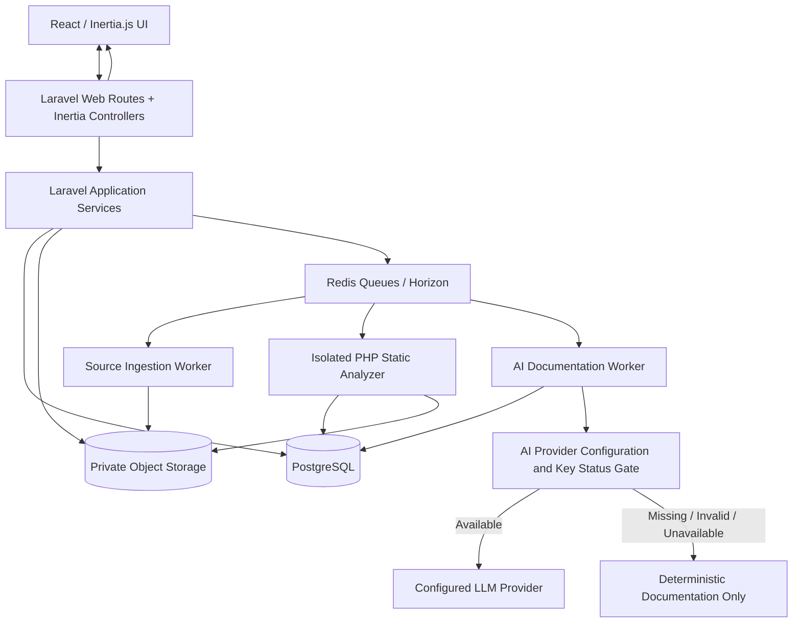
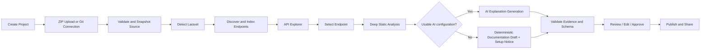
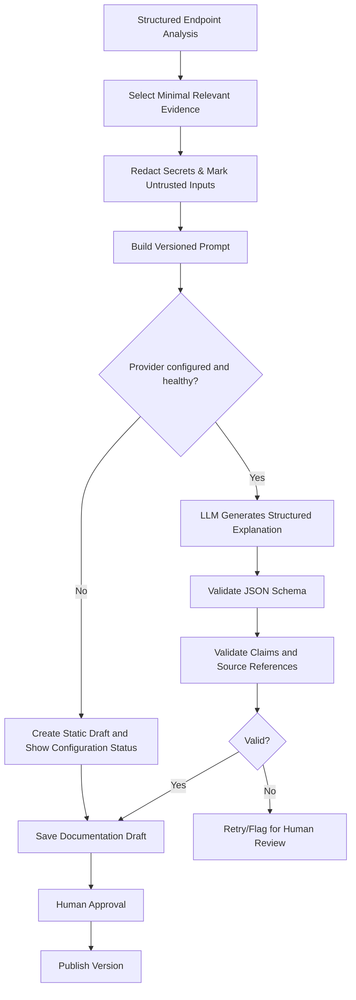
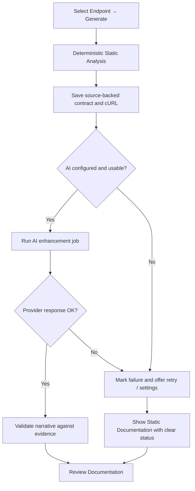
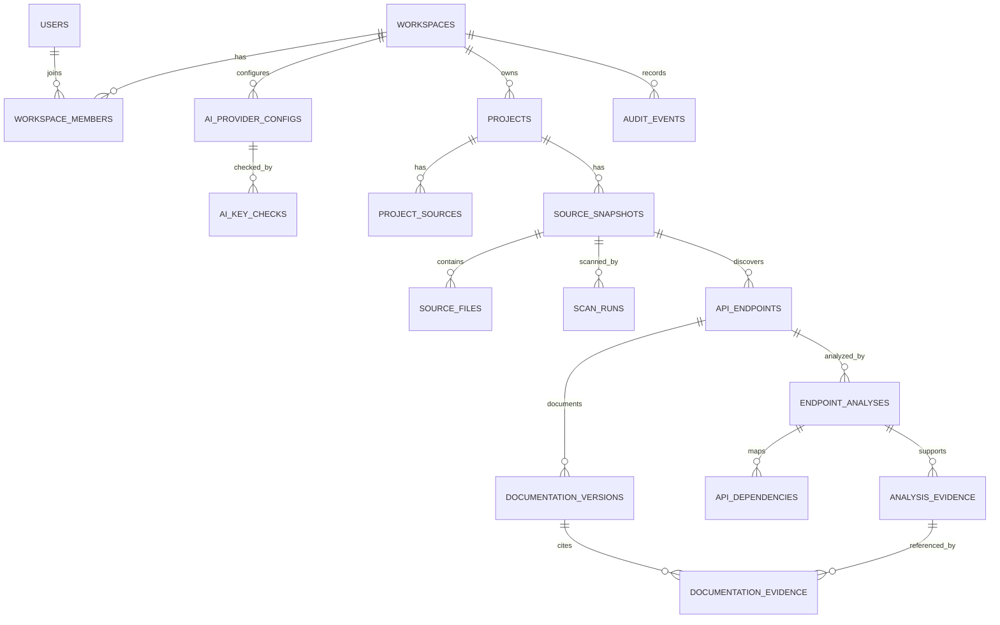
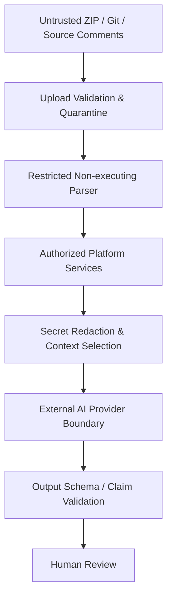

# Universal Laravel API Documentation Generator

**Technical Architecture, Module Breakdown, Database Schema & MVP Implementation Plan**  
**Version:** 1.1  
**Initial framework:** Laravel  
**Project import:** ZIP upload and Git repositories  
**Analysis strategy:** Hybrid deterministic static analysis + AI  
**Primary optimization:** Documentation accuracy, source evidence, and reproducibility  
**Application UI:** Laravel + React + Inertia.js (single Laravel application)  
**AI configuration:** Workspace-level, optional; deterministic-only mode supported

---

## 1. Executive Summary

Build a **modular Laravel platform with a separate, isolated PHP source-analysis worker**. Users import an existing project, the system discovers endpoints without executing untrusted application code, and users generate documentation on demand for selected endpoints. Generated content is backed by exact source references, reviewed by an authorized developer, and then published for frontend, mobile, web, and QA teams.

### Product goals

1. Import a Laravel project by ZIP or Git.
2. Detect its framework, structure, and route registrations.
3. Index and display endpoints in a searchable API Explorer.
4. On selection, analyze the endpoint's controller, request validation, services, resources, middleware, and dependencies.
5. Produce a structured API contract and clear human-readable documentation.
6. Include authentication, request fields, sample cURL, response schemas, error cases, workflow steps, and source references.
7. Require review and approval before publication.
8. Version documentation against an immutable repository snapshot.

**Core principle:** Source code is evidence; AI explains evidence and must not invent contracts.

### Architecture overview



A Laravel + React + Inertia modular monolith hosts the web UI, controllers, authorization, and most product logic. Inertia delivers server-driven page props and React renders the UI without a separate Next.js backend. A small JSON route surface is retained for polling, editor autosave, and integrations. Isolate untrusted source parsing and import workers from the public web runtime. This is a logical diagram; components can share deployable services where security boundaries allow.

### Recommended stack

| Area | Technology | Rationale |
|---|---|---|
| UI | React + TypeScript + Inertia.js, Tailwind CSS, shadcn/ui | Single Laravel application with React pages; no Next.js or separate frontend API required |
| Backend | Supported Laravel/PHP versions, Laravel web routes + Inertia controllers | Page delivery, services, jobs, authorization, limited internal JSON endpoints |
| Authentication | Sanctum, policies | Session/API authentication and project access control |
| Database | PostgreSQL | Transactional metadata and JSONB extraction results |
| Async workers | Redis, Laravel Horizon | Import, scanning, extraction and AI jobs |
| Source parser | `nikic/php-parser` | PHP AST-based static analysis |
| Contract output | OpenAPI 3.1 | Interoperable, structured API descriptions |
| API reference | Scalar or custom viewer | Searchable interactive documentation |
| AI | Configurable structured-output LLM, encrypted workspace credentials | Optional evidence-based generation; graceful static-only fallback |
| Source/object storage | Private S3-compatible storage | Archives, snapshots and exports |
| Runtime isolation | Hardened disposable workers | Untrusted repository processing |

Scramble and Scribe are useful extraction references or optional adapters, but must not be required inside uploaded projects.

---

## 2. End-to-End User Flow



**Important:** Discovery and deep analysis are separate processes. Importing a repository should not automatically trigger expensive AI documentation generation for every endpoint.

### Create Project wizard

1. **Project Details:** Name, description, workspace, visibility.
2. **Source:** ZIP or authorized Git provider; repository and ref selection for Git.
3. **Framework:** Verify detected Laravel root and version; allow corrections.
4. **Configuration:** Route categories, static-only default, on-demand generation preference.
5. **Review:** Confirm, start asynchronous scan, track progress.

**Important UX rule:** Missing AI configuration does **not** block creating a project, importing source, discovering endpoints, or producing deterministic contracts. Show an optional AI setup step after indexing or a non-blocking warning in the generation UI.

After scanning, show total endpoints, unresolved route findings, warning counts, and an **Open API Explorer** action.

---

## 3. Module Breakdown

| Module | Responsibilities | Release |
|---|---|---|
| Identity & Workspaces | Authentication, team membership, RBAC, policies | MVP |
| Project Management | CRUD, drafts, settings, project status | MVP |
| Source Ingestion | ZIP validation, Git connection, immutable snapshots | MVP |
| Framework Detection | Recognize Laravel versions, root, modules | MVP |
| Endpoint Discovery | Routes, methods, paths, controller mapping | MVP |
| Source Analysis | Requests, middleware, responses, dependencies, evidence | MVP |
| AI Configuration | Provider choice, model selection, encrypted key, test connection, key health and fallback policy | MVP |
| AI Documentation | Context selection, structured generation, validation, deterministic fallback | MVP |
| Documentation Management | Edits, review, revisions, publishing, exports | MVP |
| API Explorer | Search, module filters, endpoint detail | MVP |
| Change Intelligence | Git sync, contract diff, impact analysis | Later |
| QA Assistance | Test scenarios, runtime error correlation | Later |
| Framework Ecosystem | NestJS/Django/Spring adapters | Later |

### Suggested code structure

```text
app/
├── Modules/
│   ├── Identity/
│   ├── Projects/
│   ├── SourceIngestion/
│   ├── FrameworkDetection/
│   ├── EndpointDiscovery/
│   ├── SourceAnalysis/
│   ├── AiDocumentation/
│   ├── Documentation/
│   └── ApiExplorer/
├── Contracts/
│   ├── FrameworkAnalyzerInterface.php
│   ├── RouteDiscoveryInterface.php
│   ├── SourceProviderInterface.php
│   └── DocumentationGeneratorInterface.php
├── Jobs/
│   ├── ImportProjectSourceJob.php
│   ├── DetectFrameworkJob.php
│   ├── DiscoverEndpointsJob.php
│   ├── AnalyzeEndpointJob.php
│   ├── GenerateDocumentationJob.php
│   └── ValidateDocumentationJob.php
└── Policies/
    ├── ProjectPolicy.php
    └── DocumentationPolicy.php
```

### Framework abstraction

```php
interface FrameworkAnalyzerInterface
{
    public function detect(
        SourceSnapshot $snapshot
    ): FrameworkDetectionResult;

    public function discoverEndpoints(
        SourceSnapshot $snapshot
    ): EndpointCollection;

    public function analyzeEndpoint(
        SourceSnapshot $snapshot,
        EndpointDefinition $endpoint
    ): EndpointAnalysisResult;
}
```

The first concrete implementation is `LaravelFrameworkAnalyzer` with components for route parsing, controller resolution, FormRequest extraction, resource analysis, middleware analysis, and dependency graph building. Framework-independent project management and publishing code should depend on these contracts, not Laravel-specific internals.

---

## 4. Source Import and Snapshots

Both import methods produce a common **immutable source snapshot**:

```text
Project
└── SourceSnapshot
    ├── Source type: zip | git
    ├── Repository identifier (if git)
    ├── Branch/tag and resolved commit SHA (if git)
    ├── Content SHA-256
    ├── Private object-storage key
    ├── Scanner configuration/version
    └── State: validating | ready | failed
```

### ZIP pipeline

1. Receive uploaded archive into a quarantine area.
2. Check format and enforce size, decompression ratio, and file-count limits.
3. Reject absolute/traversal paths, symlinks, special files, unsafe nesting, and oversized entries.
4. Extract to an isolated non-executable workspace.
5. Identify the Laravel root (e.g., `composer.json`, `artisan`, bootstrap structure).
6. Exclude credentials and sensitive files from downstream AI context.
7. Compute a content fingerprint; store the validated immutable snapshot.
8. Enqueue framework detection.

### Git pipeline

1. User connects an authorized GitHub/GitLab account or supported scoped provider.
2. Choose repository and branch/tag/commit.
3. Resolve a specific immutable commit SHA.
4. Import via a trusted provider integration or restricted fetch worker.
5. Validate files and construct the same immutable snapshot representation.
6. Store metadata and initiate discovery.

Never clone arbitrary URLs directly in the web process. Restrict provider domains/protocols and network destinations; use minimal read permissions, verify webhook signatures, and avoid storing long-lived credentials in project records.

---

## 5. Laravel Discovery Engine

### Discovery candidates

```text
routes/api.php
routes/web.php
bootstrap/app.php
app/Providers/*
Modules/*/Routes/*
Modules/*/Providers/*
Custom route registration files
```

These are candidates, not a guaranteed complete list. Custom providers and dynamic runtime route registration may require unresolved-route warnings.

### Static parsing

Detect common patterns such as:

```php
Route::get('/orders', [OrderController::class, 'index']);
Route::post('/orders', [OrderController::class, 'store']);

Route::prefix('customer')->middleware('auth:api')->group(function () {
    Route::get('/profile', [ProfileController::class, 'show']);
});
```

Resolve method, URI, name, group prefix, middleware, namespace, action, and source line. Identify route declarations that cannot be resolved deterministically.

**Default security rule:** Do not run `artisan route:list`, execute route files, `composer install`, tests, seeders, or migrations from an uploaded repository.

### Deep endpoint analysis

When a user requests documentation:

1. Resolve route and controller method.
2. Analyze FormRequest or inline validation, path/query/body fields, relevant headers.
3. Trace resolvable service calls and dependency injection.
4. Infer returned resources, conditional keys, and response statuses.
5. Identify exceptions, business conditions, and asynchronous jobs/events.
6. Record database-related model interactions when statically provable.
7. Generate structured facts and evidence references.
8. Explicitly list uncertain or unresolved behavior.

Example dependency graph:

```text
POST /orders
├── StoreOrderRequest::rules()
├── OrderController::store()
├── OrderService::create()
│   ├── PricingService::calculate()
│   ├── Order::create()
│   └── OrderCreatedJob::dispatch()
└── OrderResource::toArray()
```

Track edges such as `handled_by`, `validates_with`, `calls`, `reads_from`, `writes_to`, `dispatches`, and `responds_with`. Bound traversal depth, detect cycles, and mark unresolved dynamic calls.

### Intermediate analysis schema

```json
{
  "schema_version": "1.0",
  "endpoint": {
    "method": "POST",
    "path": "/api/orders",
    "controller": "OrderController@store"
  },
  "request": {
    "content_type": "application/json",
    "fields": [
      {
        "name": "store_id",
        "type": "integer",
        "required": true,
        "evidence": ["source_101"]
      }
    ]
  },
  "responses": [
    {
      "status": 201,
      "schema_status": "inferred",
      "evidence": ["source_108"]
    }
  ],
  "dependencies": [
    {
      "symbol": "OrderService::create",
      "relation": "calls",
      "evidence": ["source_105"]
    }
  ],
  "unresolved": ["Conditional payment configuration"]
}
```

**Note:** This sample is illustrative, not a real analyzed endpoint.

---

## 6. AI Documentation Pipeline



### Documentation sections

| Section | Content |
|---|---|
| Overview | Endpoint purpose and business use |
| Route | HTTP method, URI, route name and controller |
| Authorization | Guards, middleware, permissions |
| Headers | Required and optional headers |
| Parameters | Path, query, and body fields |
| Validation | Field rules, conditional requirements |
| cURL | Copyable example commands with placeholders |
| Responses | Evidence-backed success/error schemas |
| Workflow | Execution sequence and business conditions |
| Dependencies | Services, resources, jobs/events |
| Source evidence | File, symbol, line range, snapshot |
| Limitations | Unknown runtime-dependent behavior |

If AI is unavailable, **do not fail the entire endpoint analysis**: save a static documentation draft (routes, method, parameters, validation, known response schema, cURL, evidence and unknowns) and clearly mark narrative business explanations as unavailable. AI generation is a separate optional job.

Store deterministic request/response contracts separately from AI-generated explanations. The model must not introduce or modify required schema fields unsupported by extracted evidence.

### Evidence statuses

- **Verified:** Directly supported by source or tests.
- **Inferred:** Derived from code but not proven in a runtime test.
- **Unknown:** Cannot be determined from the available evidence.

### Generation run metadata

Record `analysis_hash`, `model_id`, `prompt_version`, configuration, token usage, status, and structured validation findings. Avoid retaining secret-bearing raw prompts in operational logs.

### Suggested completeness score

| Component | Weight |
|---|---:|
| Endpoint/controller resolution | 20% |
| Request schema evidence | 25% |
| Response schema evidence | 25% |
| Authentication/middleware evidence | 10% |
| Dependency/workflow coverage | 10% |
| Source-reference validity | 10% |

This is a coverage score, **not** a statistical probability of correctness. Show separate request and response coverage where useful.

---


## 6A. AI Configuration and Failure-Handling Specification

### Settings UI (Workspace Settings → AI Configuration)

Show: enable/disable AI enhancement; provider selector (start with one supported provider, e.g. OpenAI); model selector constrained to supported provider models; masked API key field with **Replace**, **Remove**, and **Test Connection** actions; last validated timestamp; health indicator; optional monthly usage cap; explicit note about source snippets being transmitted to the selected provider. **Never return the plaintext key to React/Inertia.** The key is write-only; only metadata such as `configured`, provider, key suffix, health state, and `last_checked_at` reaches the client.

Keep AI credentials at **workspace** scope, optionally allow project policy `inherit` / `disabled` in the MVP. Project-specific keys can wait. A platform operator may configure a server-managed credential as an explicit later feature; never silently consume an unspecified shared key.

### Credential and provider states

| State | Detect via | UI behavior | Generator behavior |
|---|---|---|---|
| `not_configured` | No usable credential saved | Neutral setup banner and Configure AI link | Static documentation only; allow project creation/analysis |
| `unchecked` | New/rotated credential not yet tested | Test connection prompt | Attempt bounded validation on demand; safe fallback |
| `ready` | Successful lightweight provider validation | Connected and last checked | Allow AI-enhanced documentation |
| `invalid_credentials` | Provider authentication failure (commonly 401/403) | Replace or remove key | Stop AI calls; retain static draft |
| `quota_exceeded` | Provider billing/quota classification | Check quota/billing | Skip or postpone AI; retain static draft |
| `rate_limited` | Provider throttling (often 429) | Retry later | Capped exponential backoff with jitter; do not retry indefinitely |
| `provider_unavailable` | Timeout, network failure, 5xx | Temporary outage notice | Capped retries; static draft remains usable |
| `misconfigured` | Unsupported provider/model or invalid settings | Correct configuration | Block AI job, not static analysis |

An **expired** API key is provider-dependent and usually appears as a rejected/revoked credential. Do not predict expiry unless the provider actually returns expiry metadata. Detect failure from safe, documented provider error codes, not from a fixed assumption that all 401/403 responses mean expiry. A successful key test does not guarantee future billing availability or generation success.

### Test Connection sequence

1. Authorized workspace Maintainer/Owner opens AI Settings.
2. Submits provider, model and an optional new credential over HTTPS (with CSRF protection).
3. Backend validates provider/model allowlist and encrypts the credential; never logs raw input.
4. `Test Connection` runs a low-cost provider request/server-side credential validation with a strict timeout and rate limit.
5. Translate provider response to one of the controlled states above and store a sanitized check event.
6. Render masked status using an Inertia partial reload; never return secrets.
7. On AI generation, re-check readiness operationally; if provider rejects credentials, atomically mark configuration unhealthy and create/retain static documentation.

The `Test Connection` route must be authorization-protected and throttled; it should not make an arbitrary user-controlled URL request. Credentials must be scoped correctly and encrypted using a managed key strategy; rotate application encryption keys carefully.

### Graceful fallback user flow



Suggested UI: `AI enhancement unavailable — API contract and source-backed details are still available. Configure AI or retry later.` Provide **View Static Documentation**, **Configure AI** (authorized users only) and **Retry AI** (only when appropriate). Never show an empty failed documentation page because a provider key is missing or invalid.

### Laravel implementation boundaries

- `AiProviderConfig` Eloquent model: workspace FK, provider, model, encrypted key, state, last validation timestamp, sanitized failure reason.
- `AiProviderManager`: validates provider/model settings and selects a trusted SDK adapter.
- `AiCredentialHealthService`: maps provider-specific errors to internal states.
- `AiGenerationService`: receives a deterministic `EndpointAnalysisResult`, returns structured narrative or typed provider failure.
- `StaticDocumentationBuilder`: always available independently of an LLM.
- `AIConfigurationPolicy`: workspace Owner/Maintainer only for secrets and provider settings.
- Queue generation jobs must never serialize plaintext API keys into Redis payloads. Resolve credentials within the worker using the configuration ID.
- Use Laravel `Crypt` / encrypted casts or a dedicated secret manager, with encrypted database backups, proper key management and secret access auditability.

### Acceptance tests

- Create/import/scan projects with **no AI key** and still generate static docs.
- Save and validate a valid key; generate AI narrative and source citations.
- Replace/remove key; verify no old credential appears in Inertia props, logs, jobs or responses.
- Simulate provider authentication failure; mark key invalid and return static docs.
- Simulate quota exceeded, throttling and 5xx; respect retry budgets and display distinguishable statuses.
- Verify unauthorized workspace members cannot edit settings or probe keys.
- Verify cross-workspace credential isolation and no secret-bearing exception responses.

---

## 7. Database Architecture (PostgreSQL)

### Entity relationships



### Core tables

| Table | Important columns | Purpose |
|---|---|---|
| `users` | id, name, email, password | Accounts |
| `workspaces` | id, name, slug, owner_id | Teams |
| `workspace_members` | workspace_id, user_id, role | RBAC membership |
| `projects` | id, workspace_id, name, slug, framework, status, settings | Projects |
| `project_sources` | id, project_id, type, provider, repository_id, repository_url, default_ref | Import connections |
| `source_snapshots` | id, project_id, source_id, commit_sha, content_sha256, storage_key, status | Immutable source versions |
| `source_files` | id, snapshot_id, relative_path, sha256, language, size_bytes | Manifest |
| `scan_runs` | id, snapshot_id, status, phase, started_at, finished_at, stats | Discovery runs |
| `api_endpoints` | id, snapshot_id, method, normalized_uri, route_identity, route_name, controller, action, middleware | Endpoint index |
| `endpoint_analyses` | id, endpoint_id, analyzer_version, input_hash, status, structured_result, quality_score | Deep analysis |
| `analysis_evidence` | id, analysis_id, source_file_id, start_line, end_line, symbol, kind | Source evidence |
| `api_dependencies` | id, analysis_id, from_symbol, to_symbol, relation, evidence_id | Call graph |
| `documentation_versions` | id, endpoint_id, analysis_id, revision, status, content, openapi_fragment, generated_by | Drafts and published docs |
| `documentation_evidence` | documentation_id, evidence_id, claim_path | Claim citations |
| `generation_runs` | id, analysis_id, ai_provider_config_id nullable, prompt_version, model_id, status, token_usage, error_code, fallback_reason nullable | AI runs; static fallback is supported |
| `ai_provider_configs` | id, workspace_id, provider, model, encrypted_api_key, key_last4, status, last_checked_at, last_error_code, settings | Workspace provider setup; never expose encrypted key in API props |
| `ai_key_checks` | id, provider_config_id, status, provider_error_code, checked_at, actor_id | Credential health-check audit (no raw credentials or error bodies) |
| `audit_events` | id, workspace_id, actor_id, action, target_type, target_id, metadata | Security/change history |

Use UUID primary keys consistently. JSONB is appropriate for structured findings and document payloads, but important searchable metadata should remain relational.

### Constraints and indexes

- `workspace_members`: unique `(workspace_id, user_id)`.
- `projects`: unique `(workspace_id, slug)`.
- `source_files`: unique `(snapshot_id, relative_path)`.
- `api_endpoints`: unique `(snapshot_id, route_identity)`; index `(snapshot_id, method)`.
- `endpoint_analyses`: unique `(endpoint_id, analyzer_version, input_hash)`.
- `documentation_versions`: unique `(endpoint_id, revision)` and index `(endpoint_id, status)`.
- `generation_runs`: index `(analysis_id, created_at)`.
- `ai_provider_configs`: unique `(workspace_id, provider)` for MVP; index `(workspace_id, status)`.
- `ai_key_checks`: index `(provider_config_id, checked_at)`.
- `audit_events`: index `(workspace_id, created_at)`.
- `scan_runs`: index `(snapshot_id, status)`.

Use a deterministic non-null route fingerprint that includes method, normalized path, action identity, and declaration identity. This prevents collisions between similarly defined routes.

### Example projects migration

```php
Schema::create('projects', function (Blueprint $table) {
    $table->uuid('id')->primary();

    $table->foreignUuid('workspace_id')
        ->constrained()
        ->cascadeOnDelete();

    $table->string('name', 180);
    $table->string('slug', 180);
    $table->text('description')->nullable();
    $table->string('framework', 40)->default('laravel');
    $table->string('status', 40)->default('draft');
    $table->jsonb('settings')->nullable();
    $table->timestamps();
    $table->softDeletes();

    $table->unique(['workspace_id', 'slug']);
    $table->index(['workspace_id', 'status']);
});
```

### Example endpoints migration

```php
Schema::create('api_endpoints', function (Blueprint $table) {
    $table->uuid('id')->primary();

    $table->foreignUuid('snapshot_id')
        ->constrained('source_snapshots')
        ->cascadeOnDelete();

    $table->string('method', 12);
    $table->string('normalized_uri', 2048);
    $table->string('route_identity', 64);
    $table->string('route_name')->nullable();
    $table->string('controller', 512)->nullable();
    $table->string('action', 255)->nullable();
    $table->jsonb('middleware')->nullable();
    $table->string('discovery_status', 40)->default('discovered');
    $table->timestamps();

    $table->unique(
        ['snapshot_id', 'route_identity'],
        'endpoints_snapshot_identity_unique'
    );
    $table->index(['snapshot_id', 'method']);
});
```

These are foundational examples, **not** the complete migration set.

### Documentation lifecycle

```text
Draft -> In Review -> Published -> Superseded
```

Do not overwrite an approved document when regenerating. A new generation creates a new revision tied to the same immutable source snapshot or to a newer snapshot as appropriate. Record reviewer, publication timestamp, source analysis, and unresolved warnings.

---

## 8. Inertia Route and Internal API Design

**Primary UX routing:** Laravel `web.php` routes use session authentication, CSRF middleware, authorization policies, and Inertia responses (`Inertia::render(...)`). React components receive validated, non-sensitive page props. Inertia form helpers perform submissions; use redirects with flashed success/error messages. Do not treat the JSON routes below as mandatory for page navigation. Use JSON endpoints only for scan polling, large paginated data, async actions and external integrations.

Example page structure:

```text
resources/js/
  Pages/Projects/Create.tsx
  Pages/Projects/Show.tsx
  Pages/Projects/Endpoints/Index.tsx
  Pages/Projects/Endpoints/Show.tsx
  Pages/Settings/AI/Index.tsx
  Components/AI/ProviderStatus.tsx
  Components/Documentation/StaticFallbackBanner.tsx
```

### Routes

| Method | Endpoint | Description |
|---|---|---|
| GET | `/projects/create` | Render Inertia create-project wizard |
| POST | `/projects` | Submit project creation via Inertia redirect |
| GET | `/settings/ai` | Inertia AI provider settings screen |
| PUT | `/settings/ai` | Save provider/model and optionally replace credential |
| POST | `/settings/ai/test` | Explicit provider key/connection validation (throttled) |
| DELETE | `/settings/ai/key` | Revoke locally stored credential (provider-side revocation is separate) |
| POST | `/api/v1/projects` | Optional JSON integration: create project draft |
| GET | `/api/v1/projects` | List authorized projects |
| GET | `/api/v1/projects/{id}` | View project |
| PATCH | `/api/v1/projects/{id}` | Edit project |
| POST | `/api/v1/projects/{id}/uploads` | Upload ZIP |
| POST | `/api/v1/projects/{id}/git-connections` | Connect Git source |
| POST | `/api/v1/projects/{id}/scans` | Queue scan |
| GET | `/api/v1/scans/{id}` | Scan status and results |
| GET | `/api/v1/projects/{id}/endpoints` | API Explorer listing |
| GET | `/api/v1/endpoints/{id}` | Endpoint detail |
| POST | `/api/v1/endpoints/{id}/analyses` | Queue deep analysis |
| GET | `/api/v1/analyses/{id}` | Analysis result/status |
| POST | `/api/v1/analyses/{id}/generations` | Queue AI generation |
| GET | `/api/v1/generations/{id}` | Generation status |
| GET | `/api/v1/endpoints/{id}/documentation` | Documentation revisions |
| PATCH | `/api/v1/documentation/{id}` | Edit draft |
| POST | `/api/v1/documentation/{id}/submit-review` | Request review |
| POST | `/api/v1/documentation/{id}/publish` | Publish approved revision |
| GET | `/api/v1/documentation/{id}/openapi` | OpenAPI export |

### Asynchronous analysis example

```http
POST /api/v1/endpoints/{id}/analyses
```

Return **202 Accepted** for enqueued work:

```json
{
  "data": {
    "analysis_id": "example-analysis-uuid",
    "status": "queued",
    "snapshot_id": "example-snapshot-uuid"
  }
}
```

Then poll `GET /api/v1/analyses/{id}`. Typical states: `queued`, `running`, `completed`, `partial`, `failed`, `cancelled`. Use idempotency keys for expensive generation and avoid duplicate concurrent jobs for identical snapshot/analyzer inputs.

---

## 9. Laravel-Compatible Security Boundaries

### Trust model



### Authorization roles

| Role | Access |
|---|---|
| Owner | Full workspace controls |
| Maintainer | Source import, scan, edit, publish |
| Developer | View authorized source evidence; generate drafts |
| QA | Read authorized published documentation/examples |
| Viewer | Read permitted published docs |

Use Laravel policies on **every project-scoped and nested resource**. Do not trust client-supplied project IDs as proof of access. Example:

```php
public function show(Request $request, Project $project)
{
    $this->authorize('view', $project);

    return new ProjectResource($project);
}
```

### No-execution default

Never execute arbitrary uploaded Laravel code during static analysis. In particular, do not run:

- `php artisan` commands from imported source;
- Composer installation/scripts;
- application migrations or seeders;
- application tests or queue jobs;
- `include` or `require` on uploaded PHP files.

Any future runtime-assisted scan must be expressly authorized and run in disposable hardened isolation with minimal privileges, no ambient secrets, limited resources, and network disabled by default. Docker alone is not a sufficient guarantee.

### Suggested operational limits (tune in testing)

| Setting | Initial value |
|---|---|
| ZIP compressed size | 100 MB |
| Total extracted size | 500 MB |
| File count | 20,000 |
| Single AST source file | 2 MB |
| Nested archives | Reject initially |
| Parser network access | Disabled |
| Source storage | Private, encrypted |
| Retention | Configurable |

### AI privacy and prompt-injection defenses

1. Exclude `.env`, secrets, private keys, certificates, and token stores.
2. Scan/redact sensitive values before preparing AI context.
3. Send only minimal endpoint-related evidence, not an entire repository.
4. Treat source comments and documentation as untrusted data, never model instructions.
5. Enforce workspace permissions for external AI processing and AI credential management; only Owners/Maintainers can configure keys.
6. Persist provider/model and audit metadata without logging raw secret-bearing prompts.
7. Validate generated JSON and source citations prior to saving or rendering.
8. Provide deterministic-only operation when external AI is disallowed.
9. Encrypt AI API keys at rest using Laravel encrypted casts or an external secret manager; redact from Inertia props, JSON responses, errors and audit logs.
10. Use server-to-provider calls only, never a provider API key in browser JavaScript.
11. Distinguish missing, invalid/revoked, quota exceeded, rate limited, upstream unavailable and configuration errors without exposing raw provider response details.

### Additional platform controls

- Secure session cookies, CSRF protection, application throttling, queue concurrency and per-workspace quotas.
- Git URL allowlists, SSRF protection, webhook signature validation.
- Signed short-lived authorized downloads; no public repository snapshots.
- Output escaping/sanitization and restrictive Content Security Policy.
- Explicit retention, deletion and audit events.
- Separate worker pools and least-privilege infrastructure credentials.

---

## 10. Background Processing and Caching

### Queue architecture

```text
Redis / Horizon
├── imports
│   ├── DownloadRepositoryJob
│   └── ValidateArchiveJob
├── discovery
│   ├── DetectFrameworkJob
│   └── DiscoverEndpointsJob
├── analysis
│   ├── ParseSourceFileJob
│   └── AnalyzeEndpointJob
└── ai-generation
    ├── GenerateDocumentationJob
    └── ValidateDocumentationJob
```

Use separate worker capacity for expensive parsing and AI calls so uploads cannot stall ordinary Laravel API requests.

### Cache strategy

| Artifact | Cache identity |
|---|---|
| Snapshot | Content hash |
| Parsed file | File hash + parser version |
| Symbol analysis | File hash + analyzer version |
| Endpoint inventory | Snapshot hash + discovery version |
| Deep analysis | Endpoint fingerprint + dependency hashes + analyzer version |
| Generated doc draft | Analysis hash + model + prompt version + settings hash |

Reuse cached analysis only after verifying tenant access; matching hashes are **not authorization** to share source data across organizations.

### Observability

Measure queue wait time, scan durations (median and p95), unresolved route counts, parse failures, generation failures, AI usage and token cost, documentation edits after generation, approval rate, and API Explorer usage.

---

## 11. Testing and Quality Strategy

### Automated testing layers

| Type | Coverage |
|---|---|
| Unit | Route and validation parser rules |
| AST fixtures | Symbols and correct file line ranges |
| Integration | Complete discovery on controlled Laravel repos |
| Contract | Extracted JSON/OpenAPI matches expected fixtures |
| Security | Traversal ZIP, decompression bombs, unsafe Git imports |
| Authorization | No cross-workspace source/document access |
| AI validation | Structured output, evidence IDs, unsupported claims |
| Regression | Stable output against golden fixtures |
| UI E2E | Project creation through publication |
| Performance | Large repos, recursion bounds, resource constraints |

### Golden fixture repositories

Include standard route files, nested groups, controller and invokable actions, FormRequests, inline validation, conditional API Resources, service classes, jobs, module service providers, closures, aliases, custom route registration and deliberately unresolvable dynamic patterns.

### Proposed launch gates

- At least **98% route discovery** on explicitly supported statically resolvable fixture cases.
- **100% of published source references** resolve within the matching snapshot.
- **Zero unsupported required fields** in release-blocking golden-schema tests.
- **Human approval required** for externally shared/published documentation.
- No known critical security findings in the threat-model test suite.
- Recoverable job retries without duplicate published revisions.

These are planned acceptance criteria, not performance measurements.

---

## 12. MVP Delivery Roadmap

**Estimated duration:** 8–12 weeks with two engineers (one Laravel/analyzer-focused, one frontend/integration/testing-focused). For one full-stack engineer, approximately 12–18 weeks may be more realistic.

| Weeks | Phase | Deliverable |
|---|---|---|
| 1–2 | Foundation | Laravel + Inertia React shell, accounts, workspaces, project wizard, ZIP/Git import, snapshots |
| 3–4 | Discovery | Laravel AST route parser, scan jobs, API Explorer |
| 5–6 | Analysis | FormRequests, middleware, resources, bounded dependencies, evidence |
| 7–8 | Generation | AI settings/key tests, optional AI generation, static fallback, cURL and error schemas |
| 9–10 | Publishing | Editor, source citations, approvals, revisions, OpenAPI export |
| 11–12 | Hardening | Security tests, fixture coverage, performance, pilot rollout |

### MVP checklist

- [ ] Workspace authentication and project RBAC
- [ ] Create Project wizard and resumable drafts
- [ ] ZIP upload validation and immutable snapshots
- [ ] Git connection, branch and commit selection
- [ ] Laravel detection and static route discovery
- [ ] Searchable/grouped API Explorer
- [ ] Request and validation analysis
- [ ] Response/Resource and dependency tracing
- [ ] AI Settings screen with encrypted provider key and Test Connection
- [ ] Missing/invalid/expired key state management and static-only fallback
- [ ] Evidence-backed AI documentation
- [ ] cURL generation with safe placeholders
- [ ] Review, edit, revision, approval, publishing
- [ ] Security tests, golden fixture corpus and observability

### Out of MVP

- Frameworks other than Laravel.
- Running imported Laravel code or connecting to real production databases.
- Live API execution or runtime 500-error diagnosis.
- Full-repository conversational AI assistant.
- Automatic Git synchronization and PR contract diffs.
- Full QA test execution and API mocking.
- Billing and public plugin marketplace.

---

## 13. Success Metrics

The core product goal is to reduce repetitive backend-to-frontend/QA explanations, not maximize AI output volume.

| Metric | Pilot target |
|---|---|
| Statically supported route discovery | ≥98% on fixture corpus |
| First-draft acceptance with minor/no edits | ≥80% |
| Median time to locate endpoint documentation | <30 seconds |
| Generation success on supported endpoints | ≥95% |
| Repeat API clarification requests | 30–50% reduction from measured baseline |
| Published documentation with traceable references | 100% |

These are targets to validate during an internal pilot, not guaranteed outcomes.

---

## 14. Architecture Decision Record (Summary)

| Decision | Selection | Why |
|---|---|---|
| Deployment | Laravel + React/Inertia modular application + restricted parser worker | Single product application with manageable operational complexity |
| AI availability | Optional per-workspace provider configuration + static fallback | Users can still analyze/document APIs with no valid AI key |
| Import | ZIP and authorized Git | Convenient and maintainable |
| Analysis | AST/deterministic extraction followed by AI | Explainable, evidence-based documentation |
| Generation timing | On demand per endpoint | Lower wasted computation |
| Contract format | OpenAPI 3.1 | Ecosystem interoperability |
| Source identity | Immutable versioned snapshot | Reproducible source references |
| Publication | Review required | Protects users from unsupported claims |
| Code execution | Disabled by default | Strong default trust boundary |
| Framework growth | Analyzer interface/adapters | Future cross-stack support |

## 15. Recommended First Product Milestone

The smallest end-to-end valuable release should achieve the following:

> Import a realistic Laravel repository, reliably discover its API endpoints, select one endpoint, extract its contract and execution dependencies, generate human-readable documentation with exact code evidence, and publish the developer-approved revision for frontend/web/QA use.

Before expanding into chat, runtime debugging, or new frameworks, validate **route discovery**, **source-backed extraction**, and **documentation claim accuracy** on several real applications.

---

## References

- [Laravel Queues](https://laravel.com/docs/queues)
- [Laravel Authorization](https://laravel.com/docs/authorization)
- [Laravel API Resources](https://laravel.com/docs/eloquent-resources)
- [nikic/PHP-Parser](https://github.com/nikic/PHP-Parser)
- [Scramble documentation](https://scramble.dedoc.co/)
- [Scribe documentation](https://scribe.knuckles.wtf/laravel/)
- [OpenAPI Specification](https://spec.openapis.org/oas/latest.html)
- [OWASP File Upload Cheat Sheet](https://cheatsheetseries.owasp.org/cheatsheets/File_Upload_Cheat_Sheet.html)
- [Laravel Horizon](https://laravel.com/docs/horizon)

